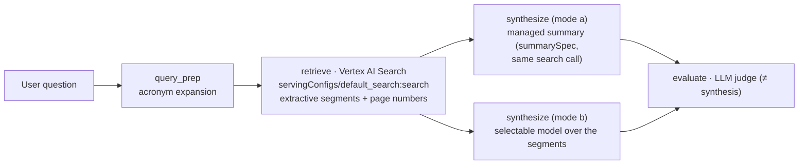
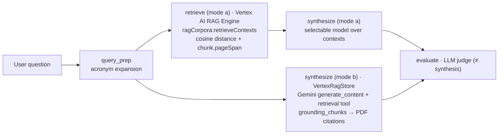
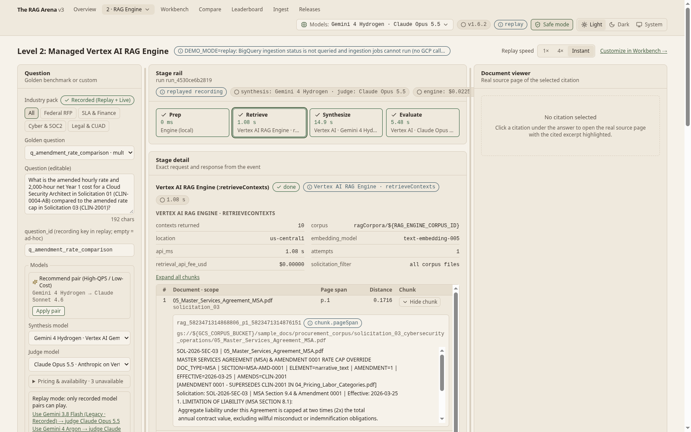
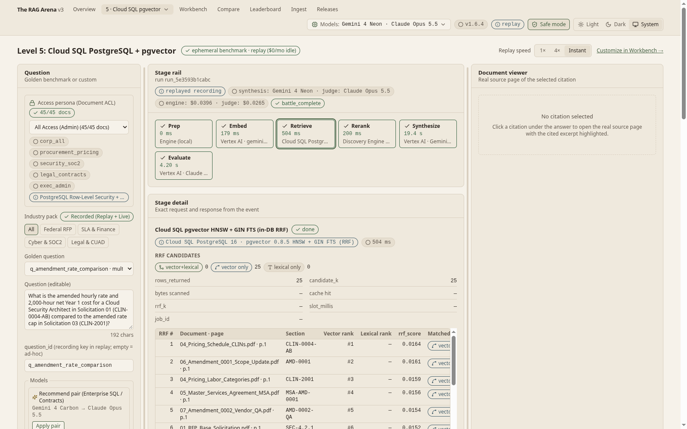
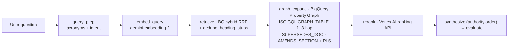
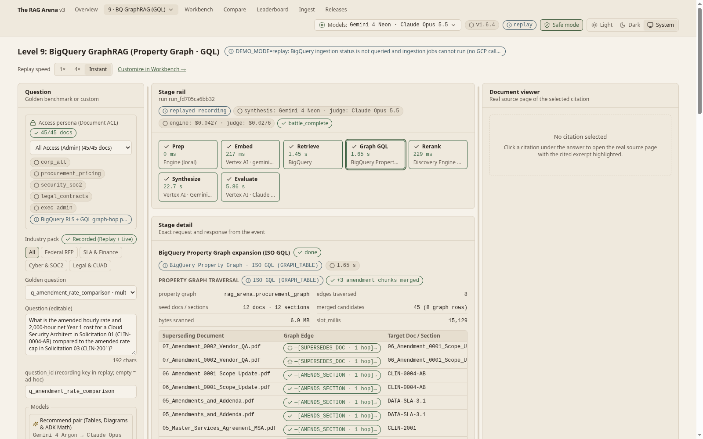
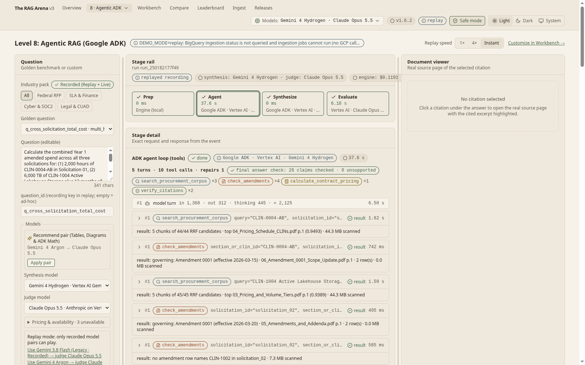
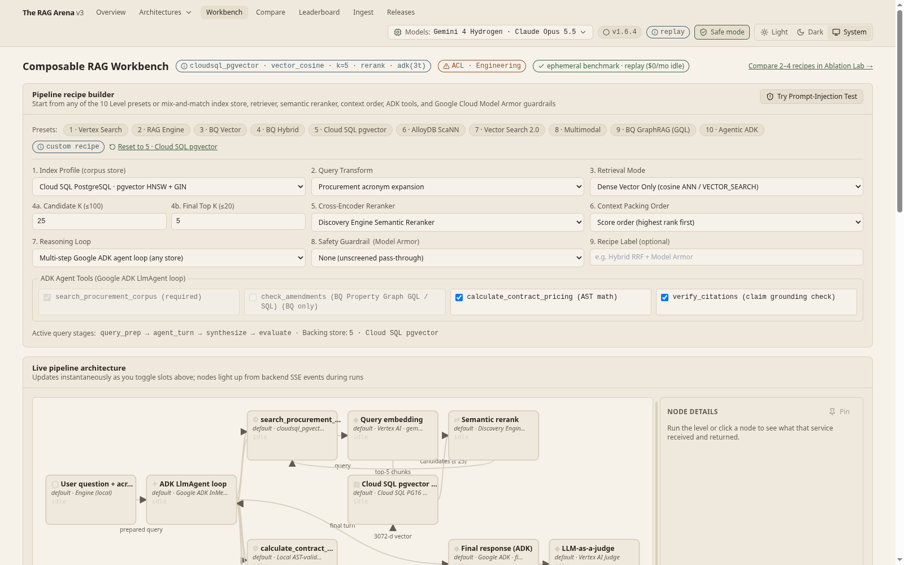
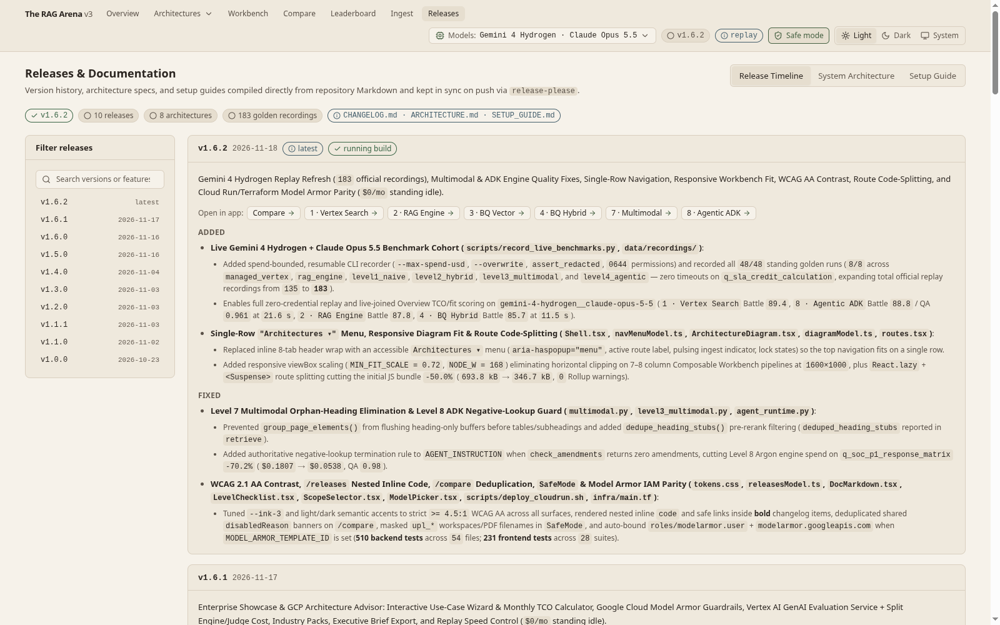

# The RAG Arena — Progressive Enterprise RAG on Google Cloud

**Ten RAG architectures, one procurement corpus (or your own PDFs), every stage measured live — pick the right architecture with evidence, not demos.**

      

**Release:** v1.6.4 (2026-11-23, see [CHANGELOG.md](CHANGELOG.md)) · **Status:** all ten architectures in customer complexity order (Levels 1–4 & 8–10 standing live at `$0/mo` idle + Levels 5–7 ephemeral Cloud SQL `pgvector` / AlloyDB `ScaNN` / Vector Search 2.0 torn down to `$0/mo` idle), standing BigQuery Property Graph GraphRAG via ISO GQL (`procurement_graph`), Gemini 4 Neon + Hydrogen + Argon + Claude Global Model Selector (`199` baseline + `10` isolated ACL refusal demo runs), Identity-Aware Document ACLs & RLS (`5` personas), Composable Workbench (`/workbench` with ADK across all 9 stores, dense-only ablation & Model Armor), Controlled Ablation Lab & Executive Export (`/compare`), Vertex AI GenAI Eval & Split Cost (`/leaderboard`), Releases & Docs (`/releases`), private PDF uploads, and restricted-org VPC-SC Cloud Run deploy.

## The problem

Enterprise procurement packages spread one deal across dozens of PDFs: base RFPs and statements of work (SOWs), price schedules keyed by contract line-item numbers (**CLINs**, e.g. `CLIN-0004-AB`), SLA matrices, architecture diagrams, and later **amendments** that supersede earlier rates and terms:

- **Direct single-file lookups mostly work** on naive vector RAG (QA relevance 0.80–1.00 on our golden set) — which hides deeper failures during toy evaluations.
- **Superseding amendments fail** (Naive Vector QA 0.50–0.65): base clauses outrank the later amendment that replaced them when chunks carry no document lineage, graph edges, or authority order.
- **Cross-document arithmetic fails** (single-pass Levels 3–8 QA 0.30–0.45): multi-document totals and SLA credit formulas require graph traversal or iterative agentic retrieval and deterministic calculation rather than single-pass top-k synthesis.
- **Complex layouts & custom PDFs vary**: multi-column tables and visual diagrams without embedded text layers require layout parsing and multimodal vision transcription.

Teams choosing a RAG architecture on Google Cloud rarely see measured quality, latency and cost trade-offs on the same data — and many demos fake the pipeline with timers and hardcoded scores.

## How The RAG Arena solves it

- **Ten architectures ordered from simplest turnkey managed to GraphRAG & agentic ADK** (Vertex AI Search → Vertex AI RAG Engine → BigQuery Naive Vector → BigQuery Hybrid + Rerank → Cloud SQL `pgvector 0.8.5` → AlloyDB `ScaNN` → Vector Search 2.0 `ScaNN` + Sparse RRF → Layout-Aware Multimodal → BigQuery Property Graph GraphRAG → Agentic ADK) tested on a **45-PDF benchmark corpus** (8 golden questions) **or your own uploaded PDFs** (v1.1+).
- **Every stage measured and streamed live** over SSE: the real SQL, ISO GQL, or API request, what came back, backend-measured duration, tokens and split Engine/Judge cost, drawn on a live architecture diagram.
- **An LLM judge that differs from the synthesis model** (enforced server-side) scores groundedness, QA relevance and context precision — with reference-free judging on uploaded or custom questions; **Compare** and **Leaderboard** highlight the winner by your chosen metric.
- **Zero-credential replay** of `199` baseline + `10` isolated ACL recorded real runs, and **one-command Cloud Run deployment** to your own project (`$0/mo` standing idle, including restricted-org VPC-SC & pre-provisioned SA toggles).


Design guarantees (full principles table: [docs/ARCHITECTURE.md](docs/ARCHITECTURE.md#0-design-principles-v3)):

- **Measured, not simulated** — stage events are emitted inside the engines; the API layer has no timers.
- **Fail loud** — a failed stage emits `stage_failed` + `engine_error`; no silent fallback service or model.
- **No hardcoded scores** — metrics come only from the live judge or from recordings of real runs.
- **Honest labels** — each stage names the service that actually ran (`reranker_used`, `adk_runner_used`, `layout_source`).
- **Replay never improvises** — questions without a recording return `engine_error`, never a made-up answer.

## The architecture ladder (Order A: simplest → most complex)

| Level | Engine id | Retrieval & synthesis | What it proves |
| :-- | :-- | :-- | :-- |
| 1 | `managed_vertex` | Vertex AI Search (Enterprise + LLM add-on) over corpus or isolated uploads store: extractive segments answered by managed summary or a selectable model | Turnkey build-vs.-buy baseline (strong segment recall; conservative managed summary) |
| 2 | `rag_engine` | Vertex AI RAG Engine (`RagCorpus` + `RagManagedDb`, `text-embedding-005` 512/100 chunks): `:retrieveContexts` + selectable model or `VertexRagStore` Gemini grounding | Managed corpus-centric RAG with high recall and grounding vs. DIY SQL |
| 3 | `level1_naive` | BigQuery `VECTOR_SEARCH` (COSINE, top-5) over 360-char windows, `gemini-embedding-2`, selectable synthesis model | Minimal serverless SQL baseline; works on direct lookups, breaks on amendments/math |
| 4 | `level2_hybrid` | Acronym expansion; `VECTOR_SEARCH` ⨝ `SEARCH()` over page-lineage chunks → RRF (k=60) top-50 → Vertex AI ranking API → top-5 | Recovers superseding amendments and exact identifier recall in one BQ statement |
| 5 | `cloudsql_pgvector` | Ephemeral Cloud SQL PostgreSQL 16 + `pgvector 0.8.5` (`halfvec(3072)` HNSW + `hnsw.iterative_scan`) + GIN `tsvector` FTS in-DB RRF + Postgres RLS + rerank | Operational PostgreSQL vector baseline on native 3072-d vectors (`$0` re-embed, `$0/mo` idle) |
| 6 | `alloydb_scann` | Ephemeral AlloyDB `alloydb_scann` cosine ANN + PostgreSQL GIN `tsvector` FTS → in-DB RRF (k=60) + Postgres RLS + rerank (AlloyDB Omni Docker supported) | Sub-400 ms operational SQL + ScaNN hybrid retrieval, torn down to `$0/mo` idle |
| 7 | `vertex_vector_v2` | Ephemeral Vertex AI Vector Search 2.0 `Collection` (`denseScann` + CRC32 `sparse_embedding` via `dataObjects:batchSearch` native RRF) + `filterFields` ACL | Managed dedicated-replica ScaNN + sparse RRF at scale, torn down to `$0/mo` idle |
| 8 | `level3_multimodal` | Document AI Layout Parser + Gemini vision transcription of diagrams → element-aware chunks with multimodal vectors; hybrid RRF + rerank; authority headers | Atomic Markdown tables, diagram vision transcription, orphan-heading dedupe, amendment order |
| 9 | `bigquery_graphrag` | Standing `$0/mo` BigQuery Property Graph (`procurement_graph`, 5 SQL tables) + ISO GQL `GRAPH_TABLE` 1..3-hop `SUPERSEDES_DOC`/`AMENDS_SECTION` expansion + BQ RLS + rerank | Deterministic contract-lineage traversal (`+3` superseding chunks/query, SLA math `QA 0.95`) at `$0/mo` idle |
| 10 | `level4_agentic` | Google ADK `LlmAgent` + `InMemoryRunner` (Gemini, ≤ 8 turns) with search, GQL/SQL amendment, pricing-calculator and citation-check tools + closure-pinned RLS | Multi-hop supersession, exact cross-document math (`QA 0.96–0.98`), self-verification |

`DEFAULT_ENABLED_LEVELS` enables all ten architectures in `replay` and the seven standing serverless/managed architectures (Levels 1–4, 8–10) in `live` (`$0/mo` standing idle; Levels 5–7 unlock live via `ENABLED_LEVELS` during ephemeral runs or local AlloyDB Omni).

**Cross-cutting Google Cloud products** (all levels and deployment):

- **Cloud Run** — single container serving UI + API (IAP-protected live service, optional replay-only copy, Direct VPC Egress & pre-provisioned SA support)
- **Artifact Registry** + **Cloud Build** — image storage and remote builds (optional private worker pool, no local Docker needed)
- **Identity-Aware Proxy (IAP)** + **Model Armor** + **IAM** — ES256 IAP JWT verification, `$0/mo` prompt/response guardrail templates, owner-isolated uploads, least-privilege runtime SA (no key files)
- **BigQuery** + **Cloud Storage** — `document_chunks_v3`, `procurement_graph` Property Graph, `query_runs`, `ingest_runs`, corpus bucket, and private upload bucket (`UPLOAD_BUCKET`, PAP enforced, UBLA on, optional CMEK)

## Level 1 architecture — Managed Vertex AI Search

**Query path** (`backend/app/engines/{managed_vertex,vais_search}.py`, `backend/app/core/vertex_search.py`):



**Ingestion** (`backend/app/ingestion/{gcs_sync,managed_job,managed_upload_job}.py`): corpus syncs changed PDFs to `gs://$GCS_CORPUS_BUCKET` and runs an `INCREMENTAL` import into `rag-arena-procurement`; uploads write a zero-download `_vais_import.jsonl` (`dataSchema="document"`) into `rag-arena-uploads` with `workspace_id` metadata. `vertex-ai-search-summary` is Level-1-only (HTTP 400 elsewhere).


## Level 2 architecture — Managed Vertex AI RAG Engine

**Query path** (`backend/app/engines/rag_engine.py`, `backend/app/core/rag_engine_client.py`):



**Ingestion** (`backend/app/ingestion/rag_engine_job.py`, `scripts/provision_rag_engine.py`): reuses active regional `ragEngineConfig` untouched (or defaults fresh projects to `RagManagedDb` Serverless), imports into `rag-arena-procurement` (`512`/`100` chunks, `text-embedding-005`), and provisions an isolated `rag-arena-upl_<12hex>` `RagCorpus` per upload workspace. `vertex-rag-engine-grounded` is Level-2-only; restricted Document ACL personas fail closed at the corpus boundary (`AclEnforcementUnsupportedError`).



## Levels 3 & 4 architectures — BigQuery Naive Vector & Hybrid + Reranker

- **Level 3 (`level1_naive`)**: `query_prep → embed_query (gemini-embedding-2, 3072-d) → retrieve` (BigQuery `VECTOR_SEARCH`, COSINE, top-5 over 360/60 chunks) `→ synthesize → evaluate`.
- **Level 4 (`level2_hybrid`)**: `query_prep` (16-term acronym expansion) `→ embed_query` + lexical terms `→ retrieve` (single parameterized BigQuery SQL fusing `VECTOR_SEARCH` top-50 ⨝ `SEARCH()` + weighted `STRPOS` top-50 via RRF `k=60` + `allowed_groups` RLS) `→ rerank` (Discovery Engine `semantic-ranker-default@latest`, 50 → 5) `→ synthesize → evaluate`.


## Levels 5, 6 & 7 architectures — Ephemeral Operational DB & ScaNN Benchmarks (`$0/mo` idle)

- **Level 5 (`cloudsql_pgvector`, `backend/app/engines/cloudsql_pgvector.py`)**: Cloud SQL PostgreSQL 16 Enterprise + `pgvector 0.8.5` reached over loopback `cloud-sql-proxy` (`127.0.0.1`). Indexes native `3072-d` `gemini-embedding-2` vectors in `halfvec(3072)` HNSW (`halfvec_cosine_ops`, `hnsw.ef_search = 40`, `hnsw.iterative_scan = 'relaxed_order'` on filtered/RLS queries) fused with GIN `tsvector` FTS via in-DB RRF (`k=60`) + PostgreSQL RLS + Discovery Engine rerank.
- **Level 6 (`alloydb_scann`, `backend/app/engines/alloydb_scann.py`)**: AlloyDB `alloydb_scann` `<=>` cosine ANN + PostgreSQL GIN `tsvector` FTS in-DB RRF (`k=60`) + Postgres RLS over `alloydb-auth-proxy` (or local AlloyDB Omni Docker `--omni`) + Discovery Engine rerank.
- **Level 7 (`vertex_vector_v2`, `backend/app/engines/vertex_vector_v2.py`)**: Vertex AI Vector Search 2.0 `dataObjects:batchSearch` combining `denseScann` + CRC32 `sparse_embedding` via server-side RRF + indexed `filterFields` ACL + Discovery Engine rerank.
- Spin-up → bulk-load existing BigQuery `hybrid` chunks (`0` re-embedding) → build index → record → `EXIT`-trapped teardown (`scripts/ephemeral_{cloudsql,alloydb,vvs2}.sh`) verifies `0` residual resources (`$0/mo` standing idle).



## Levels 8, 9 & 10 architectures — Multimodal, BigQuery GraphRAG (GQL) & Agentic ADK

- **Level 8 (`level3_multimodal`)**: Document AI Layout Parser (`≤15`-page splits) + Gemini vision transcription of diagram pages → atomic Markdown tables, heading-grouped paragraphs (`dedupe_heading_stubs`), and multimodal diagram embeddings → BigQuery hybrid RRF + rerank + authority headers (latest amendment first).
- **Level 9 (`bigquery_graphrag`, `backend/app/engines/bigquery_graphrag.py`, `backend/app/ingestion/bq_graph.py`)**: Standing `$0/mo` BigQuery Property Graph (`procurement_graph`, 5 SQL tables: `45` docs, `21` sections, `17` defines, `6` amends, `7` supersedes). Adds a parameterized ISO GQL `GRAPH_TABLE` **`graph_expand`** stage traversing 1..3-hop `SUPERSEDES_DOC` and `AMENDS_SECTION` paths (`QUALIFY` chunk dedupe + BigQuery RLS) ahead of Discovery Engine reranking and authority-ordered synthesis.
- **Level 10 (`level4_agentic`, `backend/app/engines/{level4_agentic,agent_runtime,agent_tools}.py`)**: Google ADK `LlmAgent` + `InMemoryRunner` (Gemini, ≤ 8 turns) with `search_procurement_corpus`, `check_amendments` (GQL `procurement_graph` / SQL fallback + authoritative negative exit), AST-safe `calculate_contract_pricing`, and `verify_citations` (+1 bounded repair turn), with closure-pinned `upload_scope` and `caller_access` RLS.







## Bring your own PDFs (v1.1+)

In `live` / `record` mode, open **`/ingest`** to create a private upload workspace (`upl_<12hex>`) alongside the pre-loaded 45-PDF benchmark corpus:

- **Private bucket & unlimited size**: `UPLOAD_BUCKET_MODE=auto` creates or verifies `<project>-rag-arena-uploads` (PAP enforced, UBLA on, zero public IAM/ACLs). Browser uploads stream straight to Cloud Storage via Origin-bound resumable session URIs (`256 KiB` chunks + `308` resume), bypassing Cloud Run's 32 MiB body cap.
- **Safety & strict scope isolation**: `/finalize` validates PDFs in `O(1)` heap (rejecting encrypted PDFs, `/JS`, `/Launch`, `/EmbeddedFiles`, `/XFA`, `/SubmitForm`, `/RichMedia`). Owners are keyed by SHA-256 of the IAP email (`404` for anyone else). Levels 9 & 10 map cleanly to Level 8 multimodal upload chunks; deleting a workspace cleans BigQuery, VAIS, RAG Engine, and GCS synchronously. Replay mode exposes zero upload routes (`404`).

## Model catalog & recommender

Catalog (`models_catalog.py`), prices (`pricing.py`), cross-family pair recommender (`model_recommender.py`), and live probes (`data/model_verification.json`) sync app-wide via header `GlobalModelPopover`, Overview Advisor, and `<ModelPicker>`. Defaults: `gemini-4-argon` + `claude-opus-5-5` (TCO default: `gemini-4-hydrogen`; `vertex-genai-eval` `$0.75/$3.75`), server-enforced **judge ≠ synthesis** ([docs/ARCHITECTURE.md](docs/ARCHITECTURE.md#4-model-selection-and-evaluation)).

| Model | Id | Provider path | $/1M in / out | Verification (`2026-11-23`) |
| :-- | :-- | :-- | --: | :-- |
| Gemini 4 Neon | `gemini-4-neon` | Vertex AI, google-genai (`global`) | 3.00 / 15.00 | ✅ HTTP 200 (flagship · `16` baseline + `4` ACL recorded) |
| Gemini 4 Hydrogen | `gemini-4-hydrogen` | Vertex AI, google-genai | 1.50 / 7.50 | ✅ HTTP 200 (default fast TCO tier · `48/48` + `6` ACL recorded) |
| Gemini 4 Carbon | `gemini-4-carbon` | Vertex AI, google-genai | 2.00 / 10.00 | ✅ HTTP 200 (balanced enterprise) |
| Gemini 4 Argon | `gemini-4-argon` | Vertex AI, google-genai | 2.00 / 10.00 | ✅ HTTP 200 (multimodal/ADK · `64/64` recorded) |
| Claude Sonnet 4.6 | `claude-sonnet-4-6` | Anthropic on Vertex AI, `:rawPredict` | 3.00 / 15.00 | ✅ HTTP 200 (L1–L9 worker / judge) |
| Claude Opus 5.5 | `claude-opus-5-5` | Anthropic on Vertex AI, `:rawPredict` | 4.00 / 20.00 | ✅ HTTP 200 (flagship judge / L1–L9) |
| Gemini 3.8 Flash *(Legacy)* | `gemini-3.8-flash` | Vertex AI, google-genai | 0.75 / 3.75 | ✅ HTTP 200 (`legacy: true` · `55` recorded) |
| Claude Fable 5.2 / 5.1 | `claude-fable-5-{2,1}` | Anthropic on Vertex AI, `:rawPredict` | 10.00 / 50.00 | gated (403 data-sharing / 429 quota) |

## Results (Levels 1–10 · 199 baseline + 10 ACL demo recordings)

Measured live (`DEMO_MODE=record`) over the 8 golden questions with `claude-opus-5-5` as cross-family judge across **Gemini 4 Hydrogen** (`48` standing runs), **Gemini 4 Argon** (`64` runs across L1–L4, L6–L8, L10), and **Gemini 4 Neon** (`16` golden runs + `4` `engineering_analyst` ACL demos across new Levels 5 & 9). **G / QA / CP** = groundedness / QA relevance / context precision (0–1); **B** = Battle Score (0–100); **lat** = engine latency without judge; **eng (tot)** = mean operational engine cost (total incl. judge) per question.

| Architecture (Order A) | Primary Cohort (Hydrogen / Neon\*) G / QA / CP · B | Primary lat · eng (tot) | Argon G / QA / CP · B | Argon lat · eng (tot) |
| :-- | :-: | --: | :-: | --: |
| 1 · Vertex AI Search (segments) | 0.982 / 0.890 / 0.739 · **89.4** | 13.9 s · $0.0220 ($0.0482) | 0.974 / 0.905 / 0.706 · **87.9** | 26.9 s · $0.0288 ($0.0542) |
| 1 · Vertex AI Search (managed summary) | — | — | 0.531 / 0.312 / 0.706 · 51.2 | 3.5 s · $0.0080 ($0.0326) |
| 2 · Vertex AI RAG Engine (`:retrieveContexts`) | 0.990 / 0.931 / 0.506 · **87.8** | 13.9 s · $0.0209 ($0.0593) | 1.000 / 0.975 / 0.456 · **87.6** | 29.8 s · $0.0291 ($0.0664) |
| 2 · Vertex AI RAG Engine (`VertexRagStore`) | — | — | 0.979 / 0.966 / 0.500 · 85.4 | 52.3 s · $0.0273 ($0.0656) |
| 3 · BigQuery Naive Vector | 0.931 / 0.693 / 0.738 · 79.8 | 14.3 s · $0.0146 ($0.0326) | 0.956 / 0.693 / 0.715 · 79.4 | 24.6 s · $0.0187 ($0.0354) |
| 4 · BigQuery Hybrid + Rerank | 0.978 / 0.835 / 0.631 · 85.7 | 11.5 s · $0.0150 ($0.0399) | 0.971 / 0.838 / 0.644 · 84.2 | 28.6 s · $0.0231 ($0.0471) |
| 5 · Cloud SQL `pgvector` *(ephemeral, Neon\*)* | 0.959 / **0.850** / 0.644 · **84.8** | 18.0 s · $0.0353 ($0.0606) | *(548 ms DB HNSW+GIN)* | — |
| 6 · AlloyDB + ScaNN *(ephemeral)* | — *(Flash: 85.6 · 11.1 s)* | — | 0.978 / 0.845 / 0.619 · 84.9 | 22.4 s · $0.0216 ($0.0458) |
| 7 · Vector Search 2.0 ScaNN *(ephemeral)* | — *(Flash: 85.8 · 19.6 s)* | — | 0.994 / 0.848 / 0.665 · 85.9 | 26.8 s · $0.0221 ($0.0447) |
| 8 · Layout-Aware Multimodal | 0.940 / 0.812 / 0.631 · 83.3 | 13.8 s · $0.0174 ($0.0397) | 0.932 / 0.819 / 0.675 · 82.7 | 27.5 s · $0.0222 ($0.0431) |
| 9 · BigQuery GraphRAG (GQL) *(Neon\*)* | 0.881 / **0.836** / 0.637 · 80.7 | 25.2 s · $0.0406 ($0.0653) | *(1.50 s GQL · +3 chunks)* | — |
| 10 · Agentic RAG (Google ADK) | 0.975 / 0.961 / 0.627 · **88.8** | 21.6 s · $0.0560 ($0.0820) | 0.929 / 0.981 / 0.656 · 85.9 | 45.9 s · $0.0734 ($0.0997) |

**Key findings**: **Level 5 Cloud SQL `pgvector 0.8.5`** (`halfvec(3072)` HNSW + GIN FTS + Postgres RLS) hits **QA `0.850`** / **Battle `84.8`** in `548 ms` mean DB retrieval (`18.0 s` end-to-end on Neon) — matching AlloyDB ScaNN (`84.9`) on small-to-medium operational corpora before tearing down to `$0/mo` idle. **Level 9 BigQuery GraphRAG** (`$0/mo` standing ISO GQL) lifts QA over Level 8 Multimodal (`0.812–0.819 → 0.836`) and solves `q_sla_credit_calculation` at **`0.95` QA** (vs. `0.40` on single-pass Cloud SQL) by injecting `+3` superseding amendment chunks per query while enforcing BigQuery RLS across graph hops. **Level 10 ADK** still leads multi-hop arithmetic (`0.96–0.98` QA), **Level 1 Vertex Search** leads Hydrogen Battle Score (`89.4`), and **Level 2 RAG Engine** leads Argon grounding (`1.000`). Recordings live in [`data/recordings/`](data/recordings/).

## Quickstart

Requirements: Python 3.11+ (3.12 in Docker), Node.js 20+. Live mode also needs the Google Cloud CLI.

### (a) Zero-credential replay

```bash
python3 -m venv .venv
.venv/bin/pip install -r backend/requirements.txt

# terminal 1 — API on :8000, plays data/recordings/** (no GCP calls, no credentials)
DEMO_MODE=replay .venv/bin/python -m uvicorn app.main:app --app-dir backend --port 8000

# terminal 2 — UI on :5173 (Vite proxies /api to :8000)
cd frontend && npm install && npm run dev
```

Open `http://localhost:5173`, pick an architecture, a golden question and a recorded pair, and press Run; `docker compose up --build` serves the same replay on `http://localhost:8080`.

### (b) Live on your own GCP project

```bash
cp .env.example .env            # git-ignored: DEMO_MODE=live|record, GCP_PROJECT_ID, GCP_LOCATION, BQ_TABLE=document_chunks_v3
gcloud auth application-default login
set -a; source .env; set +a
BQ_TABLE=document_chunks ./scripts/bootstrap_gcp.sh               # APIs, corpus bucket, dataset, Layout Parser processor
PYTHONPATH=backend .venv/bin/python scripts/verify_models.py      # writes data/model_verification.json
PYTHONPATH=backend .venv/bin/python scripts/provision_bq_graph.py --apply   # $0/mo standing Level 9 Property Graph
```

Set `DOCAI_PROCESSOR_ID` (plus `VAIS_*` via `scripts/provision_vertex_search.py`, `RAG_ENGINE_CORPUS_ID` via `scripts/provision_rag_engine.py`, and optional `$0/mo` `MODEL_ARMOR_TEMPLATE_ID` via `scripts/provision_model_armor.py`) in `.env`, start the backend and UI, and open `/ingest`. Full guide: [docs/SETUP_GUIDE.md](docs/SETUP_GUIDE.md).

## Workbench, Compare, Leaderboard & Releases

- **`/workbench`** builds custom RAG recipes (`PipelineSpec` = `IndexProfile` + 8 slots incl. **Model Armor Guardrails**, **ADK agent unlocked across all 9 index stores**, and **dense-only `vector_cosine` ablation** across Cloud SQL, AlloyDB ScaNN & VVS2) from 1-click Level 1–10 presets, updating the responsive SVG diagram in `0 ms`.
- **`/compare`** switches between the **Preset Ladder** (Levels 1–10) and the **Controlled Ablation Lab** (2–4 recipes) with Industry Packs, Replay Speed (`1×`/`4×`/`Instant`), **Retrieval Diff Inspector**, and Executive Brief export (`.md`/`.csv`/Print).
- **`/leaderboard`** aggregates live runs (`query_runs`) or `199` committed baseline recordings per `(synthesis, judge)` pair (incl. **Gemini 4 Neon** and **Vertex AI GenAI Eval** `:evaluateInstances`), splitting operational **Engine $** (scored) from **Judge $** (unscored).
- **`/releases`** compiles [CHANGELOG.md](CHANGELOG.md), [docs/ARCHITECTURE.md](docs/ARCHITECTURE.md), and [docs/SETUP_GUIDE.md](docs/SETUP_GUIDE.md) directly inside the app with release search, quick-launch pills, and leak checks.
- **Battle Score** (0–100) = 40% QA relevance + 35% groundedness + 15% context precision + 10% efficiency (latency vs 60 s, operational Engine Cost vs $0.20).






## Deploy to Cloud Run (your own project)

```bash
cp deploy/cloudrun.env.example deploy/cloudrun.env   # git-ignored: project, region, access, upload bucket, VPC-SC/SA toggles
scripts/deploy_cloudrun.sh --dry-run                  # validates every key, prints the exact plan
scripts/deploy_cloudrun.sh --yes                      # idempotent apply; provisions private upload bucket, Model Armor IAM + services
```

Choices: `REGION` (`us-central1`); `ACCESS_MODE=iap` (only `IAP_MEMBERS`) or `public`; `DEPLOY_REPLAY=true` adds a replay-only copy (`REPLAY_PUBLIC_INVOKER=false` for orgs disallowing `allUsers`); restricted-org toggles (`CREATE_SERVICE_ACCOUNTS=false` + `EXISTING_{LIVE,REPLAY}_SA_EMAIL`, Direct VPC Egress `VPC_NETWORK`/`VPC_SUBNETWORK`/`VPC_EGRESS`, CMEK `CORPUS_BUCKET_KMS_KEY`/`BIGQUERY_KMS_KEY`, private `CLOUD_BUILD_WORKER_POOL`) in both `deploy/cloudrun.env` and `infra/main.tf`. Min instances `0` → `$0/mo` idle; `scripts/teardown_cloudrun.sh --yes` removes only what deploy created. Details: [docs/SETUP_GUIDE.md](docs/SETUP_GUIDE.md#6-cloud-run).

## API & SSE protocol

| Method & path | Purpose |
| :-- | :-- |
| `GET /api/v1/health` · `GET /api/v1/releases` · `GET /api/v1/levels` · `GET /api/v1/models` | Mode, version & `.env` identity; compiled changelog + docs; Order A 10-level descriptors; catalog + `recorded_pairs` |
| `GET /api/v1/pipelines/presets` · `POST /api/v1/pipelines/validate` | Level 1–10 `PipelineSpec` presets (`pipe_<12hex>`); cross-slot validation + dynamic diagram descriptor |
| `GET /api/v1/benchmarks` · `GET /api/v1/leaderboard?scope=golden\|uploads` · `GET\|POST /api/v1/tco/{defaults,estimate}` | Golden benchmark (8 questions); split Engine/Judge leaderboard; deterministic monthly GCP TCO & workload-fit advisor |
| `POST /api/v1/battle/stream` | Run: `{query, question_id?, engines?, pipelines?, solicitation_filter?, synthesis_model?, judge_model?, replay_speed?, access_persona?}` → SSE |
| `GET /api/v1/acl/personas` | Access personas (`5`), deterministic 45-PDF group visibility summary, per-architecture RLS capabilities, and recorded ACL demos |
| `POST /api/v1/ingest/jobs` · `GET …/jobs/{id}` · `GET …/jobs/{id}/stream` · `GET /api/v1/ingest/status` | Benchmark ingestion jobs, live counts, Property Graph / index states, and owner-scoped `active_jobs` |
| `GET\|POST /api/v1/uploads/bucket` · `GET\|POST /api/v1/uploads` · `GET\|DELETE /api/v1/uploads/{id}` | Private upload bucket check/create; owner-isolated upload workspaces and synchronous cleanup |
| `POST …/uploads/{id}/files` · `POST …/files/{fid}/finalize` · `GET …/estimate` · `POST …/ingest` | Direct-to-GCS resumable session URI, PDF safety validation, L8 cost estimate, scoped ingest |
| `GET /api/v1/documents/page` · `GET /api/v1/documents/highlights` | Corpus or owner-checked uploaded PDF page PNG and excerpt highlights (server-side `403 acl_forbidden` on unauthorized `?persona=`) |

Run streams are `data: {json}\n\n` frames bounded by `MAX_SSE_FRAMES` (600). Events and payloads: [docs/ARCHITECTURE.md](docs/ARCHITECTURE.md#23-sse-protocol).

## Quality & tests

All tests run offline (fakes for Vertex AI, BigQuery + Property Graph, Cloud Storage, Document AI, Vertex AI Search, Vertex AI RAG Engine, Cloud SQL `pgvector`, AlloyDB, Vertex AI Vector Search 2.0, Model Armor, Vertex GenAI Eval and ADK). Measured 2026-11-23:

| Suite | Checks | What it guards |
| :-- | --: | :-- |
| **Backend total** (`pytest`, 56 files) | **525 passed** | engines (L1–L10), Cloud SQL `pgvector`, BQ Property Graph GQL, Document ACLs & RLS, TCO advisor, Model Armor, Vertex Eval, workbench, `/releases`, uploads, IAP/CSP |
| `test_v164_cloudsql_graphrag.py` · `test_v163_document_acls.py` | 6 · 8 | `halfvec(3072)` HNSW + RLS + dense-only SQL, BQ Property Graph DDL & ISO GQL, 45-PDF ACL partition, ADK closure-pinning, `403` viewer guard |
| `test_routes_no_timers.py` · `test_no_silent_fallbacks.py` | 2 · 3 | zero-timer SSE forwarder and zero-fallback engine AST invariants |
| `test_recording_redaction.py` · `test_recording_roundtrip.py` | 3 · 6 | `${…}` redaction incl. `${CLOUDSQL_DSN}`, `${ALLOYDB_DSN}`, `${UPLOAD_BUCKET}`, `${MODEL_ARMOR_TEMPLATE_ID}` and project numbers; replay fidelity |
| `test_tco_calculator.py` · `test_model_recommender.py` · `test_model_armor.py` | 6 · 3 · 8 | 10-level bounded TCO & Neon cohort join, cross-family model recommender, Model Armor REST v1 screening/fail-loud |
| `test_vertex_genai_eval.py` · `test_uploads*.py` · `test_auth_and_headers.py` | 9 · 24 · 7 | `199`-run split cost & Vertex `:evaluateInstances`, bucket privacy, IDOR/replay `404`, ES256 IAP JWT, CSP/headers |
| `test_pipeline_spec.py` · `test_composable_engine.py` · `test_releases_docs.py` | 10 · 8 · 6 | 10-level `PipelineSpec` + ADK-across-stores + dense-only ablation, `/api/v1/releases` manifest, 6-way version sync |
| `test_publish_manifest.py` · `test_cloudrun_deploy.py` · `test_terraform*.py` | 5 · 23 · 4 | tracked-repo + `frontend/dist` leak scan; restricted-org VPC-SC & pre-provisioned SA Terraform/deploy parity |
| **Frontend total** (`npm test`, 30 suites) | **241 passed** | 10-level Order A & Neon TCO, GraphRAG `GraphExpandDetail`, Workbench ADK/dense-only, Document ACLs, WCAG AA tokens, nav menu, responsive SVG, brief export |

```bash
PYTHONPATH=backend .venv/bin/pytest backend/tests -q            # 525 passed across 56 files
PYTHONPATH=backend .venv/bin/python scripts/build_docs_manifest.py --check
cd frontend && npm test && npm run build                        # 241 passed across 30 suites + tsc/vite
```

## Repository layout

```text
rag-arena/
├── backend/
│   ├── app/                 api/ · core/ (acl, tco, model_armor, ...) · engines/ (L1–L10 + composable + ADK) · evaluation/ · ingestion/ (bq_graph, ...) · recording/
│   └── tests/               525 offline tests + fakes (56 files)
├── frontend/
│   ├── src/                 app/ · features/ (acl/ wizard/ models/ levels/ workbench/ compare/ export/ packs/ releases/ ingest/ uploads/) · components/ · lib/ · pages/ · theme/ styles/ types/
│   └── tests/               30 offline test suites (241 checks)
├── data/                    sample_docs/ (45 PDFs) · golden_benchmarks/ (8 questions) · recordings/ (199 baseline + 10 ACL demo runs)
├── deploy/ · infra/         Cloud Run env template (real file git-ignored) · Terraform (main.tf with VPC-SC/SA/CMEK toggles)
├── scripts/                 bootstrap, provisioning (incl. provision_bq_graph.py), ephemeral DB/ANN scripts, live recorders, deploy/teardown
├── .github/workflows/       release-docs.yml (CI test/leak gate + manual release-please dispatch)
├── docs/                    ARCHITECTURE, SETUP_GUIDE, audits, screenshots (14 safe-mode PNGs)
└── Dockerfile · docker-compose.yml · release-please-config.json · .env.example · LICENSE (MIT)
```

## Security & leak hygiene

- **Identity only from git-ignored `.env` / `deploy/cloudrun.env`**; code defaults are empty, recorder redacts project IDs, project numbers, corpus/upload buckets, `RAG_ENGINE_CORPUS_ID`, `CLOUDSQL_DSN`, `ALLOYDB_DSN`, and `VVS2_COLLECTION` to `${…}` placeholders, and **Safe mode** (`?safe=1` or header toggle) masks them in the UI.
- **Document ACLs & private uploads**: narrowing-only persona group resolution (`ceiling ∩ persona`), store-native pre-synthesis RLS/filtering (parameterized SQL/GQL/filter arrays, zero string interpolation, closure-pinned ADK tools, `403 acl_forbidden` viewer checks, honest fail-closed `RagCorpus`), IAP owner isolation (SHA-256), Origin-bound resumable GCS sessions, server-side PDF active-content rejection, PNG-only page rendering, and zero upload routes on replay.
- **Cloud Run & Restricted Orgs**: least-privilege or pre-provisioned service accounts, optional Direct VPC Egress, private replay invoker toggle, CMEK keys, private Cloud Build worker pool, upload leak scan before every build, and explicit bounds/timeouts on every loop, retry, poll and request.

## Roadmap

| Release | Scope | Status |
| :-- | :-- | :-- |
| `v1.0` – `v1.5.0` | Standing L1–L4/L8/L10, Private PDF Uploads, Managed Vertex AI RAG Engine, Composable Workbench & Ablation Lab, Ephemeral AlloyDB/VVS2 ScaNN Benchmarks, In-App `/releases` & CI | ✅ live |
| `v1.6.0` – `v1.6.2` | ES256 IAP JWT & CSP Hardening, Use-Case Architecture Advisor & TCO Calculator, Model Armor Guardrails, Vertex GenAI Eval + Split Cost, Gemini 4 Hydrogen Refresh (`183` runs), Single-Row Nav, WCAG AA | ✅ live |
| `v1.6.3` | Identity-Aware Document ACLs & Row-Level Security (`5` personas, native BigQuery/AlloyDB/VVS2/VAIS RLS pre-filtering, ADK closure-pinning, `403` viewer guard, honest `RagCorpus` fail-closed, `6` ACL demos) | ✅ live |
| `v1.6.4` | Cloud SQL `pgvector 0.8.5` (L5), Standing BigQuery Property Graph GraphRAG via ISO GQL (L9), Gemini 4 Neon (`199` baseline + `10` ACL runs), Workbench ADK-Across-Stores & Dense-Only Ablation, Restricted-Org VPC-SC/SA Toggles | ✅ ready |

## License

The code is released under the [MIT License](LICENSE). Data notices: 18 fictional solicitation PDFs (`scripts/build_procurement_corpus.py`), 27 commercial agreements from [CUAD v1](https://zenodo.org/records/4595826) by The Atticus Project under [CC BY 4.0](https://creativecommons.org/licenses/by/4.0/) (`scripts/download_procurement_corpus.sh`, not relicensed under MIT), and `data/golden_benchmarks/procurement_benchmark.json`.

## Acknowledgements

Built on Google Cloud (Vertex AI, Vertex AI RAG Engine, Vertex AI Vector Search 2.0, Cloud SQL for PostgreSQL + `pgvector`, AlloyDB for PostgreSQL, BigQuery + Property Graph ISO GQL, Cloud Storage, Vertex AI Search, Document AI, Model Armor, Agent Development Kit, Cloud Run), Anthropic Claude models on Vertex AI, PyMuPDF, Starlette, React, Vite and Tailwind CSS. Contract data from The Atticus Project's CUAD.
