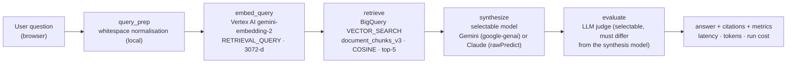
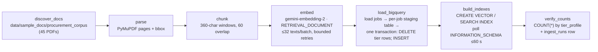
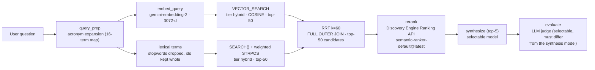
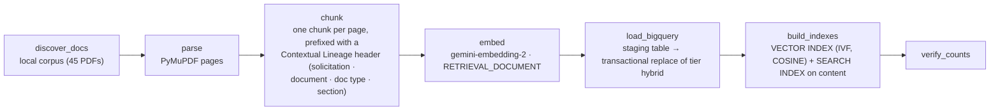
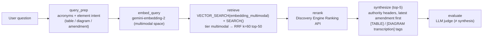
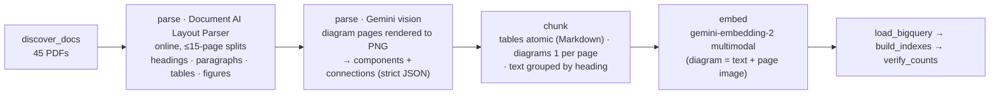

# The RAG Arena — Progressive Enterprise RAG on Google Cloud (v3)

The RAG Arena is a Google Cloud reference application that climbs the production RAG maturity curve one level
at a time on a single domain — **Enterprise IT & Cloud Procurement** (RFPs, SOWs, CLIN rate cards, SLA
matrices, architecture exhibits, superseding amendments). You pick a level, ask a question, and watch the real
pipeline execute: every stage lights up when the backend actually enters it, shows the exact SQL or API
request it sent, what came back, and the measured duration, cost and LLM-judge scores.

**Status: Levels 1–3 live · Levels 4–5 in progress.** Level 1 (naive vector RAG), Level 2 (BigQuery hybrid RRF +
Discovery Engine Ranking API) and Level 3 (Document AI Layout Parser + Gemini vision, multimodal embeddings) have
each run end-to-end on a live GCP project (ingestion, queries, recordings). Compare, Levels 4–5 and the Cloud Run
deployment are planned and are marked as such everywhere below.

---

## Why v3: measured, not simulated

v2 shipped seven engines, but an audit ([`docs/audits/2026-10-20-v2-authenticity-audit.md`](docs/audits/2026-10-20-v2-authenticity-audit.md))
found timer-driven stage events, silent fallbacks to local files, a Python-scripted "agent" trace and
hardcoded evaluation scores. v3 rebuilds the product around six rules:

| # | Principle | How it is enforced in the code |
| :-- | :-- | :-- |
| P1 | **Measured, not simulated** — every stage event is emitted inside the engine when the stage starts/ends, with a backend-measured `duration_ms`. | `core/telemetry.py` (`StageEmitter`); `routes.py` only forwards events — `test_routes_no_timers.py` guards it. |
| P2 | **Fail loud** — no silent fallback or impersonation; a failed stage emits `stage_failed`, then `engine_error`. | `test_no_silent_fallbacks.py` (AST scan of `engines/**`). |
| P3 | **No hardcoded scores** — live metrics come only from the LLM judge; replay metrics come from recordings of real live runs. | `EngineResult` has no `eval_metrics`; recordings carry a provenance header. |
| P4 | **One level at a time** — `ENABLED_LEVELS` gates the registry, navigation and Compare. | `core/config.py`; locked levels render a "Locked" card. |
| P5 | **Honest labels** — a stage is labelled with the service that actually ran. | `stage_started.service`, `EngineFlags` (`reranker_used`, `adk_runner_used`, `layout_source`). |
| P6 | **Zero-credential replay** — `DEMO_MODE=replay` streams recorded events with their original timing. | `engines/replay_engine.py`; ad-hoc questions in replay return `engine_error`, never an improvised answer. |

---

## The architecture ladder

| Level | Engine id | Retrieval & synthesis | What it proves | Status |
| :-- | :-- | :-- | :-- | :-- |
| 1 | `level1_naive` | BigQuery `VECTOR_SEARCH` (COSINE, top-5) over 360-char windows, `gemini-embedding-2`, selectable synthesis model | The baseline — and its failure modes: identifiers blurred, tables scrambled, no amendment awareness | ✅ live |
| 2 | `level2_hybrid` | Acronym expansion; BigQuery `VECTOR_SEARCH` ⨝ `SEARCH()` lexical over one-chunk-per-page lineage chunks → RRF (k=60) top-50 → Discovery Engine Ranking API (`semantic-ranker-default@latest`) → top-5 | Exact identifier recall; reranker precision | ✅ live |
| 3 | `level3_multimodal` | Document AI Layout Parser v1.5 (release candidate) elements + Gemini vision transcription of diagram pages → element-aware chunks with `gemini-embedding-2` multimodal vectors; hybrid RRF + Ranking API; authority headers (latest amendment first) | Tables and diagrams answered correctly | ✅ live |
| 4 | `level4_agentic` | Real Google ADK `Runner` with retrieval, amendment lookup, pricing math and citation-check tools | Multi-hop supersession, deterministic math, self-verification | 🔒 planned |
| 5 | `managed_vertex` | Vertex AI Search data store (extractive segments + summary) | Build vs. buy baseline | 🔒 planned |

Levels 4–5 still contain their v2 bodies in `backend/app/engines/` but are **not enabled**: they run under one
measured `legacy` stage and emit `stage_skipped` for the canonical stages until their phase rebuilds them.
`ENABLED_LEVELS` defaults to `level1_naive,level2_hybrid,level3_multimodal` (the signed-off levels).
Vertex AI Vector Search 2.0 and AlloyDB ScaNN engines are parked in `backend/app/engines/parked/` (excluded
from the registry).

---

## Level 1 architecture

**Query path** (`backend/app/engines/level1_naive.py`, `backend/app/evaluation/`):



**Ingestion path** (`backend/app/ingestion/jobs.py`, `backend/app/ingestion/live_backends.py`):



The UI draws the same graph live from `GET /api/v1/levels` (design metadata only — nodes, edges, code
references); all state on it comes from SSE events.


---

## Level 2 architecture

**Query path** (`backend/app/engines/level2_hybrid.py`, `backend/app/ingestion/bq_indexer.py`,
`backend/app/core/ranking.py`):



Both legs and the fusion run as **one parameterized BigQuery statement**, scoring
`1/(60 + vector_rank) + 1/(60 + lexical_rank)` (SQL shape in [docs/ARCHITECTURE.md](docs/ARCHITECTURE.md)).

**Ingestion path** (`hybrid` tier, same job runner as Level 1):



CUAD agreements are labelled `doc_type = COMMERCIAL_AGREEMENT`, so the lineage header tells the ranker and the
synthesis model what kind of document a page comes from.


---

## Level 3 architecture

**Query path** (`backend/app/engines/level3_multimodal.py`):



**Ingestion path** (`multimodal` tier; `backend/app/ingestion/{layout_documentai,vision_transcribe,multimodal,multimodal_job}.py`):




- **Element boxes come from the PDF text layer.** The v1.5 Layout Parser returns table structure but no bounding
  boxes, so each element is located with `page.search_for` (else the full page); every citation carries
  `bbox_source` (`documentai` | `pdf_text_layer` | `page`).
- **Unusable vision answers are not invented around**: a page whose transcription is empty, not JSON or has no
  labelled components (e.g. a logo or signature page flagged as a figure) is listed in `vision_failed_pages`
  and gets no diagram chunk.
- **Known limitation: BigQuery allows one vector index per table.** The `embedding` index already exists, so
  `VECTOR_SEARCH` on `embedding_multimodal` brute-forces (BigQuery reports the index "does not cover the column
  to search"); at scale the multimodal tier needs its own table.

---

## What each stage shows

Every value is read from the stage event payloads the engine emits (and that recordings store verbatim in
`data/recordings/`).

| Stage | Level 1 | Level 2 adds | Level 3 adds |
| :-- | :-- | :-- | :-- |
| `query_prep` | original and prepared query (local, ~0 ms) | deterministic 16-acronym expansion (CLIN, SLA, RTO, …) with a word-level diff | `element_intent` (table / diagram / amendment) with the matched keywords |
| `embed_query` | model, `task_type=RETRIEVAL_QUERY`, 3072 dimensions, billed token count | — | same model, multimodal embedding space |
| `retrieve` | parameterized `VECTOR_SEARCH` SQL, rows, scores, BigQuery `job_id`, bytes scanned, cache hit | one hybrid SQL statement: up to 50 candidates with `vector_rank`, `lexical_rank`, RRF score, and BigQuery's verbatim index-usage report | `embedding_multimodal` column; element / layout source / bbox source badges per candidate; `element_types`, `layout_sources`, `amendment_candidates` counts |
| `rerank` | — | Discovery Engine Ranking API over all candidates: RRF rank → rerank rank, scores, truncated records, billed counts, cost; an API error fails the stage (no fallback ranker) | same, with element badges joined per row |
| `synthesize` | prompt with top-5 chunks, selected model, prompt/output/thinking tokens from the provider's usage block | same, with `[doc · section · page]` context labels | `authority_headers` (e.g. `[AMENDMENT 0001 · effective … · SUPERSEDES SEC-4.2]`), ordered latest amendment first; `element_mix`; diagram transcription shown in the citation drawer |
| `evaluate` | judge model (must differ from synthesis), groundedness / QA relevance / context precision, rationale, judge tokens and cost | — | — |

Also in the UI:

- **Citations** open a drawer with the real PDF page (rendered by PyMuPDF) and the cited excerpt located on it
  with `page.search_for`; when the excerpt can't be found it says so instead of guessing.
- **Model picker** per run (synthesis + judge from the verified catalog); **Ingestion** (`/ingest`) jobs with
  their own stage rail and BigQuery-reported index states; **Leaderboard** per (engine, synthesis, judge) pair;
  light / dark / system themes.

---

## Model catalog

Catalog in `backend/app/core/models_catalog.py`, prices in `backend/app/core/pricing.py` (published Vertex AI
rates with source URL and `price_as_of`), availability in `data/model_verification.json` (written by
`scripts/verify_models.py` — re-run it on your project).

| Model | Id | Provider path | Endpoint | Input $/1M | Output $/1M | Price as of | Verified |
| :-- | :-- | :-- | :-- | --: | --: | :-- | :-- |
| Gemini 4 Argon | `gemini-4-argon` | Vertex AI, google-genai `generate_content` | `global` | 2.00 | 10.00 | 2026-10-20 | ✅ HTTP 200, 2026-10-21 |
| Gemini 3.8 Flash | `gemini-3.8-flash` | Vertex AI, google-genai `generate_content` | `global` | 0.75 | 3.75 | 2026-10-21 | ✅ HTTP 200, 2026-10-21 |
| Claude Opus 5.5 | `claude-opus-5-5` | Anthropic on Vertex AI, `:rawPredict` | `global` | 4.00 | 20.00 | 2026-10-21 | ✅ HTTP 200, 2026-10-21 |
| Claude Fable 5.1 | `claude-fable-5-1` | Anthropic on Vertex AI, `:rawPredict` | `global` | 10.00 | 50.00 | 2026-10-21 | ✅ HTTP 200, 2026-10-21 |

- Gemini 4 Argon and Gemini 3.8 Flash prices are introductory global rates (through 2026-11-30 and 2026-12-31;
  Flash $1.50 / $7.50 from 2027-01-01); output rates include thinking tokens.
- Defaults: synthesis `GEMINI_FAST_MODEL` (`gemini-4-argon`), judge `JUDGE_MODEL` (`claude-opus-5-5`).
  **Judge ≠ synthesis is enforced server-side** (HTTP 400 before streaming); there is no fallback model.
- **Claude Fable** also requires Anthropic data sharing to be enabled on your project (one-time
  `setPublisherModelConfig`; see [docs/SETUP_GUIDE.md](docs/SETUP_GUIDE.md)); until then it is marked unavailable.

Other billable services (details in [docs/ARCHITECTURE.md](docs/ARCHITECTURE.md)):

| Service | Used by | Price | Source, as of |
| :-- | :-- | :-- | :-- |
| `gemini-embedding-2` | all levels | $0.20 / 1M input tokens | `pricing.py`, 2026-10-20 |
| Discovery Engine Ranking API | Levels 2–3 (`rerank`) | $1.00 / 1,000 counts; 1 count = 1 query of ≤ 100 docs (50 records = $0.001) | `pricing.py`, 2026-10-21 |
| Document AI Layout Parser | Level 3 ingestion | $10 / 1,000 pages; online requests ≤ 15 pages, so PDFs are split | `multimodal_job.py`, 2026-10-22 |

---

## Results so far (Levels 1–3)

Each level ran the 8 golden questions live (`DEMO_MODE=record`) with two (synthesis, judge) pairs: **Argon** =
`gemini-4-argon` + `claude-opus-5-5`, **Flash** = `gemini-3.8-flash` + `claude-opus-5-5`. G / QA / CP =
groundedness / QA relevance / context precision from the LLM judge (0–1); latency = engine run without the
judge; run cost = engine + judge, mean per question (total for the 8 in brackets).

| Level | Argon G / QA / CP | Argon latency | Argon run cost (total) | Flash G / QA / CP | Flash latency | Flash run cost (total) |
| :-- | :-: | --: | --: | :-: | --: | --: |
| 1 · naive | 0.956 / 0.693 / 0.715 | 24.6 s | $0.0354 ($0.283) | 0.934 / 0.672 / 0.715 | 14.9 s | $0.0229 ($0.183) |
| 2 · hybrid + rerank | 0.971 / 0.838 / 0.644 | 28.6 s | $0.0471 ($0.377) | 0.984 / 0.855 / 0.637 | 13.8 s | $0.0309 ($0.247) |
| 3 · multimodal | 0.932 / 0.825 / 0.694 | 26.7 s | $0.0428 ($0.342) | 0.963 / 0.825 / 0.704 | 18.4 s | $0.0271 ($0.217) |

Level 2 lifts QA relevance on amendment and table questions, but its reranker pulled CUAD agreements into the
top 5 on three questions (lower CP); Level 3 recovers most of that precision. Remaining weak spots:
`q_soc_p1_response_matrix` (QA 0.55) and cross-solicitation cost math (QA 0.35 / 0.25) — Level 4's job.
These are single runs scored by one judge, so treat differences of a few hundredths as noise. Per-question
scores, SQL, prompts, judge rationales and provenance headers are in [`data/recordings/`](data/recordings/)
(one JSON per level / pair / question; BigQuery result-cache hits show 0 bytes processed).

---

## Quickstart

Requirements: Python 3.11+ (3.12 in the Docker image), Node.js 20+. Live mode also needs the Google Cloud CLI
(`gcloud`, `bq`).

### (a) Zero-credential replay

```bash
python3 -m venv .venv
.venv/bin/pip install -r backend/requirements.txt

# terminal 1 — API on :8000, plays data/recordings/** (no GCP calls, no credentials)
DEMO_MODE=replay .venv/bin/python -m uvicorn app.main:app --app-dir backend --port 8000

# terminal 2 — UI on :5173 (Vite proxies /api to :8000)
cd frontend && npm install && npm run dev
```

Open `http://localhost:5173`, pick a level, a golden question and a recorded pair (`gemini-4-argon` or
`gemini-3.8-flash` with judge `claude-opus-5-5`), and press Run; events replay with their recorded timing and
ad-hoc questions return `engine_error`. Levels 1–3 are enabled by default. (`docker-compose.yml` predates v3 — use the two commands above.)

### (b) Live on your own GCP project

1. **Configure.** `cp .env.example .env` (git-ignored), then set at least:
   ```bash
   DEMO_MODE=live                      # or record: live + writes data/recordings/**
   GCP_PROJECT_ID=your-gcp-project-id
   GCP_LOCATION=us-central1            # BigQuery location
   VERTEX_GENAI_LOCATION=global
   BQ_DATASET=rag_arena
   BQ_TABLE=document_chunks_v3         # v3 ingestion refuses BQ_TABLE=document_chunks (the frozen v2 table)
   ```
2. **Authenticate** with Application Default Credentials: `gcloud auth application-default login`
   (optionally isolate a profile via `CLOUDSDK_CONFIG` / `GOOGLE_APPLICATION_CREDENTIALS` in `.env`).
3. **Bootstrap** APIs, the corpus bucket, the dataset and the Level 3 Layout Parser processor. The script reads
   environment variables (not `.env`) and creates a v2-schema table named by `BQ_TABLE`, so pass the v2 name —
   the ingestion jobs create the v3 table themselves. Put the printed `DOCAI_PROCESSOR_ID` in `.env`.
   ```bash
   set -a; source .env; set +a
   BQ_TABLE=document_chunks ./scripts/bootstrap_gcp.sh
   ```
4. **Verify models** (writes `data/model_verification.json`; failing models are disabled with the error):
   `PYTHONPATH=backend .venv/bin/python scripts/verify_models.py`
5. **Run** the backend and UI as in (a), open `/ingest`, and run the ingestion job of each level you enable
   (Level 3 needs the `DOCAI_*` keys). A level's Run button stays
   disabled while its tier has 0 rows.

IAM for the backend principal: `roles/aiplatform.user`, `roles/bigquery.jobUser`, `roles/bigquery.dataEditor` on
`rag_arena`. Step-by-step setup, all `.env` keys, the Fable data-sharing call and troubleshooting:
[docs/SETUP_GUIDE.md](docs/SETUP_GUIDE.md).

---

## API & SSE protocol

| Method & path | Purpose |
| :-- | :-- |
| `GET /api/v1/health` | Mode, enabled levels, configured models, project/bucket from `.env` (the UI never hardcodes them) |
| `GET /api/v1/levels` | All five levels with `enabled`, stages and architecture descriptor |
| `GET /api/v1/models` | Verified catalog, defaults, and `recorded_pairs` playable in replay |
| `GET /api/v1/benchmarks` | Golden procurement benchmark (8 questions, 4 failure modes) |
| `POST /api/v1/battle/stream` | Run: `{query, question_id?, engines?, solicitation_filter?, synthesis_model?, judge_model?}` → SSE |
| `GET /api/v1/leaderboard` | Aggregates of recorded runs per (engine, synthesis, judge) with provenance |
| `POST /api/v1/ingest/jobs` · `GET /api/v1/ingest/jobs/{id}` · `GET /api/v1/ingest/jobs/{id}/stream` | Start / inspect / stream an ingestion job (`{level}`) |
| `GET /api/v1/ingest/status` | Live `COUNT(*)` by tier, index states, recent `ingest_runs` |
| `GET /api/v1/documents/page` · `GET /api/v1/documents/highlights` | Rendered PDF page (PNG) and excerpt highlight rectangles |
| `POST /api/v1/ingest/upload` | Guarded PDF upload (uploaded sessions are not indexed for Levels 1–3 yet) |

Run stream frames are `data: {json}\n\n`, bounded by `MAX_SSE_FRAMES` (600):

| Event | Key fields |
| :-- | :-- |
| `run_started` | `run_id`, `engines[]`, `demo_mode`, `question_id` |
| `stage_started` | `engine`, `stage`, `label`, `service`, `request` |
| `stage_completed` | `engine`, `stage`, `duration_ms`, `payload` |
| `stage_failed` / `stage_skipped` | `error_type`, `error` / `reason` |
| `answer_complete` | `answer`, `citations[]`, `latency_ms`, `cost_usd`, `usage`, `flags` |
| `eval_complete` | `metrics`, `judge_model`, `reference_answer_used`, `duration_ms`, judge tokens & cost |
| `engine_error` | `error_type`, `error`, `failed_stage` |
| `stream_warning` · `battle_complete` | `message` · `engines_completed[]`, `engines_failed[]` |

Per-level `stage_completed.payload` fields are listed in [docs/ARCHITECTURE.md](docs/ARCHITECTURE.md) (§3).
Ingestion streams emit `job_started`, `stage_started|completed|failed`, `doc_progress`, `embed_progress` and
`job_complete` (counts read back from BigQuery).

---

## Repository layout

```text
backend/app/
  api/          routes.py (REST + SSE forwarder), documents.py, query_runs.py
  core/         config, telemetry (StageEmitter), models_catalog, pricing, ranking, architectures, …
  engines/      level1_naive, level2_hybrid, level3_multimodal, common_stages, synthesis, replay_engine;
                level4 / managed_vertex not enabled; parked/
  evaluation/   judges, evaluator, scoring
  ingestion/    jobs, live_backends, parsers, bq_indexer, documentai_client, layout_documentai,
                vision_transcribe, multimodal, multimodal_job, …
  recording/    recorder, store, codec, redaction
backend/tests/  24 offline test modules + shared fakes
frontend/src/   app, pages, features/{levels,ingest}, components, lib, theme, styles, types
data/           sample_docs/procurement_corpus (45 PDFs), golden_benchmarks, model_verification.json,
                recordings/<engine>/<synthesis>__<judge>/<question_id>.json
docs/           ARCHITECTURE.md, SETUP_GUIDE.md, audits/, screenshots/
scripts/        bootstrap_gcp.sh, verify_models.py, provision_documentai.py, build/download corpus, …
infra/main.tf   Terraform (APIs, bucket, dataset, table, Layout Parser processor)
```

`docker-compose.yml` predates v3 and is being updated; `.env.example` is the configuration template.

---

## Testing

```bash
PYTHONPATH=backend .venv/bin/pytest backend/tests -q   # 208 passed (2026-10-22)
cd frontend && npm test                                 # node test runner suites
cd frontend && npm run build                            # tsc + vite build
```

Backend tests are offline (fakes for Vertex AI, BigQuery and Document AI) and include the principle guards: no
timers in `routes.py`, no silent fallbacks, recording redaction, judge ≠ synthesis, and the public-docs leak scan.

## Security & leak hygiene

- **Identity only from the git-ignored `.env`** (project, bucket, credential paths); code defaults are empty.
- **Recorder redaction**: identity values become `${…}` placeholders and `assert_redacted` refuses to write
  otherwise. **Safe mode** (`?safe=1` or the header toggle) masks them in the UI for screen sharing.
- **No key files** (ADC only); parameterized queries, validated identifiers, and an explicit bound and timeout on
  every loop, retry, poll and request.

## Roadmap

| Phase | Scope | Status |
| :-- | :-- | :-- |
| 1 | Level 1 Naive Vector RAG | ✅ live |
| 2 | Level 2 BigQuery Hybrid RRF + Discovery Engine Ranking API (rerank before/after scores) | ✅ live |
| 3 | Level 3 Document AI Layout Parser + Gemini vision, multimodal embeddings, authority headers | ✅ live |
| 4 | Level 4 real Google ADK runner with tools over real data — **next** | 🔒 planned |
| 5 | Managed Vertex AI Search baseline | 🔒 planned |
| 6 | Compare page, leaderboard from `query_runs`, updated compose, **Cloud Run** deployment (single container, least-privilege service account, IAP-protected live service, optional public replay service) | 🔒 planned |

## Data & license

- **Generated procurement corpus**: 18 interconnected solicitation documents across 3 solicitations (cloud
  infrastructure, data analytics platform, cybersecurity operations) built by
  `scripts/build_procurement_corpus.py`; fictional, for benchmarking only.
- **CUAD**: 27 commercial agreements (maintenance, hosting, development, license, outsourcing) from the
  [Contract Understanding Atticus Dataset (CUAD) v1](https://zenodo.org/records/4595826) by The Atticus
  Project, licensed under [CC BY 4.0](https://creativecommons.org/licenses/by/4.0/); fetched by
  `scripts/download_procurement_corpus.sh` and included as the original CUAD PDFs.
- **Golden benchmark**: 8 questions across 4 failure modes in `data/golden_benchmarks/procurement_benchmark.json`.

## Acknowledgements

Built on Google Cloud (Vertex AI, BigQuery, Cloud Storage), Anthropic Claude models on Vertex AI, PyMuPDF,
Starlette, React, Vite and Tailwind CSS. Contract data from The Atticus Project's CUAD.
