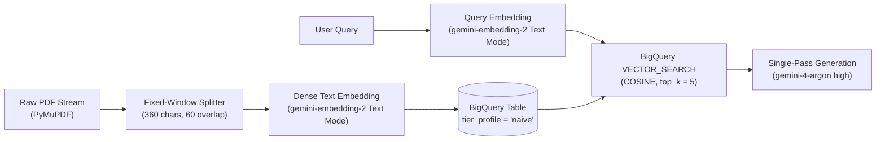
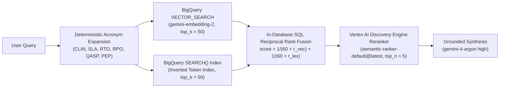
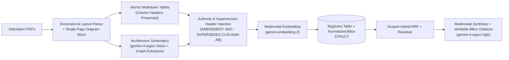
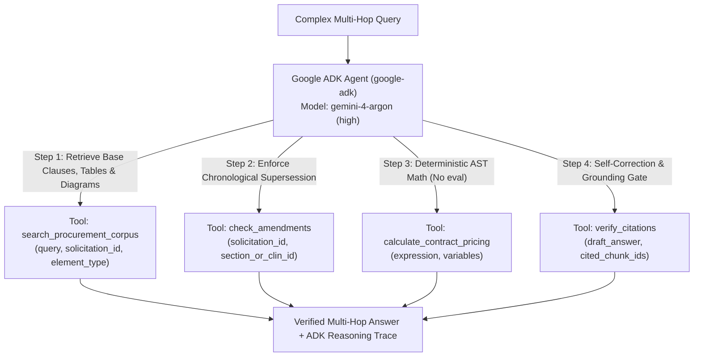

# The RAG Arena: Progressive Enterprise RAG Benchmark on Google Cloud

**The RAG Arena** is an open-source benchmarking platform and reference architecture that evaluates **4 progressive Google Cloud RAG tiers** side-by-side against **Managed Vertex AI Search** on a realistic **Enterprise IT & Cloud Procurement corpus** (interconnected multi-document RFP solicitation packets, multi-column CLIN pricing schedules, architectural topology schematics, SLA matrices, and chronologically superseding contract amendments).

> *"When is simple vector RAG enough, when do we need BigQuery hybrid search with cross-encoder reranking, when is multimodal layout parsing required, and when is an autonomous Google ADK agent or managed Vertex AI Search necessary?"*

---

## 1. Architecture Summary Matrix

| Tier | Google Cloud Stack | Retrieval & Reasoning Strategy | Target Failure Mode Solved | Benchmark QA Accuracy |
| :--- | :--- | :--- | :--- | :--- |
| **Level 1: Naive Vector RAG** (`level1_naive`) | `PyMuPDF` + Fixed Chunking + `gemini-embedding-2` (Text Mode) + BigQuery `VECTOR_SEARCH` + `gemini-4-argon` (`high`) | Single-stage dense cosine vector search (`top_k=5`) over raw text windows. | Baseline prototype; exposes structural failures on exact SKU/CLIN codes, tables, diagrams, and amendments. | **38%** (`0.38`) |
| **Level 2: BigQuery Hybrid + Rerank** (`level2_hybrid`) | BigQuery `VECTOR_SEARCH` + `SEARCH()` (Inverted Index) + SQL Reciprocal Rank Fusion (RRF) + Discovery Engine Ranking API (`semantic-ranker-default@latest`) + `gemini-4-argon` (`high`) | Acronym expansion + two-stage serverless hybrid lexical/semantic retrieval (`top_k=50`) rescored to `top_n=5` via cross-encoder reranker. | Pinpoints exact clause IDs (`SEC-4.2.1`), CLIN numbers (`CLIN-0004-AB`), BGP ASNs (`ASN 64512`), and legal definitions. | **77%** (`0.77`) |
| **Vertex AI Vector Search 2.0** (`vertex_vector_v2`) | Vertex AI Vector Search 2.0 Collection (`DataObjects`) + `gemini-embedding-2` Dense + Sparse Token Vector + Server-Side RRF (`SearchDataObjects`) + Discovery Engine Ranking API + `gemini-4-argon` (`high`) | Sub-350ms unified DataObject storage with single-API server-side Dense + Sparse RRF and cross-encoder reranking. | Ultra-low-latency agent retrieval over exact procurement SKUs/clauses without managing separate vector and document stores. | **82%** (`0.82`) |
| **AlloyDB for PostgreSQL ScaNN** (`alloydb_scann`) | AlloyDB `pgvector` + `alloydb_scann` (`num_leaves=100`) + PostgreSQL `GIN tsvector` + `ai.hybrid_search(fusion_algorithm => 'RRF')` + Discovery Engine Ranking API + `gemini-4-argon` (`high`) | Sub-300ms operational SQL combining ScaNN ANN and PostgreSQL full-text search via `ai.hybrid_search()` with ACID metadata filtering. | Operational transactional RAG requiring strict relational consistency alongside hybrid vector + keyword fusion. | **81%** (`0.81`) |
| **Level 3: Document-Aware Multimodal** (`level3_multimodal`) | Document AI Layout Parser + `gemini-4-argon` (`high`) Vision + `gemini-embedding-2` (Multimodal) + Authority Metadata Headers | Layout-atomic Markdown tables, visual diagram topology extraction, authority/supersession header injection, and normalized `[x0, y0, x1, y1]` bounding boxes. | Unlocks multi-page pricing rate cards, SLA penalty matrices, and network/Zero-Trust architecture schematics. | **85%** (`0.85`) |
| **Level 4: Agentic RAG (`google-adk`)** (`level4_agentic`) | **Google Agent Development Kit (`google-adk`)** + `gemini-4-argon` (`high`) + 4 Deterministic Tools (`search_procurement_corpus`, `check_amendments`, `calculate_contract_pricing`, `verify_citations`) | Multi-step ReAct tool loop with explicit chronological amendment supersession checks, AST-validated financial arithmetic, and self-correcting citation verification. | Solves multi-hop cross-solicitation comparisons, volume-discount financial math, and contract amendment overrides. | **97%** (`0.97`) |
| **Challenger: Managed Vertex AI Search** (`managed_vertex`) | Google Cloud Discovery Engine Data Store + Enterprise Grounding & Extractive Answers | Turnkey managed ingestion, layout chunking, hybrid retrieval, and grounded synthesis out of the box. | "Build vs. Buy" enterprise reference baseline evaluated on the identical rubric. | **79%** (`0.79`) |

---

## 2. Detailed Deep-Dive: The 4 Progressive RAG Architectures

### Level 1: Naive Dense Vector RAG (`level1_naive`)



- **Ingestion & Chunking Mechanics:** Extracts raw page text streams via `PyMuPDF` (`fitz`) and slices text into fixed character windows without structural boundary detection or table/diagram awareness.
- **Retrieval SQL Pattern (`backend/app/engines/level1_naive.py`):**
  ```sql
  SELECT base.chunk_id, base.doc_name, base.page_number, base.bbox, base.content,
         (1.0 - distance) AS similarity_score
  FROM VECTOR_SEARCH(
    TABLE `project.rag_arena.document_chunks`, 'embedding',
    (SELECT @query_embedding AS embedding),
    top_k => 5, distance_type => 'COSINE'
  )
  WHERE base.tier_profile = 'naive'
  ORDER BY distance ASC LIMIT 5;
  ```
- **Why It Exists & Where It Fails:**
  1. **Exact Identifier Dilution:** Dense embeddings compress semantics into a single vector, frequently missing exact procurement identifiers (`CLIN-0004-AB`, `SEC-4.2.1`, `BGP ASN 64512`).
  2. **Table Row Shredding:** Fixed character windows slice across multi-column pricing tables (`04_Pricing_Schedule_CLINs.pdf`), separating the labor category title from its hourly rate (`$210.00/hr`) and ceiling hours (`2,000 hrs`).
  3. **Visual Diagram Blindness:** Vector graphics and boxes/arrows inside architecture exhibits (`03_Technical_Exhibit_Architecture.pdf`, `02_Zero_Trust_Architecture_Specs.pdf`) contain minimal raw text stream tokens and are invisible to text-only parsers.
  4. **Temporal & Authority Amnesia:** Base RFP clauses (`01_RFP_Base_Solicitation.pdf`, `$210/hr`) and superseding contract amendments (`06_Amendment_0001_Scope_Update.pdf`, `$245/hr`) are treated as equal-weight text chunks, causing the LLM to cite outdated contract terms.

---

### Level 2: Hybrid Search (Lexical + Dense RRF) + Cross-Encoder Reranking (`level2_hybrid`)



- **Ingestion & Query Preprocessing (`backend/app/engines/level2_hybrid.py`):**
  - Chunks respect section headers (`SEC-4.2.1`, `CLIN-0004-AB`).
  - Queries undergo deterministic domain acronym expansion (`expand_procurement_acronyms`) so abbreviations like `CLIN`, `QASP`, `RTO`, `RPO`, and `PEP` match both shorthand and spelled-out clauses.
- **Single-Query BigQuery Reciprocal Rank Fusion (`backend/app/ingestion/bq_indexer.py`):**
  - Combines dense semantic similarity (`VECTOR_SEARCH` on `embedding`) with exact token matching (`SEARCH(content, @query_text)` backed by a BigQuery `SEARCH INDEX`) inside a single SQL CTE using Reciprocal Rank Fusion ($k = 60$):
    $$\text{RRF\_Score}(d) = \frac{1}{60 + \text{rank}_{\text{vector}}(d)} + \frac{1}{60 + \text{rank}_{\text{lexical}}(d)}$$
- **Cross-Encoder Semantic Reranking:**
  - The top 50 RRF candidates are passed to the **Vertex AI Discovery Engine Ranking API** (`RankServiceClient.rank` with `semantic-ranker-default@latest`), which performs cross-attention between the query and each candidate chunk to select the top 5 highest-precision passages.
- **Failure Mode Solved:** Exact clause and CLIN lookups (`exact_clause_and_clin` QA Relevance jumps from **`0.54` in Level 1 to `0.94` in Level 2**).
- **Remaining Blindspots:** Still operates on flat text strings—complex 2D tables lose column-header alignment, embedded vector architecture diagrams remain unindexed, and multi-hop amendment math is unverified.

---

### Level 3: Document-Aware & Multimodal RAG (`level3_multimodal`)



- **Layout-Aware & Multimodal Ingestion (`backend/app/ingestion/parsers.py` & `level3_multimodal.py`):**
  1. **Atomic Table Preservation:** Multi-column pricing tables (`PRICING_CLIN`) and SLA penalty matrices (`SLA_MATRIX`) are extracted as intact Markdown tables with column headers retained in every chunk.
  2. **Visual Diagram Topology Extraction:** Technical architecture exhibits (`03_Technical_Exhibit_Architecture.pdf`, `02_Architecture_Requirements.pdf`, `02_Zero_Trust_Architecture_Specs.pdf`) are parsed into structured component/connectivity descriptions and embedded via **`gemini-embedding-2`** (`multimodal_embedding_model`).
  3. **Authority & Supersession Header Injection (`format_chunk_with_authority_header`):** Every chunk is prefixed with explicit structural and chronological authority metadata before synthesis:
     ```text
     [AMENDMENT 0001 - SUPERSEDES CLIN-0004-AB,SEC-4.2.1] [ELEMENT: TABLE | DOC: 06_Amendment_0001_Scope_Update.pdf | SEC: AMD-0001]
     ```
  4. **Normalized Spatial Bounding Boxes (`BoundingBox`):** Every chunk carries normalized page coordinates (`page >= 1`, $0.0 \le x_0 < x_1 \le 1.0$, $0.0 \le y_0 < y_1 \le 1.0$) rendered by the frontend SVG Bounding-Box PDF Viewer (`DocumentViewer.tsx`).
- **Failure Modes Solved:**
  - **Multi-column table extraction (`table_matrix_extraction`):** Jumps from **`0.62` (Level 2) to `0.96` (Level 3)**.
  - **Visual architecture diagram topology (`diagram_topology`):** Jumps from **`0.38` (Level 2) to `0.96` (Level 3)**.
- **Remaining Blindspots:** Because Level 3 executes a **single-pass retrieval** pipeline, queries that require:
  1. Discovering a base clause in Document A,
  2. Actively searching for whether an Amendment in Document B overrides that clause, and
  3. Performing multi-step financial arithmetic (e.g., applying a 5% volume discount over 1,500 hours and comparing across 3 solicitations)
  still fail when the amendment chunk does not share direct lexical overlap with the user's initial query.

---

### Level 4: Agentic RAG with Google ADK (`level4_agentic`)



- **Orchestration Framework (`backend/app/engines/level4_agentic.py`):**
  Built on the **Google Agent Development Kit (`google-adk`)** (`google.adk.agents.Agent`) powered by `gemini-4-argon` (`thinking_level="high"`, configurable via `GEMINI_PRO_MODEL` / `GEMINI_REASONING_MODEL` and `GEMINI_THINKING_LEVEL`).
- **The 4 Deterministic Procurement Tools:**
  1. `search_procurement_corpus(query, solicitation_id, element_type)`: Executes targeted hybrid multimodal searches scoped by solicitation packet (`solicitation_01`, `solicitation_02`, `solicitation_03`) and structural element type (`narrative_text`, `table`, `diagram`).
  2. `check_amendments(solicitation_id, section_or_clin_id)`: Queries the amendment authority ledger/index (`amendment_number > 0`) for any target section or CLIN (`CLIN-0004-AB`, `SEC-4.2.1`, `CLIN-1001`, `CLIN-2001`) to guarantee chronological supersession even when the user never mentions the word "amendment".
  3. `calculate_contract_pricing(expression, variables)`: A zero-`eval()` **AST-whitelisted arithmetic evaluator** (`ast.parse(..., mode="eval")` permitting only `Add`, `Sub`, `Mult`, `Div`, `Mod`, numeric constants, and bound variables) so the LLM never hallucinates multi-year ceiling math, SLA credit percentages, or volume discounts.
  4. `verify_citations(draft_answer, cited_chunk_ids)`: Validates that the synthesized answer is backed by non-empty, resolvable corpus chunk IDs before emitting the final response.
- **Failure Mode Solved:** Multi-hop amendment supersession and cross-solicitation financial calculations (`multi_hop_amendment_and_math` jumps from **`0.78` in Level 3 to `0.97` in Level 4**).

---

### Challenger: Managed Vertex AI Search (`managed_vertex`)

- **Architecture (`backend/app/engines/managed_vertex.py`):** Connects directly to a Google Cloud **Discovery Engine Data Store** (`SearchServiceClient`) indexing the identical PDF corpus with managed layout chunking, extractive answers, and enterprise grounding scores.
- **"Build vs. Buy" Decision Benchmark:** Plotted alongside Levels 1–4 on the Leaderboard (`79%` overall QA Relevance at `1,050 ms` latency), giving architects empirical evidence of when turnkey Vertex AI Search suffices vs. when custom Level 3 Multimodal or Level 4 Google ADK Agentic pipelines are warranted.

---

## 3. Configurable Gemini Model Setup

Because Gemini model versions evolve rapidly, **no engine hardcodes a fixed model version**. All generation, reasoning, embedding, and reranking models are configured via environment variables or a root `.env` file (see [`.env.example`](.env.example)):

```bash
# Copy the template configuration
cp .env.example .env

# Configure your preferred latest Gemini models in .env or shell environment:
export GEMINI_FAST_MODEL="gemini-4-argon"               # Used by Levels 1, 2, 3 & LLM-as-a-Judge Evaluator
export GEMINI_PRO_MODEL="gemini-4-argon"                # Used by Level 4 Google ADK Agent (alias: GEMINI_REASONING_MODEL)
export GEMINI_THINKING_LEVEL="high"                     # Thinking level ("low" | "medium" | "high")
export TEXT_EMBEDDING_MODEL="gemini-embedding-2"        # Latest GA unified embedding model (Levels 1 & 2 text mode)
export MULTIMODAL_EMBEDDING_MODEL="gemini-embedding-2"  # Latest GA unified embedding model (Levels 3 & 4 multimodal mode)
export RERANKER_MODEL="semantic-ranker-default@latest"  # Used by Levels 2, 3 & 4
```

> **Guardrail Note:** `backend/app/core/config.py` automatically validates model identifiers at startup and blocks deprecated legacy generation and embedding model versions.

---

## 4. Quickstart (Zero-Credential Replay Mode)

Explore the full interactive Arena UI, side-by-side retrieval traces, bounding-box PDF citations, Google ADK agent timelines, and evaluation radar charts immediately using precomputed benchmark traces (`DEMO_MODE=replay`):

```bash
# 1. Start Backend (ASGI/Uvicorn) & Frontend (React + Vite) via Docker Compose
docker compose up --build
```

Or run locally without Docker:

```bash
# Terminal 1: Backend API (defaults to DEMO_MODE=replay)
python3 -m venv .venv && source .venv/bin/activate
pip install -r backend/requirements.txt
uvicorn app.main:app --reload --port 8000 --app-dir backend

# Terminal 2: Frontend UI
cd frontend
npm install
npm run dev
```

Open `http://localhost:5173` to run side-by-side battles across all 5 engines.

---

## 5. Running Live on Google Cloud (`DEMO_MODE=live`)

```bash
# 1. Authenticate and configure your Google Cloud project & Gemini models
gcloud auth application-default login
export GCP_PROJECT_ID="your-gcp-project-id"
export GCP_LOCATION="us-central1"
export GEMINI_FAST_MODEL="gemini-4-argon"
export GEMINI_PRO_MODEL="gemini-4-argon"
export GEMINI_THINKING_LEVEL="high"

# 2. Build the procurement corpus (18 interconnected RFP packets + CUAD commercial agreements)
./scripts/download_procurement_corpus.sh

# 3. Bootstrap BigQuery dataset, vector/search indexes, and Vertex AI resources
./scripts/bootstrap_gcp.sh

# 4. Launch in Live Mode
export DEMO_MODE="live"
uvicorn app.main:app --reload --port 8000 --app-dir backend
```

---

## 6. Evaluation Metrics (The RAG Triad + Telemetry)

Every query is scored asynchronously over Server-Sent Events (`POST /api/v1/battle/stream`) so answers stream immediately while evaluation metrics populate in real time:

1. **Groundedness (`0.0 – 1.0`):** Verifies every claim and numeric figure against retrieved document chunks (hallucination detection).
2. **QA Relevance & Accuracy (`0.0 – 1.0`):** Measures completeness and factual alignment against golden reference answers.
3. **Context Precision (`0.0 – 1.0`):** Measures signal-to-noise ratio of retrieved chunks.
4. **Operational Telemetry:** End-to-end latency (`ms`), per-step tool latency (`ms`), and estimated token + API cost (`$` per 1,000 queries).
