# The RAG Arena — Progressive Enterprise RAG on Google Cloud

**Eight RAG architectures, one procurement corpus (or your own PDFs), every stage measured live — pick the right architecture with evidence, not demos.**

      

**Release:** v1.6.3 (2026-11-20, see [CHANGELOG.md](CHANGELOG.md)) · **Status:** all eight architectures in customer complexity order (Levels 1–4 & 7–8 standing live + Levels 5–6 ephemeral ScaNN benchmarks at $0/mo idle), Identity-Aware Document ACLs & Row-Level Security (`5` personas, native BigQuery/AlloyDB/VVS2/VAIS pre-filtering + honest RagCorpus corpus-boundary fail-closed + `6` isolated ACL refusal replay demos), Use-Case Architecture Advisor & TCO Calculator (`/`), Gemini 4 + Claude Global Model Selector (`183` baseline recorded runs incl. `48/48` `gemini-4-hydrogen`), Model Armor Guardrails & Composable Workbench (`/workbench`), Controlled Ablation Lab & Executive Export (`/compare`), Vertex AI GenAI Eval & Split Cost (`/leaderboard`), Releases & Docs (`/releases`), private PDF uploads, and Cloud Run live.

## The problem

Enterprise procurement packages spread one deal across dozens of PDFs: base RFPs and statements of work (SOWs), price schedules keyed by contract line-item numbers (**CLINs**, e.g. `CLIN-0004-AB`), SLA matrices, architecture diagrams, and later **amendments** that supersede earlier rates and terms:

- **Direct single-file lookups mostly work** on naive vector RAG (QA relevance 0.80–1.00 on our golden set) — which hides deeper failures during toy evaluations.
- **Superseding amendments fail** (Naive Vector QA 0.50–0.65): base clauses outrank the later amendment that replaced them when chunks carry no document lineage or authority order.
- **Cross-document arithmetic fails** (single-pass Levels 3–7 QA 0.30–0.40): multi-document totals and SLA credit formulas require iterative retrieval and deterministic calculation rather than single-pass top-k synthesis.
- **Complex layouts & custom PDFs vary**: multi-column tables and visual diagrams without embedded text layers require layout parsing and multimodal vision transcription.

Teams choosing a RAG architecture on Google Cloud rarely see measured quality, latency and cost trade-offs on the same data — and many demos fake the pipeline with timers and hardcoded scores.

## How The RAG Arena solves it

- **Eight architectures ordered from simplest turnkey managed to agentic ADK** (Vertex AI Search → Vertex AI RAG Engine → BigQuery Naive Vector → BigQuery Hybrid + Rerank → AlloyDB ScaNN → Vertex AI Vector Search 2.0 ScaNN + Sparse RRF → Layout-Aware Multimodal → Agentic ADK) tested on a **45-PDF benchmark corpus** (8 golden questions) **or your own uploaded PDFs** (v1.1+).
- **Every stage measured and streamed live** over SSE: the real SQL or API request, what came back, backend-measured duration, tokens and split Engine/Judge cost, drawn on a live architecture diagram.
- **An LLM judge that differs from the synthesis model** (enforced server-side) scores groundedness, QA relevance and context precision — with reference-free judging on uploaded or custom questions; **Compare** and **Leaderboard** highlight the winner by your chosen metric.
- **Zero-credential replay** of 183 recorded real runs, and **one-command Cloud Run deployment** to your own project (`$0/mo` standing idle).

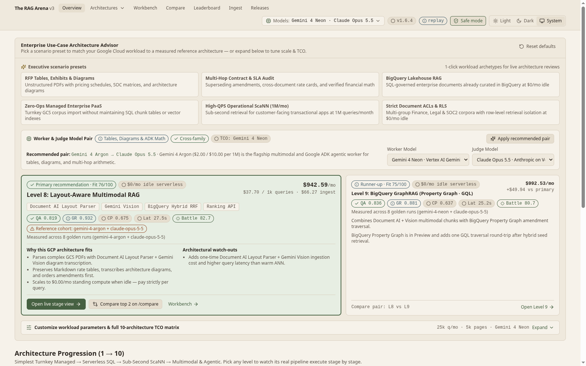

Design guarantees (full principles table: [docs/ARCHITECTURE.md](docs/ARCHITECTURE.md#0-design-principles-v3)):

- **Measured, not simulated** — stage events are emitted inside the engines; the API layer has no timers.
- **Fail loud** — a failed stage emits `stage_failed` + `engine_error`; no silent fallback service or model.
- **No hardcoded scores** — metrics come only from the live judge or from recordings of real runs.
- **Honest labels** — each stage names the service that actually ran (`reranker_used`, `adk_runner_used`, `layout_source`).
- **Replay never improvises** — questions without a recording return `engine_error`, never a made-up answer.

## The architecture ladder (Order A: simplest → most complex)

| Level | Engine id | Retrieval & synthesis | What it proves |
| :-- | :-- | :-- | :-- |
| 1 | `managed_vertex` | Vertex AI Search (Enterprise + LLM add-on) over corpus or isolated uploads store: extractive segments answered by managed summary or a selectable model | Turnkey build-vs.-buy baseline (strong segment recall; conservative managed summary) |
| 2 | `rag_engine` | Vertex AI RAG Engine (`RagCorpus` + `RagManagedDb`, `text-embedding-005` 512/100 chunks): `:retrieveContexts` + selectable model or `VertexRagStore` Gemini grounding | Managed corpus-centric RAG with high recall and grounding vs. DIY SQL |
| 3 | `level1_naive` | BigQuery `VECTOR_SEARCH` (COSINE, top-5) over 360-char windows, `gemini-embedding-2`, selectable synthesis model | Minimal serverless SQL baseline; works on direct lookups, breaks on amendments/math |
| 4 | `level2_hybrid` | Acronym expansion; `VECTOR_SEARCH` ⨝ `SEARCH()` over page-lineage chunks → RRF (k=60) top-50 → Vertex AI ranking API → top-5 | Recovers superseding amendments and exact identifier recall in one BQ statement |
| 5 | `alloydb_scann` | Ephemeral AlloyDB `alloydb_scann` cosine ANN + PostgreSQL GIN `tsvector` FTS → in-DB RRF (k=60) + selectable model (AlloyDB Omni Docker supported) | Sub-400 ms operational SQL + ScaNN hybrid retrieval, torn down to $0/mo idle |
| 6 | `vertex_vector_v2` | Ephemeral Vertex AI Vector Search 2.0 `Collection` (`denseScann` + CRC32 `sparse_embedding` via `dataObjects:batchSearch` native RRF) + selectable model | Managed dedicated-replica ScaNN + sparse RRF at scale, torn down to $0/mo idle |
| 7 | `level3_multimodal` | Document AI Layout Parser + Gemini vision transcription of diagrams → element-aware chunks with multimodal vectors; hybrid RRF + rerank; authority headers (latest amendment first) | Atomic Markdown tables, diagram vision transcription, orphan-heading dedupe, amendment order |
| 8 | `level4_agentic` | Google ADK `LlmAgent` + `InMemoryRunner` (Gemini, ≤ 8 turns) with search, amendment, pricing-calculator and citation-check tools | Multi-hop supersession, exact cross-document math (QA 0.96–0.98), self-verification |

`DEFAULT_ENABLED_LEVELS` enables all eight architectures in `replay` and the six standing serverless/managed architectures (Levels 1–4, 7–8) in `live` (`$0/mo` standing idle; Levels 5–6 unlock live via `ENABLED_LEVELS` during ephemeral runs or local AlloyDB Omni).

**Cross-cutting Google Cloud products** (all levels and deployment):

- **Cloud Run** — single container serving UI + API (IAP-protected live service, optional public replay-only copy)
- **Artifact Registry** + **Cloud Build** — image storage and remote builds (no local Docker needed)
- **Identity-Aware Proxy (IAP)** + **Model Armor** + **IAM** — ES256 IAP JWT verification, `$0/mo` prompt/response guardrail templates, owner-isolated uploads, least-privilege runtime SA (no key files)
- **BigQuery** + **Cloud Storage** — `document_chunks_v3`, `query_runs`, `ingest_runs`, corpus bucket, and private upload bucket (`UPLOAD_BUCKET`, PAP enforced, UBLA on, direct-to-GCS resumable uploads)

## Level 1 architecture — Managed Vertex AI Search

**Query path** (`backend/app/engines/{managed_vertex,vais_search}.py`, `backend/app/core/vertex_search.py`):

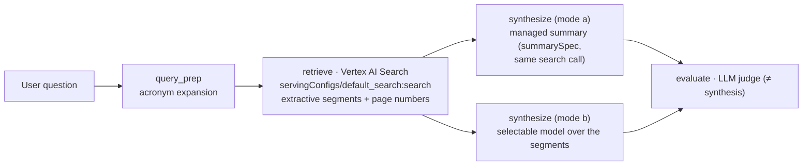

**Ingestion** (`backend/app/ingestion/{gcs_sync,managed_job,managed_upload_job}.py`): corpus syncs changed PDFs to `gs://$GCS_CORPUS_BUCKET` and runs an `INCREMENTAL` import into `rag-arena-procurement`; uploads write a zero-download `_vais_import.jsonl` (`dataSchema="document"`) into `rag-arena-uploads` with `workspace_id` metadata. The pseudo model `vertex-ai-search-summary` is Level-1-only (HTTP 400 elsewhere).

**Google Cloud products**: **Vertex AI Search** (Enterprise + LLM add-on), **Cloud Storage**, **Gemini / Claude on Vertex AI** (mode b synthesis & default `claude-opus-5-5` judge).

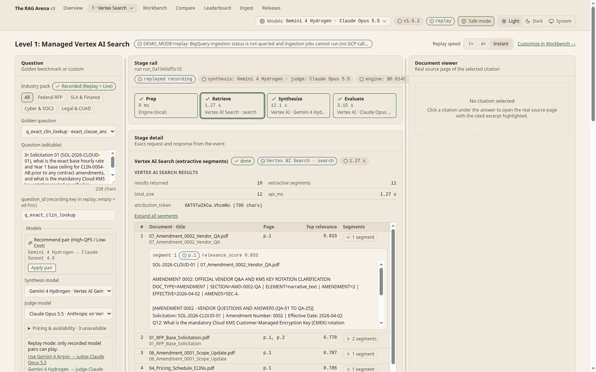

## Level 2 architecture — Managed Vertex AI RAG Engine

**Query path** (`backend/app/engines/rag_engine.py`, `backend/app/core/rag_engine_client.py`):

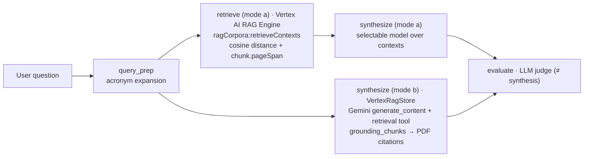

**Ingestion** (`backend/app/ingestion/rag_engine_job.py`, `scripts/provision_rag_engine.py`): reuses active regional `ragEngineConfig` untouched (or defaults fresh projects to `RagManagedDb` Serverless, never calling `unprovisioned`), imports into `rag-arena-procurement` (`512`/`100` chunks, `text-embedding-005`), and provisions an isolated `rag-arena-upl_<12hex>` `RagCorpus` per upload workspace. `vertex-rag-engine-grounded` is Level-2-only.

**Google Cloud products**: **Vertex AI RAG Engine** (`RagCorpus`, `RagManagedDb`, `:retrieveContexts`, `VertexRagStore`), **Vertex AI `text-embedding-005`**, **Cloud Storage**, **Gemini / Claude on Vertex AI**.


## Level 3 architecture — Naive Vector RAG (BigQuery)

**Query path** (`backend/app/engines/level1_naive.py`, `backend/app/evaluation/`):

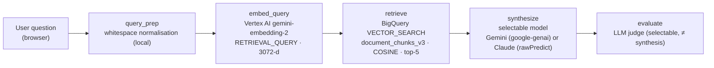

**Ingestion path** (`backend/app/ingestion/{jobs,live_backends}.py`): `discover_docs → parse` (PyMuPDF) `→ chunk` (360/60) `→ embed` (`gemini-embedding-2`) `→ load_bigquery` (staging + transactional replace) `→ build_indexes → verify_counts`.

**Google Cloud products**: **Vertex AI `gemini-embedding-2`**, **BigQuery** (load jobs, `VECTOR_SEARCH` COSINE + IVF index), **Gemini / Claude on Vertex AI**.

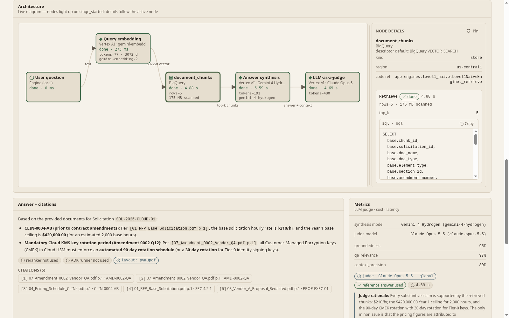

## Level 4 architecture — BigQuery Hybrid + Reranker

**Query path** (`backend/app/engines/level2_hybrid.py`, `backend/app/ingestion/bq_indexer.py`, `backend/app/core/ranking.py`):

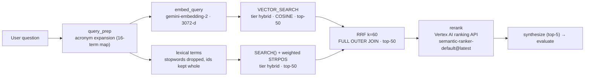

Both legs and Reciprocal Rank Fusion (`1/(60 + vector_rank) + 1/(60 + lexical_rank)`) run as **one parameterized BigQuery statement** ([docs/ARCHITECTURE.md](docs/ARCHITECTURE.md#3b-level-2-query-path-engineslevel2_hybridpy)). **Ingestion** (`hybrid` tier): one chunk per page prefixed with a Contextual Lineage header (solicitation · document · doc type · section).

**Google Cloud products** — Level 3, plus **BigQuery `SEARCH()` + search index** and **Vertex AI ranking API** (`semantic-ranker-default@latest`, 50 → 5).

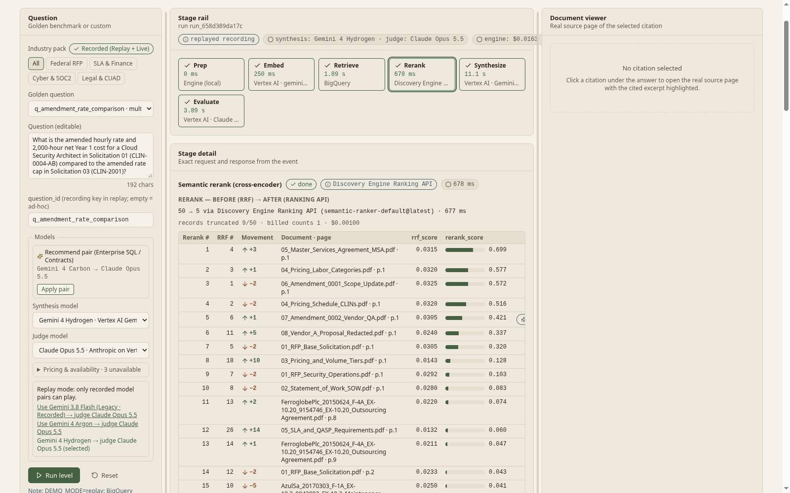

## Levels 5 & 6 architectures — Ephemeral ScaNN (AlloyDB & Vector Search 2.0)

- **Level 5 (`alloydb_scann`, `backend/app/engines/alloydb_scann.py`)**: `query_prep → embed_query → retrieve` (parameterized CTE fusing `alloydb_scann` `<=>` cosine ANN + PostgreSQL `to_tsvector` GIN FTS via in-DB RRF `k=60` over `psycopg` / `alloydb-auth-proxy`, or local AlloyDB Omni Docker) `→ synthesize → evaluate`.
- **Level 6 (`vertex_vector_v2`, `backend/app/engines/vertex_vector_v2.py`)**: `query_prep → embed_query → retrieve` (`vectorsearch.googleapis.com/v1beta` `dataObjects:batchSearch` combining `denseScann` + deterministic CRC32 `sparse_embedding` `knnHint` via server-side `rrf`) `→ synthesize → evaluate`.
- **Google Cloud products**: **AlloyDB for PostgreSQL** (`alloydb_scann` + Auth Proxy), **Vertex AI Vector Search 2.0** (`Collection`, `Index`, `dataObjects:batchSearch`), **Vertex AI `gemini-embedding-2`**, **Gemini / Claude on Vertex AI**. Spin-up → bulk-load from BigQuery → ScaNN training → `DEMO_MODE=record` → teardown (`scripts/ephemeral_{alloydb,vvs2}.sh`) keeps standing idle cost at `$0/mo` ([docs/SETUP_GUIDE.md](docs/SETUP_GUIDE.md)).

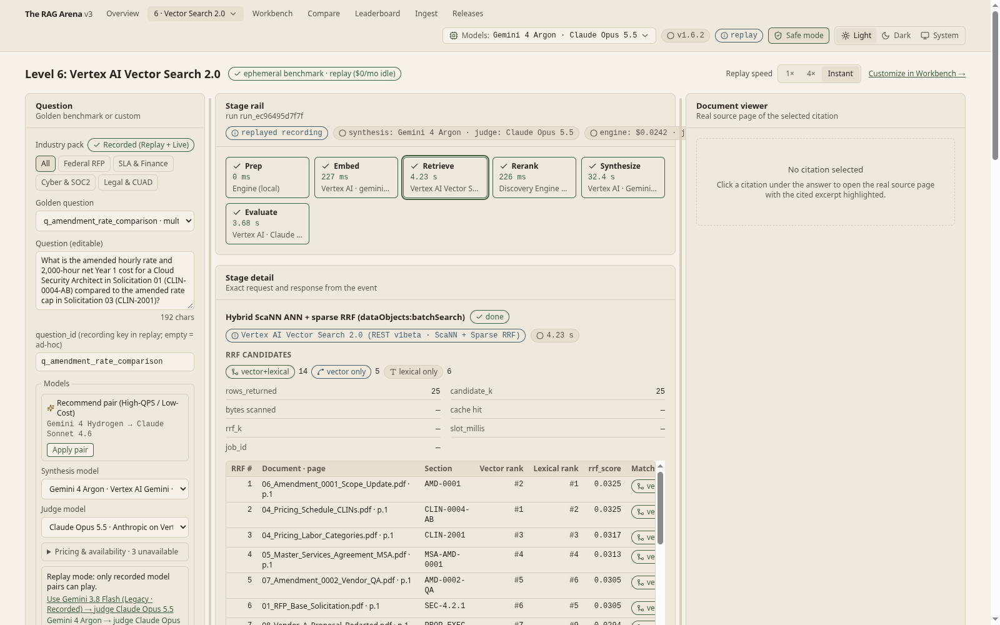

## Level 7 architecture — Layout-Aware Multimodal RAG

**Query path** (`backend/app/engines/level3_multimodal.py`) & **Ingestion** (`backend/app/ingestion/{layout_documentai,vision_transcribe,multimodal,multimodal_job}.py`):

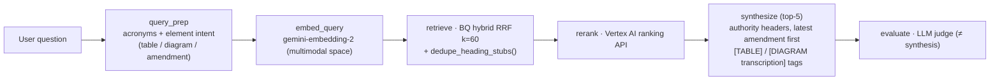

**Ingestion** (`multimodal` tier): Document AI Layout Parser (`≤15`-page splits) + Gemini vision transcription of diagram pages → atomic Markdown tables, heading-grouped paragraphs (heading buffers absorbed into following tables/subheadings), and 1-per-page multimodal diagram chunks (`text + page PNG` embedded via `gemini-embedding-2`). Element boxes come from the PDF text layer (`bbox_source`), and `embedding_multimodal` uses exact brute-force scan ([docs/ARCHITECTURE.md](docs/ARCHITECTURE.md#3c-level-3-query-path-engineslevel3_multimodalpy)).

**Google Cloud products** — Level 4, plus **Document AI Layout Parser** (v1.5), **Gemini Vision**, and **Vertex AI `gemini-embedding-2` multimodal embeddings**.

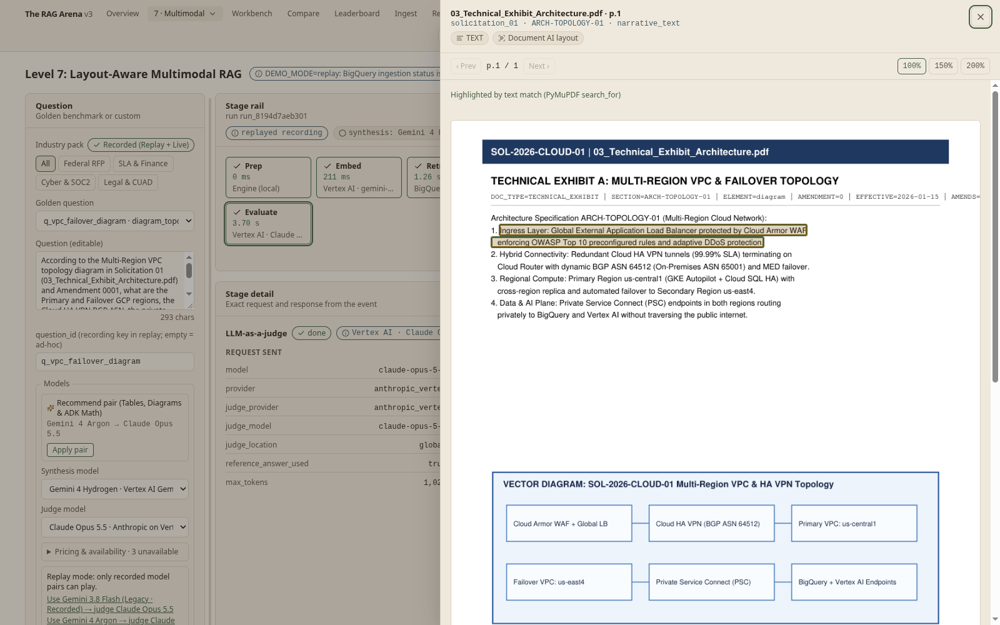

## Level 8 architecture — Agentic RAG (Google ADK)

**Query path** (`backend/app/engines/{level4_agentic,agent_runtime,agent_tools,agent_calculator,agent_verify}.py`; reuses the Level 7 `multimodal` tier):

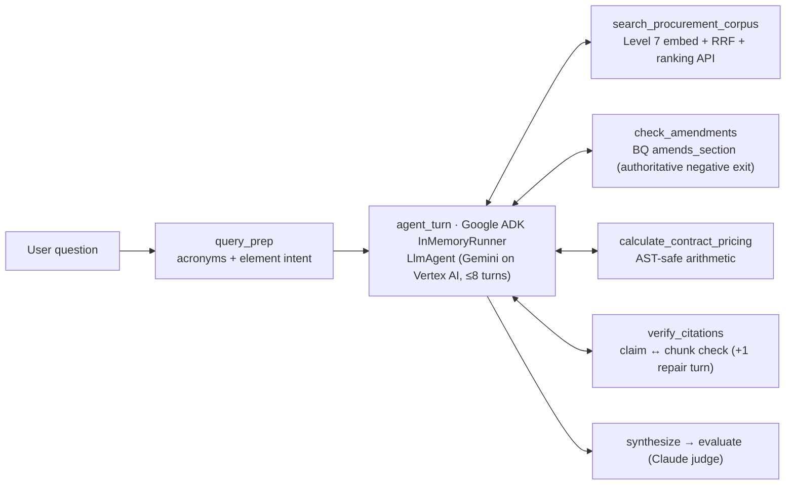

Every model turn, tool call and tool result streams live as an `agent_turn` SSE event; unsupported claims after `verify_citations` trigger one bounded repair turn, and authoritative negative `check_amendments` lookups stop redundant reformulation loops. On upload runs (`upl_*`), `upload_scope` is closure-pinned inside the tools.

**Google Cloud products** — Level 7 retrieval stack, plus **Agent Development Kit (ADK)** (`LlmAgent` + `InMemoryRunner`) driving **Gemini on Vertex AI** and **Claude Opus 5.5** judge.


## Bring your own PDFs (v1.1+)

In `live` / `record` mode, open **`/ingest`** to create a private upload workspace (`upl_<12hex>`) alongside the pre-loaded 45-PDF benchmark corpus:

- **Private bucket & unlimited size**: `UPLOAD_BUCKET_MODE=auto` creates or verifies a dedicated bucket (`<project>-rag-arena-uploads`, PAP enforced, UBLA on, zero public IAM/ACLs, no auto-delete lifecycle). Browser uploads stream straight to Cloud Storage via server-issued, Origin-bound resumable session URIs (`256 KiB` chunks + `308` resume), bypassing Cloud Run's 32 MiB request cap with no app-imposed file-size, page, or count limits.
- **Safety & strict scope isolation**: `/finalize` streams bytes in `O(1)` heap and rejects non-PDFs, encrypted files, `/JS`, `/Launch`, and `/EmbeddedFiles`. Owners are keyed by SHA-256 of the IAP email (`404` for anyone else). Unscoped benchmark queries exclude `upl_*` rows, upload `build_indexes` snapshots index state in `<3 s`, Level 7 requires pre-flight cost confirmation, Level 1 uses an isolated `rag-arena-uploads` store filtered by `workspace_id`, Level 2 creates an isolated `rag-arena-upl_<12hex>` `RagCorpus`, and deleting a workspace cleans BigQuery, VAIS, RAG Engine, and GCS synchronously.
- **Reference-free evaluation & persistent progress**: upload runs grade QA relevance without a golden answer (`reference_answer_used: false`), stay separated under `Scope: Uploads` on the Leaderboard, and stream live progress across navigation via `IngestSessionProvider`. Replay mode exposes zero upload routes or controls.

## Model catalog & recommender

Catalog (`models_catalog.py`), prices (`pricing.py`), cross-family pair recommender (`model_recommender.py`), and live probes (`data/model_verification.json`) sync app-wide via header `GlobalModelPopover`, Overview Advisor, and `<ModelPicker>`. Defaults: `gemini-4-argon` + `claude-opus-5-5` (TCO default: `gemini-4-hydrogen`; `vertex-genai-eval` `$0.75/$3.75`), server-enforced **judge ≠ synthesis** ([docs/ARCHITECTURE.md](docs/ARCHITECTURE.md#4-model-selection-and-evaluation)).

| Model | Id | Provider path | $/1M in / out | Verification (`2026-11-18`) |
| :-- | :-- | :-- | --: | :-- |
| Gemini 4 Hydrogen | `gemini-4-hydrogen` | Vertex AI, google-genai | 1.50 / 7.50 | ✅ HTTP 200 (default fast TCO tier · `48/48` recorded) |
| Gemini 4 Carbon | `gemini-4-carbon` | Vertex AI, google-genai | 2.00 / 10.00 | ✅ HTTP 200 (balanced enterprise) |
| Gemini 4 Argon | `gemini-4-argon` | Vertex AI, google-genai | 2.00 / 10.00 | ✅ HTTP 200 (flagship multimodal/ADK · `64/64` recorded) |
| Claude Sonnet 4.6 | `claude-sonnet-4-6` | Anthropic on Vertex AI, `:rawPredict` | 3.00 / 15.00 | ✅ HTTP 200 (L1–L7 worker / judge) |
| Claude Opus 5.5 | `claude-opus-5-5` | Anthropic on Vertex AI, `:rawPredict` | 4.00 / 20.00 | ✅ HTTP 200 (flagship judge / L1–L7) |
| Gemini 3.8 Flash *(Legacy)* | `gemini-3.8-flash` | Vertex AI, google-genai | 0.75 / 3.75 | ✅ HTTP 200 (`legacy: true` · `55` recorded) |
| Claude Fable 5.2 / 5.1 | `claude-fable-5-{2,1}` | Anthropic on Vertex AI, `:rawPredict` | 10.00 / 50.00 | gated (403 data-sharing / 429 quota) |

## Results (Levels 1–8 · 183 official recordings)

Measured live (`DEMO_MODE=record`) over the 8 golden questions with `claude-opus-5-5` as cross-family judge across **Gemini 4 Hydrogen** (`48/48` standing runs, `0` timeouts) and **Gemini 4 Argon** (`64/64` across all 8 levels; Levels 1–2 also include their managed pseudo-models). **G / QA / CP** = groundedness / QA relevance / context precision (0–1); **B** = Battle Score (0–100); **lat** = engine latency without judge; **eng (tot)** = mean operational engine cost (total incl. judge) per question.

| Architecture (Order A) | Hydrogen G / QA / CP · B | Hydrogen lat · eng (tot) | Argon G / QA / CP · B | Argon lat · eng (tot) |
| :-- | :-: | --: | :-: | --: |
| 1 · Vertex AI Search (segments) | 0.982 / 0.890 / 0.739 · **89.4** | 13.9 s · $0.0220 ($0.0482) | 0.974 / 0.905 / 0.706 · **87.9** | 26.9 s · $0.0288 ($0.0542) |
| 1 · Vertex AI Search (managed summary) | — | — | 0.531 / 0.312 / 0.706 · 51.2 | 3.5 s · $0.0080 ($0.0326) |
| 2 · Vertex AI RAG Engine (`:retrieveContexts`) | 0.990 / 0.931 / 0.506 · **87.8** | 13.9 s · $0.0209 ($0.0593) | 1.000 / 0.975 / 0.456 · **87.6** | 29.8 s · $0.0291 ($0.0664) |
| 2 · Vertex AI RAG Engine (`VertexRagStore`) | — | — | 0.979 / 0.966 / 0.500 · 85.4 | 52.3 s · $0.0273 ($0.0656) |
| 3 · BigQuery Naive Vector | 0.931 / 0.693 / 0.738 · 79.8 | 14.3 s · $0.0146 ($0.0326) | 0.956 / 0.693 / 0.715 · 79.4 | 24.6 s · $0.0187 ($0.0354) |
| 4 · BigQuery Hybrid + Rerank | 0.978 / 0.835 / 0.631 · 85.7 | 11.5 s · $0.0150 ($0.0399) | 0.971 / 0.838 / 0.644 · 84.2 | 28.6 s · $0.0231 ($0.0471) |
| 5 · AlloyDB + ScaNN *(ephemeral)* | — *(Flash: 85.6 · 11.1 s)* | — | 0.978 / 0.845 / 0.619 · 84.9 | 22.4 s · $0.0216 ($0.0458) |
| 6 · Vector Search 2.0 ScaNN *(ephemeral)* | — *(Flash: 85.8 · 19.6 s)* | — | 0.994 / 0.848 / 0.665 · 85.9 | 26.8 s · $0.0221 ($0.0447) |
| 7 · Layout-Aware Multimodal | 0.940 / 0.812 / 0.631 · 83.3 | 13.8 s · $0.0174 ($0.0397) | 0.932 / 0.819 / 0.675 · 82.7 | 27.5 s · $0.0222 ($0.0431) |
| 8 · Agentic RAG (Google ADK) | 0.975 / 0.961 / 0.627 · **88.8** | 21.6 s · $0.0560 ($0.0820) | 0.929 / 0.981 / 0.656 · 85.9 | 45.9 s · $0.0734 ($0.0997) |

**Key findings**: **Gemini 4 Hydrogen** cuts latency roughly in half vs. Argon (`11.5–21.6 s` vs. `24.6–45.9 s`) and completes `8/8` Agentic ADK questions with `0` timeouts (`q_sla_credit_calculation` in `26.1 s`; legacy `gemini-3.8-flash` still archived across `55` runs, with 7/8 on ADK). Level 4 Hybrid lifts QA on superseding amendments (`0.693 → 0.835`); Level 8 ADK closes cross-document arithmetic (`q_cross_solicitation_total_cost` exact `$2,765,500.00`, QA `0.98` Argon / `0.96` Hydrogen); Level 1 Vertex Search segments lead overall Hydrogen Battle Score (`89.4`), while managed summary often declines (`51.2`); Level 2 RAG Engine leads Argon grounding (`1.000`); ephemeral Levels 5–6 deliver sub-400 ms ScaNN hybrid retrieval before tearing down to `$0/mo` idle. Recordings live in [`data/recordings/`](data/recordings/).

## Quickstart

Requirements: Python 3.11+ (3.12 in Docker), Node.js 20+. Live mode also needs the Google Cloud CLI.

### (a) Zero-credential replay

```bash
python3 -m venv .venv
.venv/bin/pip install -r backend/requirements.txt

# terminal 1 — API on :8000, plays data/recordings/** (no GCP calls, no credentials)
DEMO_MODE=replay .venv/bin/python -m uvicorn app.main:app --app-dir backend --port 8000

# terminal 2 — UI on :5173 (Vite proxies /api to :8000)
cd frontend && npm install && npm run dev
```

Open `http://localhost:5173`, pick an architecture, a golden question and a recorded pair, and press Run; `docker compose up --build` serves the same replay on `http://localhost:8080`.

### (b) Live on your own GCP project

```bash
cp .env.example .env            # git-ignored: DEMO_MODE=live|record, GCP_PROJECT_ID, GCP_LOCATION, BQ_TABLE=document_chunks_v3
gcloud auth application-default login
set -a; source .env; set +a
BQ_TABLE=document_chunks ./scripts/bootstrap_gcp.sh            # APIs, corpus bucket, dataset, Layout Parser processor
PYTHONPATH=backend .venv/bin/python scripts/verify_models.py   # writes data/model_verification.json
```

Set `DOCAI_PROCESSOR_ID` (plus `VAIS_*` via `scripts/provision_vertex_search.py`, `RAG_ENGINE_CORPUS_ID` via `scripts/provision_rag_engine.py`, and optional `$0/mo` `MODEL_ARMOR_TEMPLATE_ID` via `scripts/provision_model_armor.py`) in `.env`, start the backend and UI, and open `/ingest`. Full guide: [docs/SETUP_GUIDE.md](docs/SETUP_GUIDE.md).

## Workbench, Compare, Leaderboard & Releases

- **`/workbench`** builds custom RAG recipes (`PipelineSpec` = `IndexProfile` + 8 slots incl. **Model Armor Guardrails**) from 1-click Level 1–8 presets over indexed stores at `$0/mo` standing idle, updating the responsive SVG diagram in `0 ms`.
- **`/compare`** switches between the **Preset Ladder** (Levels 1–8) and the **Controlled Ablation Lab** (2–4 recipes) with Industry Packs, Replay Speed (`1×`/`4×`/`Instant`), **Retrieval Diff Inspector**, and Executive Brief export (`.md`/`.csv`/Print).
- **`/leaderboard`** aggregates live runs (`query_runs`) or `183` committed recordings per `(synthesis, judge)` pair (incl. **Vertex AI GenAI Eval** `:evaluateInstances`), splitting operational **Engine $** (scored) from **Judge $** (unscored).
- **`/releases`** compiles [CHANGELOG.md](CHANGELOG.md), [docs/ARCHITECTURE.md](docs/ARCHITECTURE.md), and [docs/SETUP_GUIDE.md](docs/SETUP_GUIDE.md) directly inside the app with release search, quick-launch pills, and leak checks.
- **Battle Score** (0–100) = 40% QA relevance + 35% groundedness + 15% context precision + 10% efficiency (latency vs 60 s, operational Engine Cost vs $0.20).


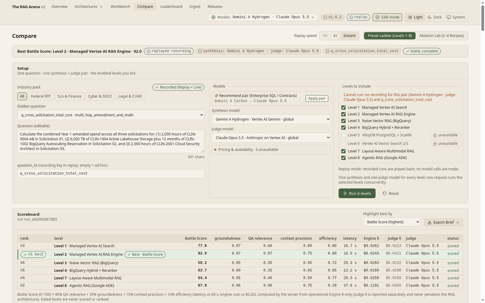

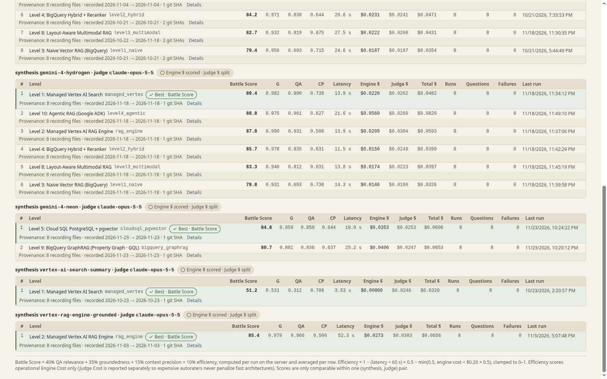


## Deploy to Cloud Run (your own project)

```bash
cp deploy/cloudrun.env.example deploy/cloudrun.env   # git-ignored: project, region, access, upload bucket, replay copy
scripts/deploy_cloudrun.sh --dry-run                  # validates every key, prints the exact plan
scripts/deploy_cloudrun.sh --yes                      # idempotent apply; provisions private upload bucket, Model Armor IAM + services
```

Choices: `REGION` (`us-central1`); `ACCESS_MODE=iap` (only `IAP_MEMBERS`) or `public`; `DEPLOY_REPLAY=true` adds a public replay-only copy (role-less SA, uploads disabled); `LIVE_INGEST=true|false`. Min instances `0` → `$0/mo` idle; `scripts/teardown_cloudrun.sh --yes` removes only what the script created. Details: [docs/SETUP_GUIDE.md](docs/SETUP_GUIDE.md#6-cloud-run).

## API & SSE protocol

| Method & path | Purpose |
| :-- | :-- |
| `GET /api/v1/health` · `GET /api/v1/releases` · `GET /api/v1/levels` · `GET /api/v1/models` | Mode, version & `.env` identity; compiled changelog + docs; Order A level descriptors; catalog + `recorded_pairs` |
| `GET /api/v1/pipelines/presets` · `POST /api/v1/pipelines/validate` | Level 1–8 `PipelineSpec` presets (`pipe_<12hex>`); cross-slot validation + dynamic diagram descriptor |
| `GET /api/v1/benchmarks` · `GET /api/v1/leaderboard?scope=golden\|uploads` · `GET\|POST /api/v1/tco/{defaults,estimate}` | Golden benchmark (8 questions); split Engine/Judge leaderboard; deterministic monthly GCP TCO & workload-fit advisor |
| `POST /api/v1/battle/stream` | Run: `{query, question_id?, engines?, pipelines?, solicitation_filter?, synthesis_model?, judge_model?, replay_speed?, access_persona?}` → SSE |
| `GET /api/v1/acl/personas` | Access personas (`5`), deterministic 45-PDF group visibility summary, per-architecture RLS capabilities, and recorded ACL demos |
| `POST /api/v1/ingest/jobs` · `GET …/jobs/{id}` · `GET …/jobs/{id}/stream` · `GET /api/v1/ingest/status` | Benchmark ingestion jobs, live counts, index states, and owner-scoped `active_jobs` |
| `GET\|POST /api/v1/uploads/bucket` · `GET\|POST /api/v1/uploads` · `GET\|DELETE /api/v1/uploads/{id}` | Private upload bucket check/create; owner-isolated upload workspaces and synchronous cleanup |
| `POST …/uploads/{id}/files` · `POST …/files/{fid}/finalize` · `GET …/estimate` · `POST …/ingest` | Direct-to-GCS resumable session URI, PDF safety validation, L7 cost estimate, scoped ingest |
| `GET /api/v1/documents/page` · `GET /api/v1/documents/highlights` | Corpus or owner-checked uploaded PDF page PNG and excerpt highlights (server-side `403 acl_forbidden` on unauthorized `?persona=`) |

Run streams are `data: {json}\n\n` frames bounded by `MAX_SSE_FRAMES` (600). Events and payloads: [docs/ARCHITECTURE.md](docs/ARCHITECTURE.md#23-sse-protocol).

## Quality & tests

All tests run offline (fakes for Vertex AI, BigQuery, Cloud Storage, Document AI, Vertex AI Search, Vertex AI RAG Engine, AlloyDB, Vertex AI Vector Search 2.0, Model Armor, Vertex GenAI Eval and ADK). Measured 2026-11-20:

| Suite | Checks | What it guards |
| :-- | --: | :-- |
| **Backend total** (`pytest`, 55 files) | **518 passed** | engines (L1–L8), Document ACLs & RLS, model recommender, TCO advisor, Model Armor, Vertex GenAI Eval, workbench, `/releases`, uploads, IAP/CSP |
| `test_v163_document_acls.py` · `test_routes_no_timers.py` · `test_no_silent_fallbacks.py` | 8 · 2 · 3 | 45-PDF ACL partition, narrowing-only access, SQL/RLS/VVS2/VAIS filters, ADK closure-pinning, `403` viewer guard, zero-timer/fallback AST checks |
| `test_recording_redaction.py` · `test_recording_roundtrip.py` | 3 · 6 | `${…}` redaction incl. `${UPLOAD_BUCKET}`, `${MODEL_ARMOR_TEMPLATE_ID}`, `${ALLOYDB_DSN}` and project numbers; replay fidelity |
| `test_tco_calculator.py` · `test_model_recommender.py` · `test_model_armor.py` | 6 · 3 · 8 | bounded TCO & `strict_document_acls` posture, cross-family model pair recommender, Model Armor REST v1 screening/fail-loud |
| `test_vertex_genai_eval.py` · `test_uploads*.py` · `test_auth_and_headers.py` | 9 · 24 · 7 | Vertex `:evaluateInstances` & split cost, bucket privacy, IDOR/replay `404`, ES256 IAP JWT, CSP/headers, `Dockerfile` check |
| `test_rag_engine*.py` · `test_alloydb_scann_engine.py` · `test_vvs2_engine.py` | 19 · 3 · 4 | `:retrieveContexts` + `VertexRagStore`, AlloyDB ScaNN + PostgreSQL RLS + GIN RRF SQL, VVS2 `batchSearch` + `filterFields` schema |
| `test_pipeline_spec.py` · `test_composable_engine.py` · `test_releases_docs.py` | 10 · 8 · 6 | `PipelineSpec` cross-slot validation, `pipe_<12hex>` IDs, `/api/v1/releases` manifest, 6-way version sync |
| `test_publish_manifest.py` · `test_cloudrun_deploy.py` | 5 · 23 | tracked-repo + `frontend/dist` leak scan; SPA/API routing, deploy plan, public-registry lockfiles |
| **Frontend total** (`npm test`, 29 suites) | **238 passed** | Document ACL switcher & RagCorpus warning, TCO wizard, model recommender, WCAG AA tokens, nav menu, responsive SVG, Model Armor, split cost, packs, brief export |

```bash
PYTHONPATH=backend .venv/bin/pytest backend/tests -q            # 518 passed
PYTHONPATH=backend .venv/bin/python scripts/build_docs_manifest.py --check
cd frontend && npm test && npm run build                        # 238 pass across 29 suites + tsc/vite
```

## Repository layout

```text
rag-arena/
├── backend/
│   ├── app/                 api/ · core/ (acl, tco, model_armor, ...) · engines/ (L1–L8 + composable + ADK) · evaluation/ · ingestion/ · recording/
│   └── tests/               518 offline tests + fakes (55 files)
├── frontend/
│   ├── src/                 app/ · features/ (acl/ wizard/ models/ levels/ workbench/ compare/ export/ packs/ releases/ ingest/ uploads/) · components/ · lib/ · pages/ · theme/ styles/ types/
│   └── tests/               29 offline test suites (238 checks)
├── data/                    sample_docs/ (45 PDFs) · golden_benchmarks/ (8 questions) · recordings/ (183 baseline + 6 ACL demo runs)
├── deploy/ · infra/         Cloud Run env template (real file git-ignored) · Terraform (main.tf)
├── scripts/                 bootstrap, provisioning, live & ScaNN benchmark recorders, docs manifest check, deploy/teardown
├── .github/workflows/       release-docs.yml (CI test/leak gate + automated release-please PRs)
├── docs/                    ARCHITECTURE, SETUP_GUIDE, audits, screenshots (12 safe-mode PNGs)
└── Dockerfile · docker-compose.yml · release-please-config.json · .env.example · LICENSE (MIT)
```

## Security & leak hygiene

- **Identity only from git-ignored `.env` / `deploy/cloudrun.env`**; code defaults are empty, recorder redacts project IDs, project numbers, corpus/upload buckets, `RAG_ENGINE_CORPUS_ID`, `ALLOYDB_DSN`, and `VVS2_COLLECTION` to `${…}` placeholders, and **Safe mode** (`?safe=1` or header toggle) masks them in the UI.
- **Document ACLs & private uploads**: narrowing-only persona group resolution (`ceiling ∩ persona`), store-native pre-synthesis RLS/filtering (parameterized SQL/filter arrays, zero string interpolation, closure-pinned ADK tools, `403 acl_forbidden` viewer checks, honest fail-closed `RagCorpus`), IAP owner isolation (SHA-256), Origin-bound resumable GCS sessions, server-side PDF active-content rejection, PNG-only page rendering, and zero upload routes on replay.
- **Cloud Run**: least-privilege service account, no key files, Cloud Build upload leak scan before every build, and explicit bounds/timeouts on every loop, retry, poll and request.

## Roadmap

| Release | Scope | Status |
| :-- | :-- | :-- |
| `v1.0` | Naive, Hybrid + Rerank, Multimodal, ADK Agent, Managed Vertex AI Search, Compare, Leaderboard, Cloud Run (IAP live + optional public replay) | ✅ live |
| `v1.1` / `1.1.1` | Private user PDF uploads across all standing levels (direct-to-GCS resumable upload, Multimodal cost confirmation, isolated VAIS uploads store, `<3 s` index snapshot), reference-free judging | ✅ live |
| `v1.2.0` | Managed Vertex AI RAG Engine (`rag_engine`: `:retrieveContexts` + `VertexRagStore` grounding, isolated `upl_*` `RagCorpus`, minimum-cost provisioning) | ✅ live |
| `v1.3.0` | Composable RAG Workbench (`/workbench`), Controlled 2–4 Recipe Ablation Lab (`/compare`), and Retrieval Diff Inspector | ✅ live |
| `v1.4.0` | Ephemeral ScaNN Benchmarks (AlloyDB + ScaNN, Vertex AI Vector Search 2.0 ScaNN + Sparse RRF, $0/mo standing idle) | ✅ live |
| `v1.5.0` | In-App Releases & Documentation Tab (`/releases`) + deterministic `release-please` & CI drift/leak automation | ✅ live |
| `v1.6.0` | P0 Security, Data Correctness & Terraform Parity (ES256 IAP JWT verification, CSP/headers, >30p upload lift, ScaNN SQL honesty, bounded SSE, v3 Terraform parity) | ✅ live |
| `v1.6.1` | Enterprise Showcase (Order A 1→8 progression, Use-Case Wizard & TCO Calculator, Model Armor Guardrails, Vertex GenAI Eval + Split Engine/Judge Cost, Industry Packs, Executive Brief Export, Replay Speed) | ✅ live |
| `v1.6.2` | Gemini 4 Hydrogen Replay Refresh (`183` recordings), Multimodal & ADK Engine Fixes, Single-Row `"Architectures ▾"` Nav, Responsive Workbench Fit, WCAG AA Contrast, Route Code-Splitting, Model Armor IAM Parity | ✅ live |
| `v1.6.3` | Identity-Aware Document ACLs & Row-Level Security (`5` personas, BigQuery/AlloyDB/VVS2/VAIS native RLS pre-filtering, ADK closure-pinning, `403` viewer guard, honest `RagCorpus` fail-closed, `6` isolated ACL refusal replay demos, Overview `strict_document_acls` TCO preset) | ✅ ready |

## License

The code is released under the [MIT License](LICENSE). Data notices: 18 fictional solicitation PDFs (`scripts/build_procurement_corpus.py`), 27 commercial agreements from [CUAD v1](https://zenodo.org/records/4595826) by The Atticus Project under [CC BY 4.0](https://creativecommons.org/licenses/by/4.0/) (`scripts/download_procurement_corpus.sh`, not relicensed under MIT), and `data/golden_benchmarks/procurement_benchmark.json`.

## Acknowledgements

Built on Google Cloud (Vertex AI, Vertex AI RAG Engine, Vertex AI Vector Search 2.0, AlloyDB for PostgreSQL, BigQuery, Cloud Storage, Vertex AI Search, Document AI, Model Armor, Agent Development Kit, Cloud Run), Anthropic Claude models on Vertex AI, PyMuPDF, Starlette, React, Vite and Tailwind CSS. Contract data from The Atticus Project's CUAD.
