# The RAG Arena — Progressive Enterprise RAG on Google Cloud

**Six RAG architectures, one procurement corpus (or your own PDFs), every stage measured live — pick the right architecture with evidence, not demos.**

      

**Release:** v1.2.0 (2026-11-03, see [CHANGELOG.md](CHANGELOG.md)) · **Status:** all six levels live · private user PDF uploads, Compare, Leaderboard and Cloud Run deployment live.

## The problem

Enterprise procurement packages spread one deal across dozens of PDFs: base RFPs and statements of work (SOWs), price schedules keyed by contract line-item numbers (**CLINs**, e.g. `CLIN-0004-AB`), SLA matrices, architecture diagrams, and later **amendments** that supersede earlier rates and terms:

- **Direct single-file lookups mostly work** on naive vector RAG (QA relevance 0.80–1.00 on our golden set) — which hides deeper failures during toy evaluations.
- **Superseding amendments fail** (Level 1 QA 0.50–0.65): base clauses outrank the later amendment that replaced them when chunks carry no document lineage or authority order.
- **Cross-document arithmetic fails** (Levels 1–3 QA 0.30–0.40): multi-document totals and SLA credit formulas require iterative retrieval and deterministic calculation rather than single-pass top-k synthesis.
- **Complex layouts & custom PDFs vary**: multi-column tables and visual diagrams without embedded text layers require layout parsing and multimodal vision transcription.

Teams choosing a RAG architecture on Google Cloud rarely see measured quality, latency and cost trade-offs on the same data — and many demos fake the pipeline with timers and hardcoded scores.

## How The RAG Arena solves it

- **Six progressively richer architectures** (naive vector → hybrid + rerank → layout multimodal → agentic ADK → managed Vertex AI Search → managed Vertex AI RAG Engine) tested on a **45-PDF benchmark corpus** (8 golden questions) **or your own uploaded PDFs** (v1.1+).
- **Every stage measured and streamed live** over SSE: the real SQL or API request, what came back, backend-measured duration, tokens and cost, drawn on a live architecture diagram.
- **An LLM judge that differs from the synthesis model** (enforced server-side) scores groundedness, QA relevance and context precision — with reference-free judging on uploaded or custom questions; **Compare** and **Leaderboard** highlight the winner by your chosen metric.
- **Zero-credential replay** of 103 recorded real runs, and **one-command Cloud Run deployment** to your own project.

Design guarantees (full principles table: [docs/ARCHITECTURE.md](docs/ARCHITECTURE.md#0-design-principles-v3)):

- **Measured, not simulated** — stage events are emitted inside the engines; the API layer has no timers.
- **Fail loud** — a failed stage emits `stage_failed` + `engine_error`; no silent fallback service or model.
- **No hardcoded scores** — metrics come only from the live judge or from recordings of real runs.
- **Honest labels** — each stage names the service that actually ran (`reranker_used`, `adk_runner_used`, `layout_source`).
- **Replay never improvises** — questions without a recording return `engine_error`, never a made-up answer.

## The architecture ladder

| Level | Engine id | Retrieval & synthesis | What it proves |
| :-- | :-- | :-- | :-- |
| 1 | `level1_naive` | BigQuery `VECTOR_SEARCH` (COSINE, top-5) over 360-char windows, `gemini-embedding-2`, selectable synthesis model | Strong on direct lookups; breaks on amendments and multi-doc math |
| 2 | `level2_hybrid` | Acronym expansion; `VECTOR_SEARCH` ⨝ `SEARCH()` over one-chunk-per-page lineage chunks → RRF (k=60) top-50 → Vertex AI ranking API → top-5 | Recovers superseding amendments and exact identifier recall |
| 3 | `level3_multimodal` | Document AI Layout Parser elements + Gemini vision transcription of diagrams → element-aware chunks with multimodal vectors; hybrid RRF + rerank; authority headers (latest amendment first) | Atomic Markdown tables, diagram vision transcription, amendment ordering |
| 4 | `level4_agentic` | Google ADK `LlmAgent` + `InMemoryRunner` (Gemini, ≤ 8 turns) with search, amendment, pricing-calculator and citation-check tools | Multi-hop supersession, exact cross-document math (QA 1.00), self-verification |
| 5 | `managed_vertex` | Vertex AI Search (Enterprise + LLM add-on) over the corpus or isolated uploads store: extractive segments, answered by the managed summary or a selectable model | Build vs. buy baseline (strong segment retrieval; conservative managed summary) |
| 6 | `rag_engine` | Vertex AI RAG Engine (`RagCorpus` + `RagManagedDb`, `text-embedding-005` 512/100 chunks): `:retrieveContexts` + selectable model or `VertexRagStore` Gemini grounding | Managed corpus-centric RAG vs. DIY BigQuery & Vertex AI Search |

`ENABLED_LEVELS` defaults to all six (Level 5 needs `VAIS_*` keys live; Level 6 needs `RAG_ENGINE_CORPUS_ID` live). Each level page draws its diagram live from `GET /api/v1/levels` + SSE. Vector Search 2.0 / AlloyDB ScaNN engines stay parked (`engines/parked/`, zero GCP resources).

**Cross-cutting Google Cloud products** (all levels and the deployment):

- **Cloud Run** — single container serving UI + API (IAP-protected live service, optional public replay-only copy)
- **Artifact Registry** + **Cloud Build** — image storage and remote builds (no local Docker needed)
- **Identity-Aware Proxy (IAP)** + **IAM** — allowlisted live access, owner-isolated uploads, least-privilege runtime SA (no key files)
- **BigQuery** — `document_chunks_v3`, `query_runs` (Golden set + Uploads scopes) and `ingest_runs`
- **Cloud Storage** — corpus bucket + dedicated private upload bucket (`UPLOAD_BUCKET`, PAP enforced, UBLA on, direct-to-GCS resumable uploads)

## Level 1 architecture

**Query path** (`backend/app/engines/level1_naive.py`, `backend/app/evaluation/`):

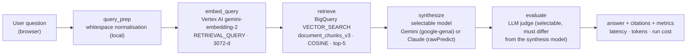

**Ingestion path** (`backend/app/ingestion/{jobs,live_backends}.py`): `discover_docs → parse` (PyMuPDF) `→ chunk` (360/60) `→ embed` (`gemini-embedding-2`) `→ load_bigquery` (staging + transactional scoped replace) `→ build_indexes → verify_counts`.

**Google Cloud products**

- **Vertex AI** — `gemini-embedding-2` embeddings (`RETRIEVAL_DOCUMENT` at ingestion, `RETRIEVAL_QUERY` per question)
- **Gemini on Vertex AI** (Gemini 4 Argon, Gemini 4 Carbon, Gemini 3.8 Flash) or **Anthropic Claude on Vertex AI** — synthesis
- **Claude Opus 5.5 on Vertex AI** — default LLM judge (any verified catalog model ≠ synthesis)
- **BigQuery** — chunk table, load jobs, `VECTOR_SEARCH` (COSINE) with an IVF vector index

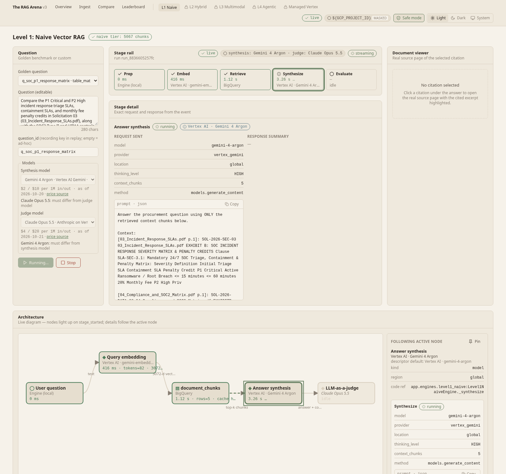

## Level 2 architecture

**Query path** (`backend/app/engines/level2_hybrid.py`, `backend/app/ingestion/bq_indexer.py`, `backend/app/core/ranking.py`):

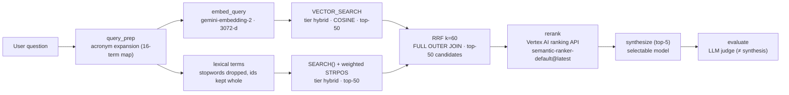

Both legs and Reciprocal Rank Fusion (`1/(60 + vector_rank) + 1/(60 + lexical_rank)`) run as **one parameterized BigQuery statement** ([docs/ARCHITECTURE.md](docs/ARCHITECTURE.md#3b-level-2-query-path-engineslevel2_hybridpy)). **Ingestion** (`hybrid` tier): one chunk per page prefixed with a Contextual Lineage header (solicitation · document · doc type · section).

**Google Cloud products** — Level 1, plus:

- **BigQuery** — `SEARCH()` with a search index, fused with `VECTOR_SEARCH` by RRF in one statement
- **Vertex AI ranking API** (Discovery Engine `rankingConfigs.rank`, `semantic-ranker-default@latest`) — reranks 50 → 5

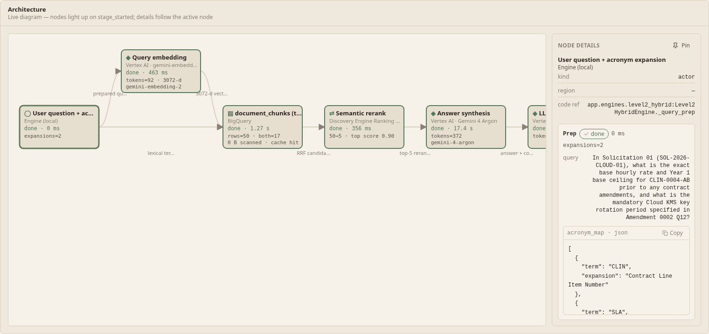

## Level 3 architecture

**Query path** (`backend/app/engines/level3_multimodal.py`):

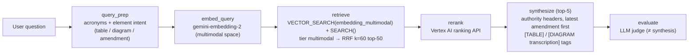

**Ingestion path** (`multimodal` tier; `backend/app/ingestion/{layout_documentai,vision_transcribe,multimodal,multimodal_job}.py`):

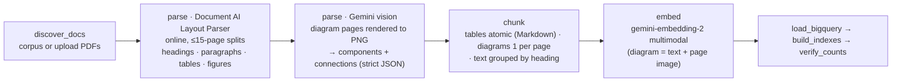

**Google Cloud products** — Level 2, plus:

- **Document AI Layout Parser** (v1.5 release candidate, online `:process`) — headings, paragraphs, tables, figures
- **Gemini on Vertex AI (vision)** — transcribes diagram pages into components + connections (`VISION_MODEL`)
- **Vertex AI `gemini-embedding-2` multimodal embeddings** — diagram chunks embedded as text + rendered page image
- **BigQuery** — `multimodal` tier with element type, layout source, bbox and amendment columns

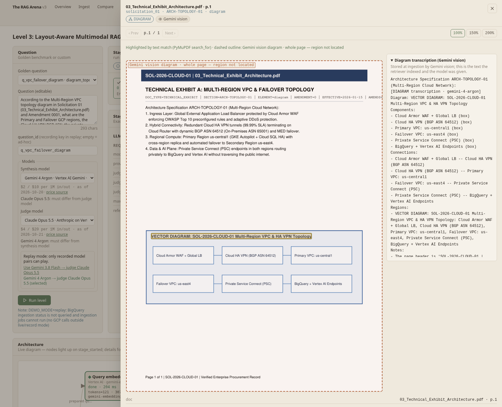

Element boxes come from the PDF text layer (`bbox_source`), unusable vision answers are reported in `vision_failed_pages`, and BigQuery's single-vector-index-per-table limit means `embedding_multimodal` uses exact brute-force scan ([docs/ARCHITECTURE.md](docs/ARCHITECTURE.md#3c-level-3-query-path-engineslevel3_multimodalpy)).

## Level 4 architecture

**Query path** (`backend/app/engines/{level4_agentic,agent_runtime,agent_tools,agent_calculator,agent_verify}.py`; reuses the Level 3 `multimodal` tier):

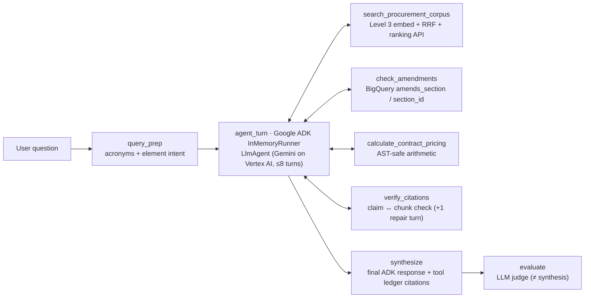

**Google Cloud products** — Level 3 retrieval stack, plus:

- **Agent Development Kit (ADK)** — `LlmAgent` + `InMemoryRunner` driving **Gemini on Vertex AI**
- **BigQuery** — hybrid RRF retrieval tool and parameterized `check_amendments` supersession query
- **Vertex AI ranking API** + **`gemini-embedding-2`** — inside `search_procurement_corpus`
- **Claude Opus 5.5 on Vertex AI** — default judge (Claude is judge-only on Level 4)

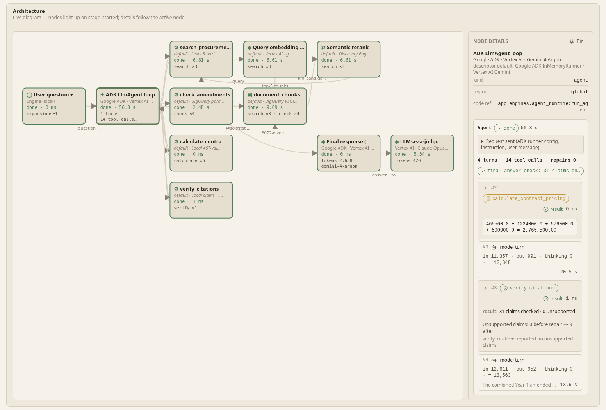

Every model turn, tool call and tool result streams live as an `agent_turn` SSE event; unsupported claims after `verify_citations` trigger one bounded repair turn. On upload runs (`upl_*`), `upload_scope` is closure-pinned inside the tools so prompt-injected PDFs cannot redirect queries to other scopes.

## Level 5 architecture (managed baseline)

**Query path** (`backend/app/engines/{managed_vertex,vais_search}.py`, `backend/app/core/vertex_search.py`):

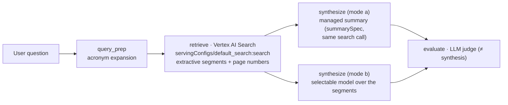

**Ingestion** (`backend/app/ingestion/{gcs_sync,managed_job,managed_upload_job}.py`): corpus syncs changed PDFs to `gs://$GCS_CORPUS_BUCKET` and runs an `INCREMENTAL` import into `rag-arena-procurement`; user uploads write a zero-download `_vais_import.jsonl` (`dataSchema="document"`) into `rag-arena-uploads` with `workspace_id` metadata.

**Google Cloud products**

- **Vertex AI Search** (Enterprise edition + LLM add-on) — isolated corpus and uploads data stores, extractive segments, managed summary
- **Cloud Storage** — corpus bucket and private upload bucket imported via `documents:import`
- **Gemini / Claude on Vertex AI** — mode (b) synthesis over the segments
- **Claude Opus 5.5 on Vertex AI** — default judge

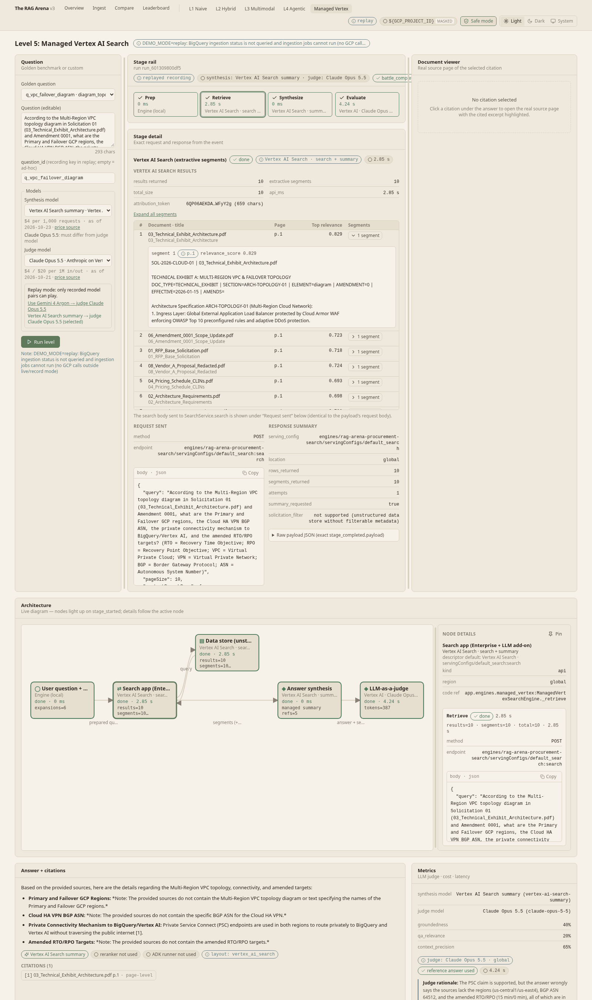

The pseudo model `vertex-ai-search-summary` is Level-5-only (HTTP 400 elsewhere). Citations are page-level (`bbox_source: "page"`).

## Level 6 architecture (managed RAG Engine)

**Query path** (`backend/app/engines/rag_engine.py`, `backend/app/core/rag_engine_client.py`):

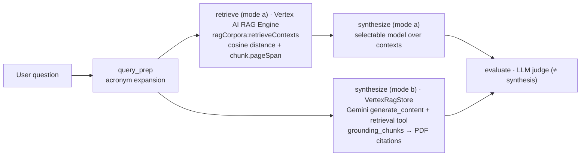

**Ingestion** (`backend/app/ingestion/rag_engine_job.py`, `scripts/provision_rag_engine.py`): reuses active regional `ragEngineConfig` untouched (or defaults fresh projects to `RagManagedDb` Serverless, never calling `unprovisioned`), imports the corpus into `rag-arena-procurement` (`512`-token chunks, `100`-token overlap, `text-embedding-005`), and provisions an isolated `rag-arena-upl_<12hex>` `RagCorpus` per upload workspace (zero local PDF downloads, deleted synchronously on workspace delete).

**Google Cloud products**

- **Vertex AI RAG Engine** (`RagCorpus`, `RagManagedDb`, `:retrieveContexts`, `VertexRagStore` grounding)
- **Vertex AI `text-embedding-005`** — managed corpus & query embeddings
- **Cloud Storage** — corpus and private upload buckets imported directly via `ragFiles:import`
- **Gemini / Claude on Vertex AI** — mode (a) synthesis and `claude-opus-5-5` default judge

The pseudo model `vertex-rag-engine-grounded` is Level-6-only (HTTP 400 elsewhere).

## Bring your own PDFs (v1.1+)

In `live` / `record` mode, open **`/ingest`** to create a private upload workspace (`upl_<12hex>`) alongside the pre-loaded 45-PDF benchmark corpus:

- **Private bucket & unlimited size**: `UPLOAD_BUCKET_MODE=auto` creates or verifies a dedicated bucket (`<project>-rag-arena-uploads`, PAP enforced, UBLA on, zero public IAM/ACLs, no auto-delete lifecycle). Browser uploads stream straight to Cloud Storage via server-issued, Origin-bound resumable session URIs (`256 KiB` chunks + `308` resume), bypassing Cloud Run's 32 MiB request cap with no app-imposed file-size, page, or count limits.
- **Safety & strict scope isolation**: `/finalize` streams bytes in `O(1)` heap and rejects non-PDFs, encrypted files, `/JS`, `/Launch`, and `/EmbeddedFiles`. Owners are keyed by SHA-256 of the IAP email (`404` for anyone else). Unscoped benchmark queries exclude `upl_*` rows, upload `build_indexes` snapshots table index state in `<3 s`, Level 3 requires explicit pre-flight cost confirmation, Level 5 uses an isolated `rag-arena-uploads` store filtered by `workspace_id`, Level 6 creates an isolated `rag-arena-upl_<12hex>` `RagCorpus`, and deleting a workspace removes BigQuery rows, VAIS documents, RAG Engine corpora, and GCS objects synchronously.
- **Reference-free evaluation & persistent progress**: upload runs grade QA relevance without a golden answer (`reference_answer_used: false`, `no reference answer` badge), stay separated under `Scope: Uploads` on the Leaderboard, and stream live progress across page navigation and reloads via `IngestSessionProvider`. Replay mode exposes zero upload routes or controls.

## Model catalog

Catalog in `backend/app/core/models_catalog.py`, prices in `backend/app/core/pricing.py` (published Vertex AI rates with source URL and `price_as_of`), availability in `data/model_verification.json` (`scripts/verify_models.py`), surfaced in a compact `"Pricing & availability"` disclosure inside `<ModelPicker>`.

| Model | Id | Provider path | Input $/1M | Output $/1M | Price as of | Default verification (`data/model_verification.json`) |
| :-- | :-- | :-- | --: | --: | :-- | :-- |
| Gemini 4 Argon | `gemini-4-argon` | Vertex AI, google-genai | 2.00 | 10.00 | 2026-10-20 | ✅ HTTP 200 (2026-10-29) |
| Gemini 4 Carbon | `gemini-4-carbon` | Vertex AI, google-genai | 2.00 | 10.00 | 2026-10-28 | gated until project access (`verify_models.py`) |
| Gemini 3.8 Flash | `gemini-3.8-flash` | Vertex AI, google-genai | 0.75 | 3.75 | 2026-10-21 | ✅ HTTP 200 (2026-10-29) |
| Claude Opus 5.5 | `claude-opus-5-5` | Anthropic on Vertex AI, `:rawPredict` | 4.00 | 20.00 | 2026-10-21 | ✅ HTTP 200 (2026-10-29) |
| Claude Fable 5.1 | `claude-fable-5-1` | Anthropic on Vertex AI, `:rawPredict` | 10.00 | 50.00 | 2026-10-21 | quota-gated (`verify_models.py`, data sharing required) |

Defaults: synthesis `gemini-4-argon`, judge `claude-opus-5-5`; **judge ≠ synthesis is enforced server-side** (HTTP 400), no fallback model. Other billable services (`gemini-embedding-2`, ranking API, Vertex AI Search, Document AI): [docs/ARCHITECTURE.md](docs/ARCHITECTURE.md#4-model-selection-and-evaluation).

## Results (Levels 1–6)

Each level ran the 8 golden questions live (`DEMO_MODE=record`) with two (synthesis, judge) pairs: **Argon** = `gemini-4-argon` + `claude-opus-5-5`, **Flash** = `gemini-3.8-flash` + `claude-opus-5-5` (Level 4 Flash has 7/8: `q_sla_credit_calculation` timed out at 120 s across 6 live attempts and returns `ReplayUnavailableError` in replay; Level 5 & Level 6 also record their managed pseudo-models against `claude-opus-5-5`). Judge-scored **G / QA / CP** = groundedness / QA relevance / context precision (0–1); latency = engine without judge; run cost = engine + judge, mean per question (total in brackets).

| Level | Argon G / QA / CP | Argon latency | Argon run cost (total) | Flash G / QA / CP | Flash latency | Flash run cost (total) |
| :-- | :-: | --: | --: | :-: | --: | --: |
| 1 · naive | 0.956 / 0.693 / 0.715 | 24.6 s | $0.0354 ($0.283) | 0.934 / 0.672 / 0.715 | 14.9 s | $0.0229 ($0.183) |
| 2 · hybrid + rerank | 0.971 / 0.838 / 0.644 | 28.6 s | $0.0471 ($0.377) | 0.984 / 0.855 / 0.637 | 13.8 s | $0.0309 ($0.247) |
| 3 · multimodal | 0.932 / 0.825 / 0.694 | 26.7 s | $0.0428 ($0.342) | 0.963 / 0.825 / 0.704 | 18.4 s | $0.0271 ($0.217) |
| 4 · agentic (ADK) | 0.929 / 0.981 / 0.637 | 47.2 s | $0.1183 ($0.946) | 0.984 / 0.973 / 0.750 *(7/8)* | 44.0 s | $0.0477 ($0.334) |
| 5 · Vertex AI Search, Argon over segments | 0.974 / 0.905 / 0.706 | 26.9 s | $0.0542 ($0.434) | — | — | — |
| 5 · Vertex AI Search managed summary | 0.531 / 0.312 / 0.706 | 3.5 s | $0.0326 ($0.261) | — | — | — |
| 6 · Vertex AI RAG Engine (`:retrieveContexts`) | 1.000 / 0.975 / 0.456 | 29.8 s | $0.0664 ($0.531) | 0.990 / 0.961 / 0.463 | 15.0 s | $0.0476 ($0.380) |
| 6 · Vertex AI RAG Engine (`VertexRagStore` grounded) | 0.979 / 0.966 / 0.500 | 52.3 s | $0.0656 ($0.525) | — | — | — |

Level 2 lifts QA relevance on superseding amendments; Level 3 adds layout-parsed Markdown tables, vision-transcribed diagrams, and amendment authority ordering; Level 4 closes cross-document arithmetic (`q_cross_solicitation_total_cost` QA 0.35 → 1.00, exact `$2,765,500.00` via `calculate_contract_pricing`) at ~1.7× latency and ~2.8× Argon cost. Level 5's extractive segments retrieve well (QA 0.905 with Argon), while its managed summary often declines to answer (QA 0.312); Level 6's `RagCorpus` top-10 `512`-token chunks trade lower context precision (`0.456–0.500` without reranking) for strong recall and grounding across both `:retrieveContexts` (QA `0.975` Argon / `0.961` Flash, Battle Score `87.6` Flash) and `VertexRagStore` Gemini grounding (QA `0.966`). Recordings live in [`data/recordings/`](data/recordings/).

## Quickstart

Requirements: Python 3.11+ (3.12 in the Docker image), Node.js 20+. Live mode also needs the Google Cloud CLI.

### (a) Zero-credential replay

```bash
python3 -m venv .venv
.venv/bin/pip install -r backend/requirements.txt

# terminal 1 — API on :8000, plays data/recordings/** (no GCP calls, no credentials)
DEMO_MODE=replay .venv/bin/python -m uvicorn app.main:app --app-dir backend --port 8000

# terminal 2 — UI on :5173 (Vite proxies /api to :8000)
cd frontend && npm install && npm run dev
```

Open `http://localhost:5173`, pick a level, a golden question and a recorded pair, and press Run; `docker compose up --build` serves the same replay from the single image on `http://localhost:8080`.

### (b) Live on your own GCP project

```bash
cp .env.example .env            # git-ignored: DEMO_MODE=live|record, GCP_PROJECT_ID, GCP_LOCATION, BQ_TABLE=document_chunks_v3
gcloud auth application-default login
set -a; source .env; set +a
BQ_TABLE=document_chunks ./scripts/bootstrap_gcp.sh            # APIs, corpus bucket, dataset, Layout Parser processor
PYTHONPATH=backend .venv/bin/python scripts/verify_models.py   # writes data/model_verification.json
```

Set the printed `DOCAI_PROCESSOR_ID` (plus `VAIS_*` from `scripts/provision_vertex_search.py` for Level 5 and `RAG_ENGINE_CORPUS_ID` from `scripts/provision_rag_engine.py` for Level 6) in `.env`, start the backend and UI, and open `/ingest` to ingest the benchmark corpus or create a private upload workspace. Full guide: [docs/SETUP_GUIDE.md](docs/SETUP_GUIDE.md).

## Compare & Leaderboard

- **`/compare`** runs one question on selected levels concurrently (on the benchmark corpus or an uploaded workspace): stacked live stage rails, side-by-side answers + citations, and a server-computed Battle Score scoreboard.
- **`/leaderboard`** aggregates live runs from BigQuery `query_runs` (`Scope: Golden set | Uploads`) or the committed recordings, one table per (synthesis, judge) pair with provenance per row; scores are never averaged across pairs or scopes.
- **Winner highlighting ("Highlight best by")**: highlights the winning row (and all ties) per table by Battle Score, QA relevance, groundedness, context precision (highest wins), latency, or run cost (lowest wins), persisted across Leaderboard and Compare.
- **Battle Score** (0–100) = 40% QA relevance + 35% groundedness + 15% context precision + 10% efficiency (latency vs 60 s, run cost vs $0.20).

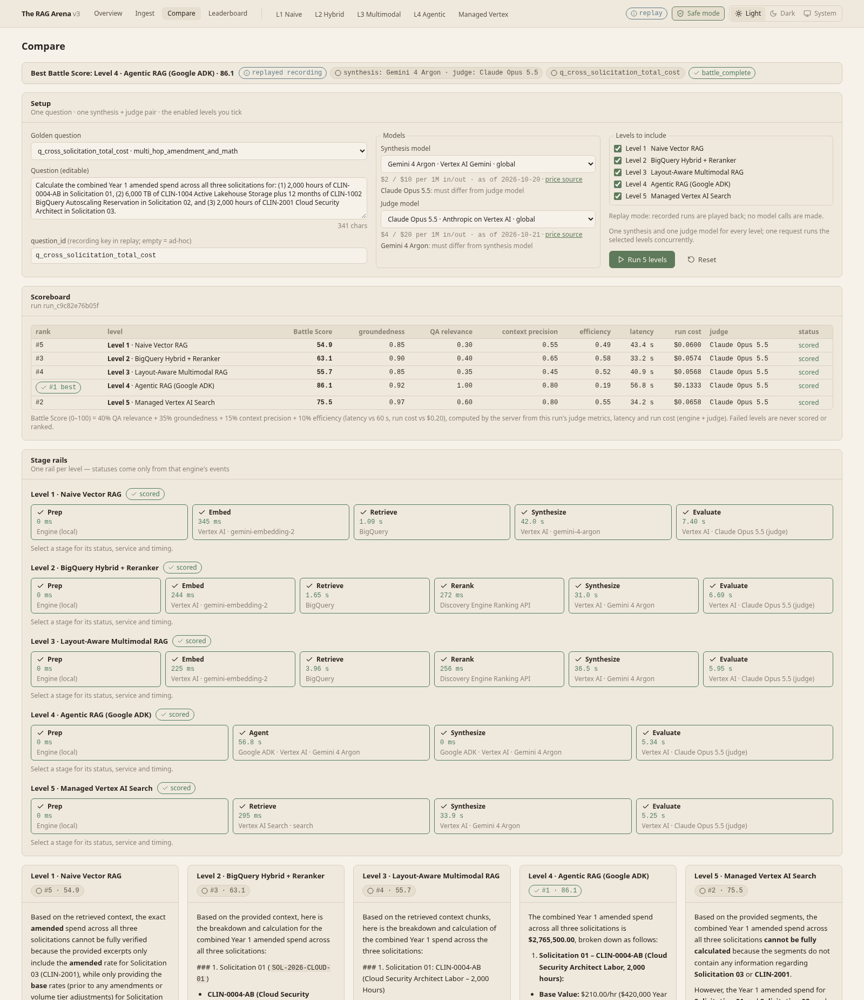

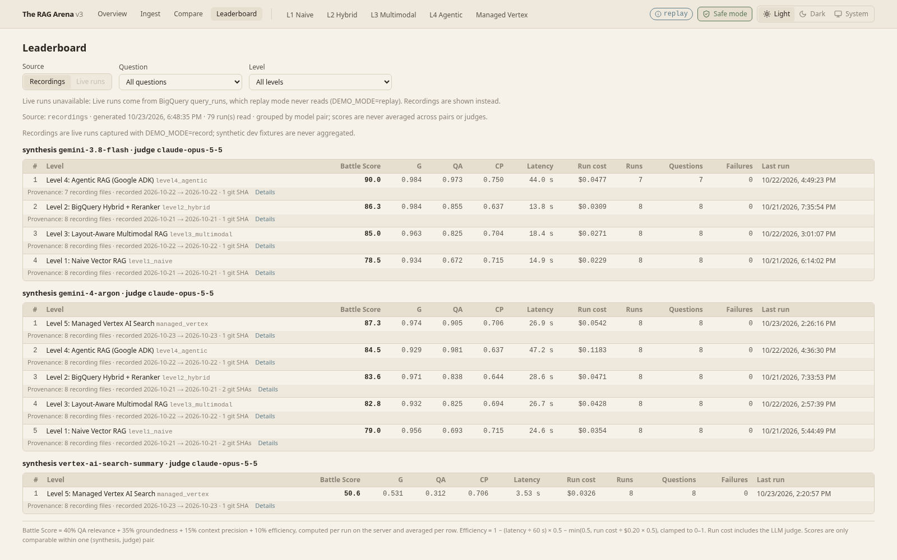

## Deploy to Cloud Run (your own project)

```bash
cp deploy/cloudrun.env.example deploy/cloudrun.env   # git-ignored: project, region, access, upload bucket, replay copy
scripts/deploy_cloudrun.sh --dry-run                  # validates every key, prints the exact plan
scripts/deploy_cloudrun.sh --yes                      # idempotent apply; provisions private upload bucket + services
```

Choices: `REGION` (default `us-central1`); `ACCESS_MODE=iap` (only `IAP_MEMBERS`, e.g. `user:you@example.com`) or `public`; `DEPLOY_REPLAY=true` adds a public replay-only copy (role-less service account, identity hidden, upload routes disabled); `LIVE_INGEST=true|false`. Min instances 0 → $0 when idle; `scripts/teardown_cloudrun.sh --yes` removes only what the script created (preserving your buckets and dataset). Details: [docs/SETUP_GUIDE.md](docs/SETUP_GUIDE.md#6-cloud-run).

## API & SSE protocol

| Method & path | Purpose |
| :-- | :-- |
| `GET /api/v1/health` · `GET /api/v1/levels` · `GET /api/v1/models` | Mode, version and `.env` identity; level descriptors; verified catalog + `recorded_pairs` |
| `GET /api/v1/benchmarks` · `GET /api/v1/leaderboard?scope=golden\|uploads` | Golden benchmark (8 questions); aggregates per (engine, synthesis, judge) with provenance |
| `POST /api/v1/battle/stream` | Run: `{query, question_id?, engines?, solicitation_filter?, synthesis_model?, judge_model?}` → SSE |
| `POST /api/v1/ingest/jobs` · `GET …/jobs/{id}` · `GET …/jobs/{id}/stream` · `GET /api/v1/ingest/status` | Benchmark ingestion jobs, live counts, index states, and owner-scoped `active_jobs` |
| `GET\|POST /api/v1/uploads/bucket` · `GET\|POST /api/v1/uploads` · `GET\|DELETE /api/v1/uploads/{id}` | Private upload bucket check/create; owner-isolated upload workspaces and synchronous cleanup |
| `POST …/uploads/{id}/files` · `POST …/files/{fid}/finalize` · `GET …/estimate` · `POST …/ingest` | Direct-to-GCS resumable session URI, PDF safety validation, L3 cost estimate, scoped L1–L3/L5/L6 ingest |
| `GET /api/v1/documents/page` · `GET /api/v1/documents/highlights` | Corpus or owner-checked uploaded PDF page PNG and excerpt highlight rectangles |

Run streams are `data: {json}\n\n` frames bounded by `MAX_SSE_FRAMES` (600). Events, fields and per-level payloads: [docs/ARCHITECTURE.md](docs/ARCHITECTURE.md#23-sse-protocol) (§2.3, §3).

## Quality & tests

All tests run offline (fakes for Vertex AI, BigQuery, Cloud Storage, Document AI, Vertex AI Search, Vertex AI RAG Engine and ADK). Measured 2026-11-03:

| Suite | Checks | What it guards |
| :-- | --: | :-- |
| **Backend total** (`pytest`, 38 files) | **415 passed** | engines, scoped uploads, ingestion, API/SSE, evaluation, recording, deployment |
| `test_routes_no_timers.py` · `test_no_silent_fallbacks.py` | 2 · 3 | no API-layer stage pacing; AST scan of `engines/**` against swallowed errors/fallbacks |
| `test_recording_redaction.py` · `test_recording_roundtrip.py` | 3 · 6 | `${…}` redaction incl. `${UPLOAD_BUCKET}`, `${RAG_ENGINE_CORPUS_ID}` and project numbers; replay fidelity |
| `test_model_selection.py` · `test_judges.py` | 20 · 17 | judge ≠ synthesis, role/level gates (`vertex-rag-engine-grounded`); golden and reference-free judge parsing |
| `test_uploads.py` · `test_upload_security.py` | 15 · 9 | bucket privacy, resumable sessions, IDOR/replay `404` matrices, unscoped SQL isolation, L4 `upload_scope` pinning, `O(1)` streaming |
| `test_rag_engine.py` · `test_rag_engine_client.py` · `test_rag_engine_ingest.py` | 7 · 6 · 6 | `:retrieveContexts` + `VertexRagStore` grounding, safe `ragEngineConfig` reuse, isolated `upl_*` `RagCorpus` lifecycle |
| `test_publish_manifest.py` · `test_cloudrun_deploy.py` | 5 · 23 | tracked-repo + `frontend/dist` leak scan; SPA/API routing, deploy plan, public-registry lockfiles |
| **Frontend total** (`npm test`, 18 suites) | **182 passed** | stream reducer, per-level views (L1–L6), uploads, persistent ingest sessions, winner highlight, bootstrap retry, safe mode |

```bash
PYTHONPATH=backend .venv/bin/pytest backend/tests -q   # 415 passed
cd frontend && npm test                                 # 182 pass across 18 suites
cd frontend && npm run build                            # tsc + vite build
```

## Repository layout

```text
rag-arena/
├── backend/
│   ├── app/
│   │   ├── api/             REST routes, uploads API, SSE forwarder, documents, query_runs, SPA serving
│   │   ├── core/            config, telemetry, GCP client lock, model catalog, pricing, ranking, architectures
│   │   ├── engines/         Levels 1–6, ADK runtime + scoped tools, replay; parked/
│   │   ├── evaluation/      LLM judges (golden + reference-free), evaluator, Battle Score, leaderboard
│   │   ├── ingestion/       job runner, upload bucket/store, PyMuPDF / Document AI / vision, BQ + VAIS + RAG Engine loaders
│   │   └── recording/       recorder, store, redaction
│   └── tests/               415 offline tests + fakes (38 files)
├── frontend/
│   ├── src/
│   │   ├── app/             router, shell, bootstrap retry, sessions, persistent ingest session, safe mode
│   │   ├── features/        levels/ · compare/ · ingest/ · uploads/
│   │   ├── components/      UI primitives, document drawer and viewer
│   │   ├── lib/             API client, bounded SSE reader, winner highlight, safe-mode masking
│   │   ├── pages/           overview, leaderboard
│   │   └── theme/ styles/ types/   themes, design tokens, SSE + API types
│   └── tests/               18 offline test suites (182 checks)
├── data/                    sample_docs/ (45 PDFs) · golden_benchmarks/ (8 questions) · recordings/ (103 runs)
├── deploy/                  Cloud Run env template (real file git-ignored)
├── scripts/                 bootstrap, provisioning, model check, corpus build, deploy/teardown
├── infra/                   Terraform (main.tf)
├── docs/                    ARCHITECTURE, SETUP_GUIDE, audits, screenshots
├── Dockerfile · docker-compose.yml · .env.example · LICENSE (MIT)
```

## Security & leak hygiene

- **Identity only from git-ignored `.env` / `deploy/cloudrun.env`**; code defaults are empty, recorder redacts project IDs, project numbers, corpus/upload buckets, and `RAG_ENGINE_CORPUS_ID` to `${…}` placeholders, and **Safe mode** (`?safe=1` or header toggle) masks them in the UI.
- **Private uploads**: IAP owner isolation (SHA-256), Origin-bound resumable GCS sessions, server-side PDF active-content rejection, PNG-only page rendering, parameterized SQL, closure-pinned L4 tool scopes, isolated L5/L6 upload stores/corpora, and zero upload routes on the public replay service.
- **Cloud Run**: least-privilege service account, no key files, Cloud Build upload leak scan before every build, and explicit bounds/timeouts on every loop, retry, poll and request.

## Roadmap

| Release | Scope | Status |
| :-- | :-- | :-- |
| `v1.0` | Levels 1–5 (naive, hybrid + rerank, multimodal, ADK agent, managed Vertex AI Search), Compare, Leaderboard, Cloud Run (IAP live + optional public replay) | ✅ live |
| `v1.1` | Private user PDF uploads across all levels (direct-to-GCS resumable upload, L3 cost confirmation, isolated L5 uploads store), reference-free judging, Leaderboard/Compare winner highlighting | ✅ live |
| `v1.1.1` | Upload ingestion `build_indexes` fast-path (`~58 s` → `<3 s` via table index snapshot) | ✅ live |
| `v1.2.0` | Level 6 Managed Vertex AI RAG Engine (`rag_engine`: `:retrieveContexts` + `VertexRagStore` grounding, isolated `upl_*` `RagCorpus`, minimum-cost provisioning) | ✅ live |

## License

The code is released under the [MIT License](LICENSE). Data notices:

- **Generated procurement corpus**: 18 interconnected solicitation PDFs across 3 solicitations (`scripts/build_procurement_corpus.py`); fictional, for benchmarking only.
- **CUAD**: 27 commercial agreements from the [Contract Understanding Atticus Dataset (CUAD) v1](https://zenodo.org/records/4595826) by The Atticus Project, licensed [CC BY 4.0](https://creativecommons.org/licenses/by/4.0/) (fetched by `scripts/download_procurement_corpus.sh`, not relicensed under MIT).
- **Golden benchmark**: `data/golden_benchmarks/procurement_benchmark.json`.

## Acknowledgements

Built on Google Cloud (Vertex AI, Vertex AI RAG Engine, BigQuery, Cloud Storage, Vertex AI Search, Document AI, Agent Development Kit, Cloud Run), Anthropic Claude models on Vertex AI, PyMuPDF, Starlette, React, Vite and Tailwind CSS. Contract data from The Atticus Project's CUAD.
