# The RAG Arena — Progressive Enterprise RAG on Google Cloud (v3)

The RAG Arena is a Google Cloud reference application that climbs the production RAG maturity curve one level
at a time on a single domain — **Enterprise IT & Cloud Procurement** (RFPs, SOWs, CLIN rate cards, SLA
matrices, architecture exhibits, superseding amendments). You pick a level, ask a question, and watch the real
pipeline execute: every stage lights up when the backend actually enters it, shows the exact SQL or API
request it sent, what came back, and the measured duration, cost and LLM-judge scores.

**Status: Levels 1–2 live · Levels 3–5 in progress.** Level 1 (naive vector RAG) and Level 2 (BigQuery hybrid
RRF + Discovery Engine Ranking API) have each run end-to-end on a live GCP project (ingestion, queries,
recordings). Compare, Levels 3–5 and the Cloud Run deployment are planned and are marked as such everywhere
below.

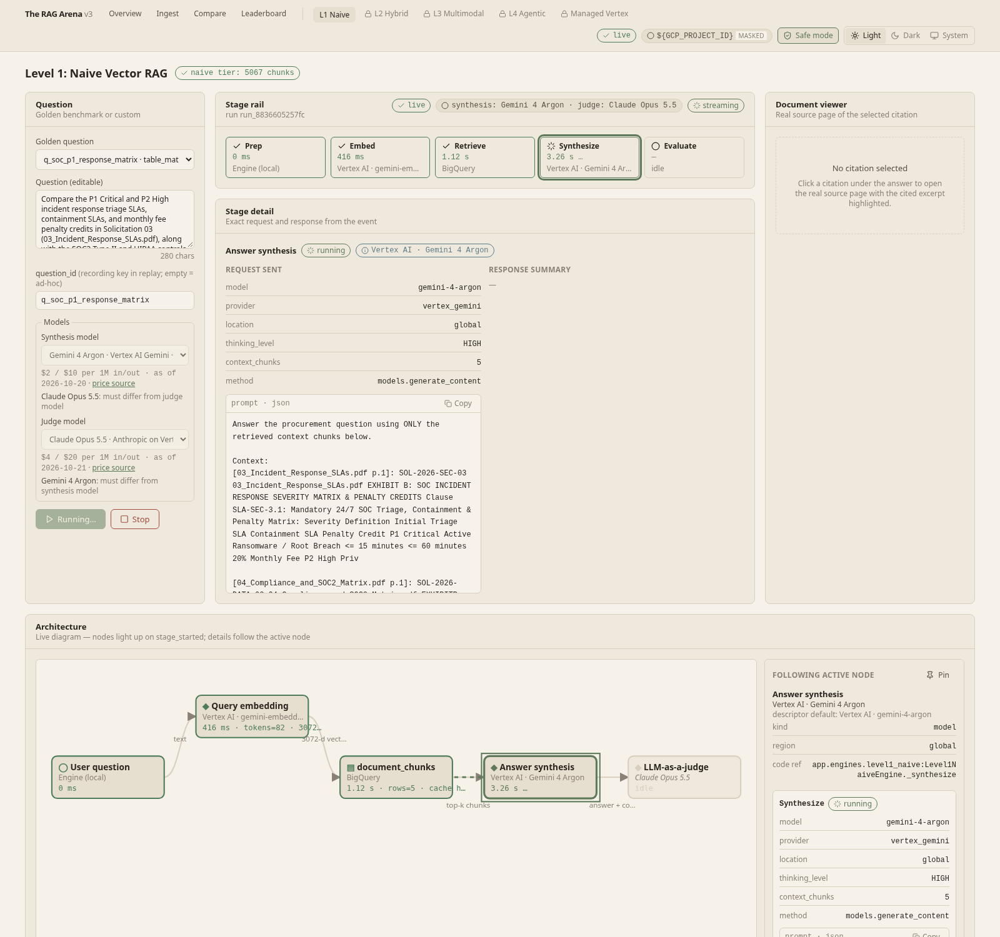

---

## Why v3: measured, not simulated

v2 shipped seven engines, but an audit ([`docs/audits/2026-10-20-v2-authenticity-audit.md`](docs/audits/2026-10-20-v2-authenticity-audit.md))
found timer-driven stage events, silent fallbacks to local files, a Python-scripted "agent" trace and
hardcoded evaluation scores. v3 rebuilds the product around six rules:

| # | Principle | How it is enforced in the code |
| :-- | :-- | :-- |
| P1 | **Measured, not simulated** — every stage event is emitted inside the engine when the stage starts/ends, with a backend-measured `duration_ms`. | `core/telemetry.py` (`StageEmitter`); `routes.py` only forwards events — `test_routes_no_timers.py` guards it. |
| P2 | **Fail loud** — no silent fallback or impersonation; a failed stage emits `stage_failed`, then `engine_error`. | `test_no_silent_fallbacks.py` (AST scan of `engines/**`). |
| P3 | **No hardcoded scores** — live metrics come only from the LLM judge; replay metrics come from recordings of real live runs. | `EngineResult` has no `eval_metrics`; recordings carry a provenance header. |
| P4 | **One level at a time** — `ENABLED_LEVELS` gates the registry, navigation and Compare. | `core/config.py`; locked levels render a "Locked" card. |
| P5 | **Honest labels** — a stage is labelled with the service that actually ran. | `stage_started.service`, `EngineFlags` (`reranker_used`, `adk_runner_used`, `layout_source`). |
| P6 | **Zero-credential replay** — `DEMO_MODE=replay` streams recorded events with their original timing. | `engines/replay_engine.py`; ad-hoc questions in replay return `engine_error`, never an improvised answer. |

---

## The architecture ladder

| Level | Engine id | Retrieval & synthesis | What it proves | Status |
| :-- | :-- | :-- | :-- | :-- |
| 1 | `level1_naive` | BigQuery `VECTOR_SEARCH` (COSINE, top-5) over 360-char windows, `gemini-embedding-2`, selectable synthesis model | The baseline — and its failure modes: identifiers blurred, tables scrambled, no amendment awareness | ✅ live |
| 2 | `level2_hybrid` | Acronym expansion; BigQuery `VECTOR_SEARCH` ⨝ `SEARCH()` lexical over one-chunk-per-page lineage chunks → RRF (k=60) top-50 → Discovery Engine Ranking API (`semantic-ranker-default@latest`) → top-5 | Exact identifier recall; reranker precision | ✅ live |
| 3 | `level3_multimodal` | Document AI Layout Parser + Gemini vision transcription of diagram pages, multimodal embeddings, authority headers | Tables and diagrams answered correctly | 🔒 planned |
| 4 | `level4_agentic` | Real Google ADK `Runner` with retrieval, amendment lookup, pricing math and citation-check tools | Multi-hop supersession, deterministic math, self-verification | 🔒 planned |
| 5 | `managed_vertex` | Vertex AI Search data store (extractive segments + summary) | Build vs. buy baseline | 🔒 planned |

Levels 3–5 still contain their v2 bodies in `backend/app/engines/` but are **not enabled**: they run under one
measured `legacy` stage and emit `stage_skipped` for the canonical stages until their phase rebuilds them.
`ENABLED_LEVELS` defaults to `level1_naive`; set `ENABLED_LEVELS=level1_naive,level2_hybrid` to enable Level 2.
Vertex AI Vector Search 2.0 and AlloyDB ScaNN engines are parked in `backend/app/engines/parked/` (excluded
from the registry).

---

## Level 1 architecture

**Query path** (`backend/app/engines/level1_naive.py`, `backend/app/evaluation/`):

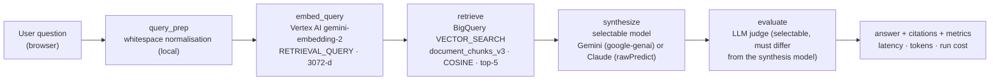

**Ingestion path** (`backend/app/ingestion/jobs.py`, `backend/app/ingestion/live_backends.py`):

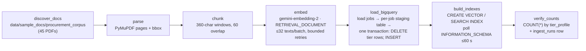

The UI draws the same graph live from `GET /api/v1/levels` (design metadata only — nodes, edges, code
references); all state on it comes from SSE events.

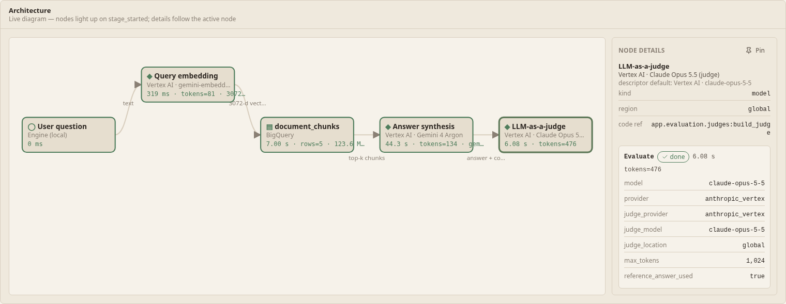

---

## Level 2 architecture

**Query path** (`backend/app/engines/level2_hybrid.py`, `backend/app/ingestion/bq_indexer.py`,
`backend/app/core/ranking.py`):

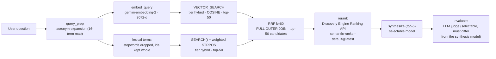

Both retrieval legs and the fusion run as **one parameterized BigQuery statement**: the vector leg ranks by
cosine distance, the lexical leg ranks by `SEARCH()` all-terms match then a weighted `STRPOS` term score
(identifier terms containing digits count ×3), and fusion scores each chunk
`1/(60 + vector_rank) + 1/(60 + lexical_rank)` (a missing leg contributes 0).

**Ingestion path** (`hybrid` tier, same job runner as Level 1):

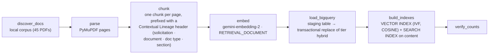

CUAD agreements are labelled `doc_type = COMMERCIAL_AGREEMENT` at parse time (never as an RFP or amendment),
so the lineage header tells both the ranker and the synthesis model what kind of document a page comes from.

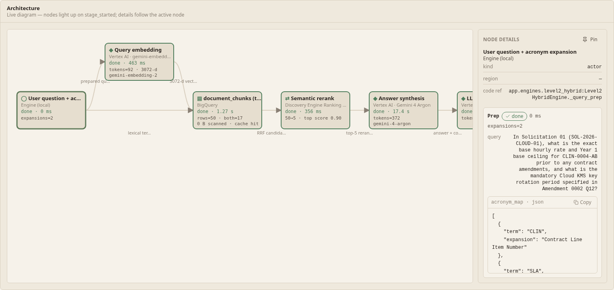

---

## Stage-by-stage walkthrough

Every value below is read from the stage event payloads emitted by the engine (and recorded verbatim in
`data/recordings/`).

### `query_prep`
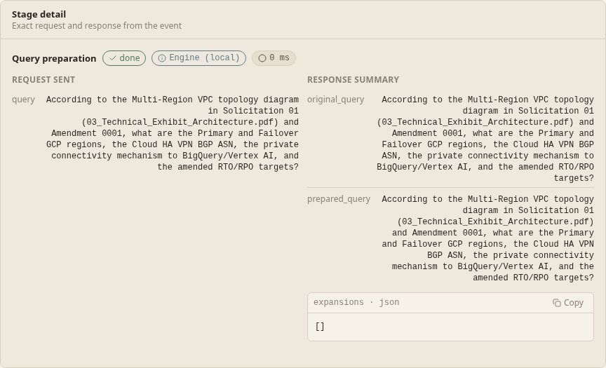
- Shows `original_query`, `prepared_query` and `expansions` (always empty at Level 1 — no acronym expansion yet).
- Runs locally; its measured duration is typically 0 ms.

### `embed_query`
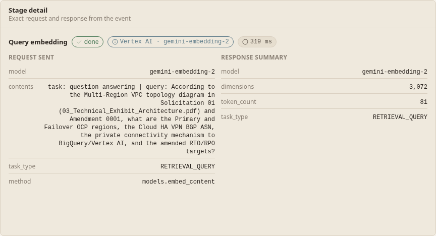
- Exact request: model, `task_type=RETRIEVAL_QUERY`, the formatted `contents`, method `models.embed_content`.
- Response: `dimensions` (3072) and the `token_count` reported by Vertex AI (billed at the embedding rate).

### `retrieve`
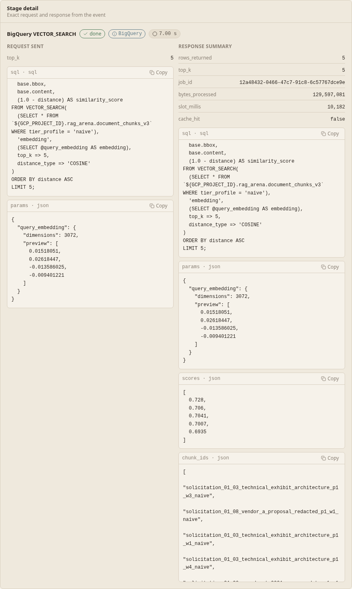
- The parameterized `VECTOR_SEARCH` SQL actually sent (the query vector is a parameter; a 4-dim preview is shown).
- `rows_returned`, similarity `scores[]`, `chunk_ids`, BigQuery `job_id`, `bytes_processed`, `slot_millis`, `cache_hit`.
- Brute-force scans read ≈130 MB per query (129,597,081 bytes in the recordings); BigQuery cache hits show 0 bytes.

### `synthesize`
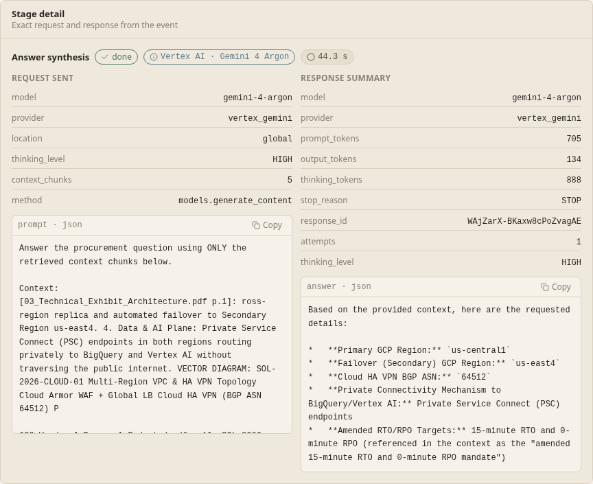
- The grounded prompt (system instruction + top-5 chunks + question) and the selected model.
- `prompt_tokens`, `output_tokens`, `thinking_tokens` from the provider's usage block (never estimated), `stop_reason`, `attempts`.

### `evaluate`
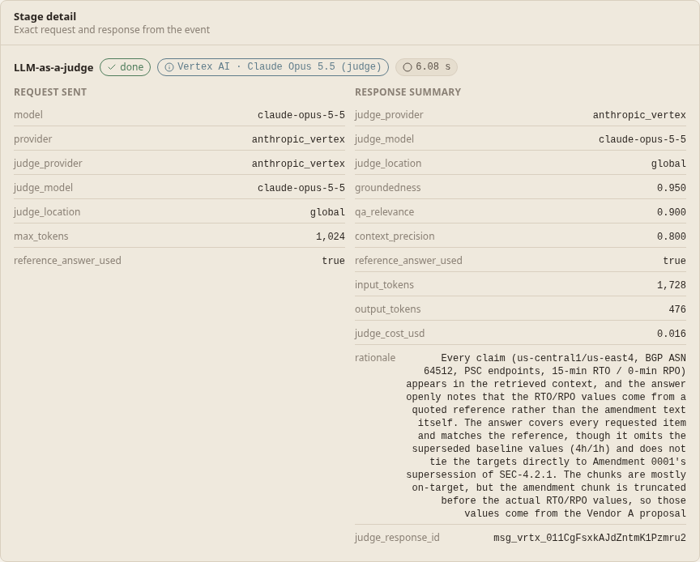
- The judge returns strict JSON: groundedness, QA relevance (against the golden reference answer when the question is a golden one), context precision, rationale.
- Judge tokens and judge cost are shown; the run cost is engine cost + judge cost.

### Citations & document viewer
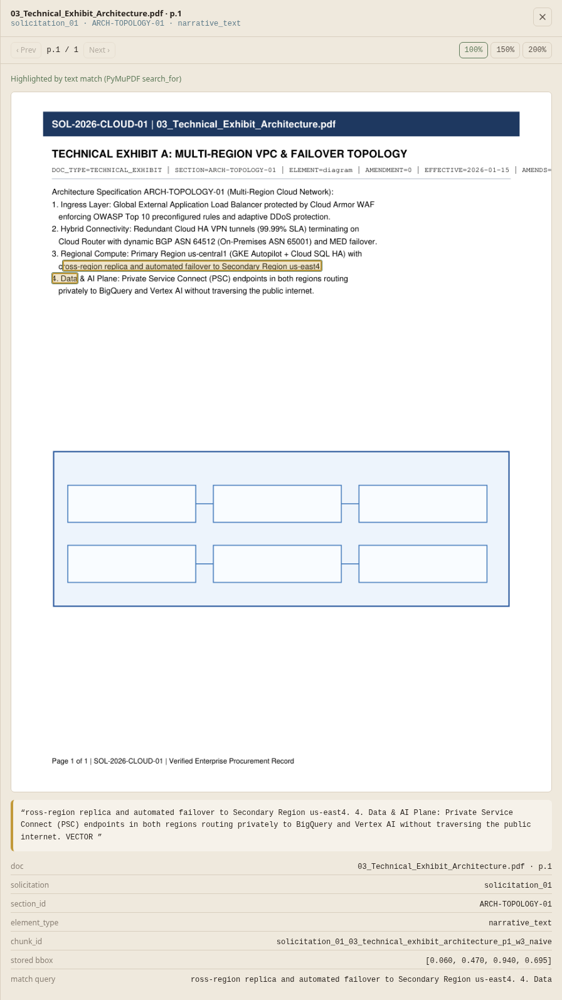
- Clicking a citation opens a drawer with the real PDF page rendered by PyMuPDF (`GET /api/v1/documents/page`).
- Highlights come from `GET /api/v1/documents/highlights` (`page.search_for` on the excerpt); `matched:false` is shown when nothing matches.

### Model picker
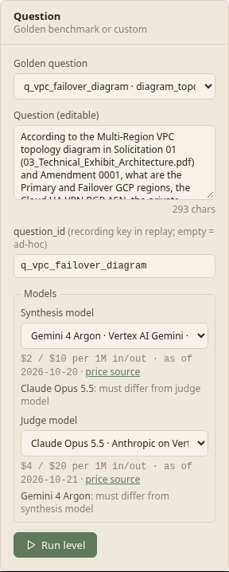
- Choose the synthesis and judge model per run from the verified catalog (`GET /api/v1/models`).
- Judge ≠ synthesis is enforced in the UI and again on the server (HTTP 400). In replay, only recorded pairs can run.

### Ingestion job & ingest status
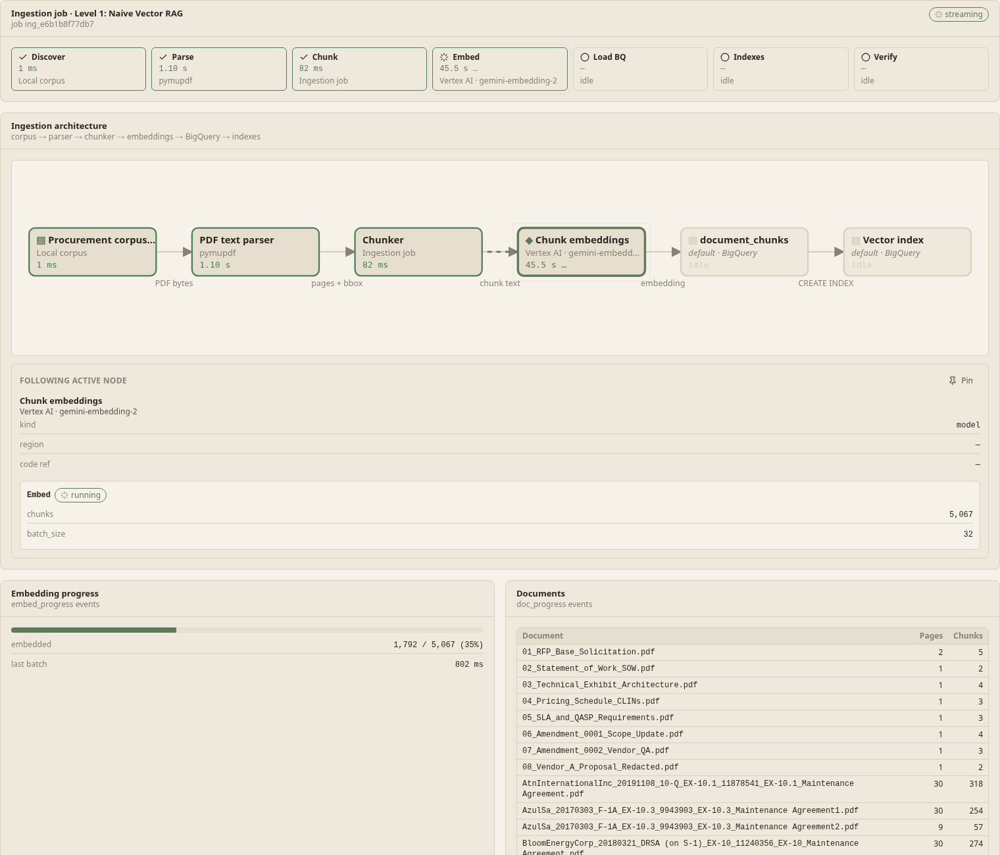
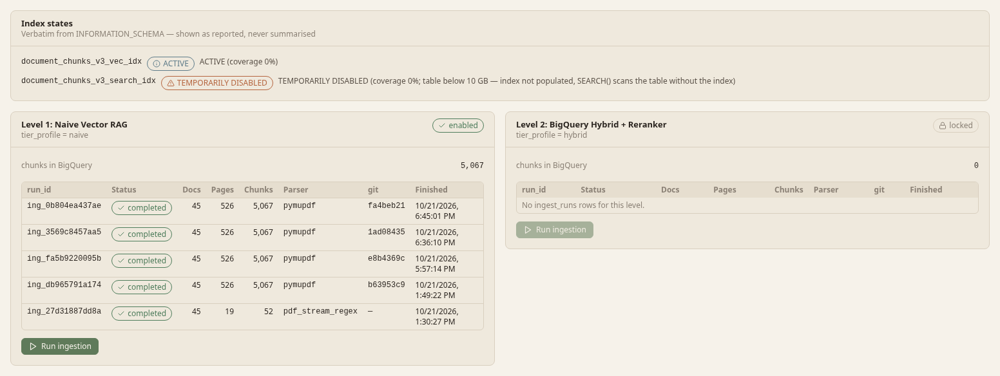
- `/ingest` starts a visible job per level with its own SSE stream (stage rail, per-document progress, embed progress).
- Status shows live `COUNT(*)` per tier and index states exactly as BigQuery reports them (e.g. a vector index `ACTIVE` with low coverage, or a search index `TEMPORARILY DISABLED` on tables below 10 GB).

### Leaderboard
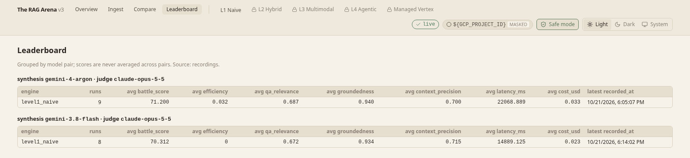
- `GET /api/v1/leaderboard` aggregates recordings of real runs per (engine, synthesis model, judge model) — never across pairs, since different judges are different scales.
- Every row carries provenance (`recorded_at`, `git_sha`, model ids); the Battle Score is 40% QA relevance + 35% groundedness + 15% context precision + 10% efficiency.

### Dark mode & overview
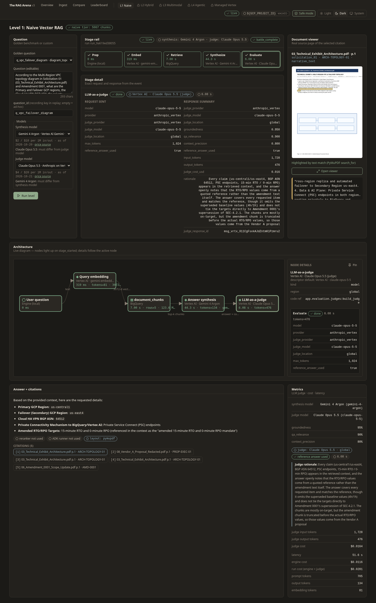
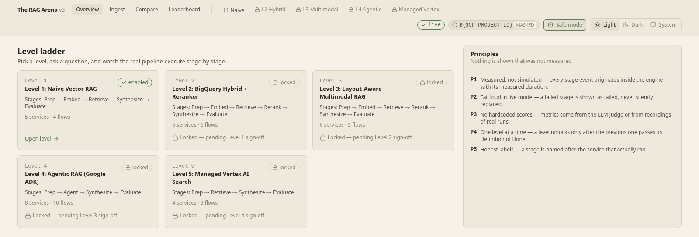
- Light / dark / system theme (persisted locally); earthy, low-chroma design tokens.
- The overview shows the five-level ladder; locked levels say which sign-off they are waiting for.

---

## Level 2 walkthrough

Level 2 adds a visible `rerank` stage and richer payloads for `query_prep` and `retrieve`; `embed_query`,
`synthesize` and `evaluate` work as in Level 1 (shared stage bodies in `engines/common_stages.py`), with
synthesis context labelled `[doc | Sec: … | p.N]` and up to 6,000 characters per chunk.

### `query_prep` — acronym expansion
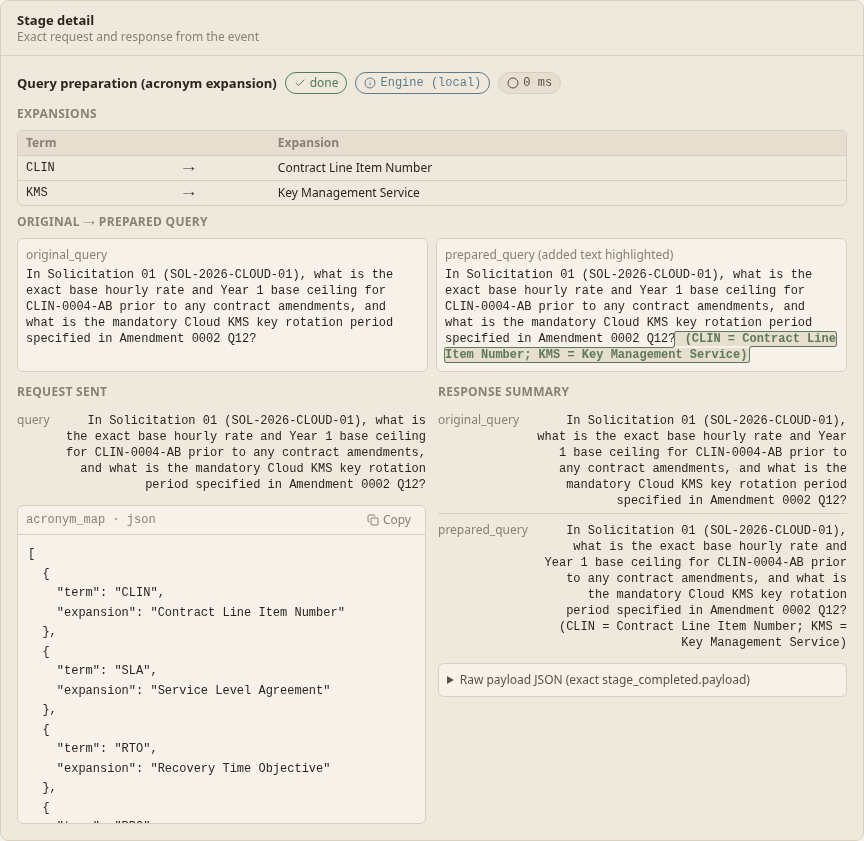
- A deterministic 16-entry map (CLIN, SLA, RTO, RPO, QASP, PEP, SOW, RFP, MSA, ZTA, VPC, VPN, BGP, ASN, KMS,
  GKE) expands upper-case acronyms as whole tokens (`CLIN-0004-AB` counts as CLIN).
- The payload lists every applied expansion; the prepared query is the original plus a glossary suffix, and
  the UI shows the word-level diff. The embedding uses the prepared query; lexical terms use the original.

### `retrieve` — hybrid RRF candidates
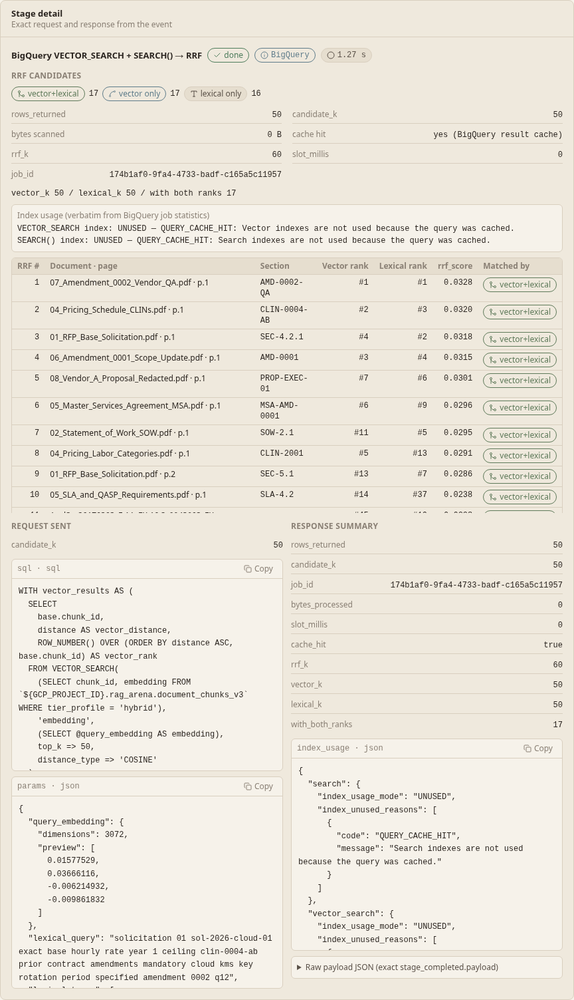
- The exact hybrid SQL and parameters (`@query_embedding` preview, `@lexical_query`, `@lexical_terms`).
- Up to 50 candidates, each with `vector_rank`, `lexical_rank` (null when that leg missed it),
  `vector_distance` and `rrf_score`; `with_both_ranks` counts chunks found by both legs.
- BigQuery job facts: `job_id`, `bytes_processed`, `slot_millis`, `cache_hit`, and `index_usage` — BigQuery's own
  `indexUsageMode` and unused-index reasons for the search and vector indexes, verbatim.

### `rerank` — Discovery Engine Ranking API
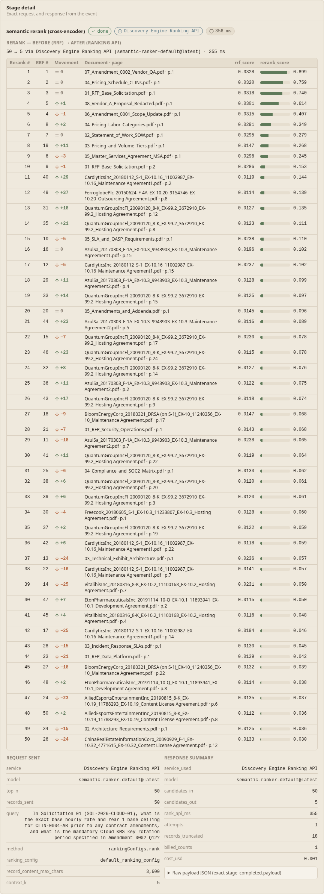
- All RRF candidates are sent in one `rankingConfigs.rank` call (title = document + section, content truncated
  to 3,600 characters to stay under the model's per-record token limit; `records_truncated` says how many).
- Every candidate gets a rerank score; the UI shows RRF rank → rerank rank movement, and the top
  `RERANK_TOP_N` (5) go to synthesis, citations and the judge.
- Measured `rank_api_ms`, `attempts`, `billed_counts` and `cost_usd`. A Ranking API error fails the stage —
  there is no heuristic or lexical fallback ranker.

---

## Model catalog

The catalog is defined in `backend/app/core/models_catalog.py`; prices come from `backend/app/core/pricing.py`
(published Vertex AI rates with source URL and `price_as_of`); availability comes from
`data/model_verification.json`, written by `scripts/verify_models.py` (one bounded live call per model).

| Model | Id | Provider path | Endpoint | Input $/1M | Output $/1M | Price as of | Verified |
| :-- | :-- | :-- | :-- | --: | --: | :-- | :-- |
| Gemini 4 Argon | `gemini-4-argon` | Vertex AI, google-genai `generate_content` | `global` | 2.00 | 10.00 | 2026-10-20 | ✅ HTTP 200, 2026-10-21 |
| Gemini 3.8 Flash | `gemini-3.8-flash` | Vertex AI, google-genai `generate_content` | `global` | 0.75 | 3.75 | 2026-10-21 | ✅ HTTP 200, 2026-10-21 |
| Claude Opus 5.5 | `claude-opus-5-5` | Anthropic on Vertex AI, `:rawPredict` | `global` | 4.00 | 20.00 | 2026-10-21 | ✅ HTTP 200, 2026-10-21 |
| Claude Fable 5.1 | `claude-fable-5-1` | Anthropic on Vertex AI, `:rawPredict` | `global` | 10.00 | 50.00 | 2026-10-21 | ✅ HTTP 200, 2026-10-21 |

- Price notes from `pricing.py`: Gemini 4 Argon is an introductory global rate through 2026-11-30; Gemini 3.8
  Flash is introductory through 2026-12-31 ($1.50 / $7.50 from 2027-01-01); output rates include thinking
  tokens. Claude Opus 5.5 is the global rate for ≤ 200K input tokens; Claude Fable 5.1 regional endpoints are
  $11 / $55. Query embeddings use `gemini-embedding-2` at $0.20 / 1M input tokens.
- Defaults: synthesis `GEMINI_FAST_MODEL` (`gemini-4-argon`), judge `JUDGE_MODEL` (`claude-opus-5-5`).
  Endpoint location defaults to `global`; override per model with `MODEL_LOCATION_<ID>`.
- **Judge ≠ synthesis is enforced server-side** (`ModelCatalog.select`): unknown, unavailable or identical
  models are rejected with HTTP 400 before any streaming. There is no fallback model.
- Claude models are called through the Vertex AI `global` endpoint with `:rawPredict`
  (`anthropic_version: vertex-2023-10-16`, ADC bearer token, no `temperature`). Retries are bounded (≤ 3
  attempts) and only on 429 / 500 / 503 / timeouts.
- **Claude Fable** additionally requires Anthropic data sharing to be enabled on your project (a one-time
  `setPublisherModelConfig` call; see [Live on your own GCP project](#b-live-on-your-own-gcp-project)). Until
  then `verify_models.py` records the 403 and the catalog marks Fable unavailable with that reason.
- `data/model_verification.json` in the repo reflects the author's project. Re-run `verify_models.py` on yours.

**Ranking API (Level 2).** `semantic-ranker-default@latest` via
`POST https://discoveryengine.googleapis.com/v1/projects/<project>/locations/global/rankingConfigs/default_ranking_config:rank`
(REST, ADC bearer token, `x-goog-user-project` header; ≤ 3 attempts, retries only on 429 / 500 / 503 /
timeouts; `RANKING_TIMEOUT_SECONDS`, default 30). Price from `pricing.py`: **$1.00 per 1,000 counts**, where one
count is one rank query of up to 100 documents (each further started block of 100 is another count); source
`https://cloud.google.com/generative-ai-app-builder/pricing`, `price_as_of` 2026-10-21. A Level 2 query
sends 50 records = 1 count = $0.001, included in the engine cost.

---

## Results so far (Levels 1–2)

Computed from the 16 committed recordings in
[`data/recordings/level1_naive/`](data/recordings/level1_naive/): two (synthesis, judge) pairs × the 8 golden
questions, all recorded live on 2026-10-21 with `DEMO_MODE=record`. Each file has a provenance header
(`recorded_at`, `git_sha`, `model_ids`, `demo_mode`) and identity values redacted to placeholders.

- **Argon** = synthesis `gemini-4-argon`, judge `claude-opus-5-5` (git `d790d4f` / `52a5697`)
- **Flash** = synthesis `gemini-3.8-flash`, judge `claude-opus-5-5` (git `692f574`)

Scores are groundedness / QA relevance / context precision (0–1). Latency is the engine run
(query_prep → synthesize), excluding the judge. Run cost = engine cost (embedding + synthesis tokens) + judge cost.

| Question | Failure mode | Argon G / QA / CP | Argon latency | Argon run cost | Flash G / QA / CP | Flash latency | Flash run cost |
| :-- | :-- | :-: | --: | --: | :-: | --: | --: |
| `q_exact_clin_lookup` | exact clause & CLIN | 1.00 / 1.00 / 0.80 | 16.5 s | $0.0203 | 1.00 / 1.00 / 0.85 | 8.7 s | $0.0140 |
| `q_vpc_failover_diagram` | diagram topology | 0.97 / 0.92 / 0.80 | 18.0 s | $0.0287 | 0.90 / 0.90 / 0.80 | 8.2 s | $0.0203 |
| `q_zero_trust_pep_diagram` | diagram topology | 0.98 / 0.97 / 0.82 | 17.0 s | $0.0272 | 0.97 / 0.88 / 0.82 | 7.4 s | $0.0177 |
| `q_soc_p1_response_matrix` | table / matrix | 1.00 / 0.80 / 0.70 | 20.0 s | $0.0312 | 1.00 / 0.80 / 0.65 | 16.1 s | $0.0236 |
| `q_data_lakehouse_addendum` | multi-hop amendment & math | 1.00 / 0.65 / 0.85 | 20.7 s | $0.0298 | 1.00 / 0.65 / 0.80 | 19.0 s | $0.0219 |
| `q_amendment_rate_comparison` | multi-hop amendment & math | 0.90 / 0.50 / 0.65 | 32.8 s | $0.0447 | 0.85 / 0.40 / 0.70 | 25.8 s | $0.0288 |
| `q_sla_credit_calculation` | multi-hop amendment & math | 0.95 / 0.40 / 0.55 | 28.0 s | $0.0411 | 0.95 / 0.50 / 0.55 | 22.7 s | $0.0308 |
| `q_cross_solicitation_total_cost` | multi-hop amendment & math | 0.85 / 0.30 / 0.55 | 43.4 s | $0.0600 | 0.80 / 0.25 / 0.55 | 11.3 s | $0.0260 |
| **Average (8)** | | **0.956 / 0.693 / 0.715** | **24.6 s** | **$0.0354** | **0.934 / 0.672 / 0.715** | **14.9 s** | **$0.0229** |

Breakdown of the averages:

| Pair | Engine cost | Judge cost | Run cost | Total, 8 runs | Synthesize | Retrieve | Embed | Judge |
| :-- | --: | --: | --: | --: | --: | --: | --: | --: |
| Argon | $0.0187 | $0.0167 | $0.0354 | $0.2830 | 22.9 s | 1.1 s | 0.30 s | 5.0 s |
| Flash | $0.0068 | $0.0161 | $0.0229 | $0.1830 | 10.5 s | 3.9 s | 0.31 s | 4.8 s |

How to read this honestly:
- **Level 1 fails the multi-hop / amendment questions by design.** Groundedness stays high (answers stick to
  the retrieved text), but QA relevance drops to 0.25–0.65 on the four `multi_hop_amendment_and_math`
  questions: top-5 dense retrieval over 360-character windows has no amendment awareness and does not
  assemble base clause + superseding amendment + rate table. Levels 2–4 exist to fix exactly this.
- These are single runs scored by a single LLM judge. Treat differences of a few hundredths as noise, and do
  not compare scores across different judges.
- Retrieve times differ between pairs because every Argon-pair query was a BigQuery cache hit (0 bytes
  processed), while 7 of 8 Flash-pair queries scanned ≈130 MB.
- Reproduce the tables from the files: each recording's `evaluation.metrics`, `result.latency_ms`,
  `result.cost_usd` and `evaluation.judge_cost_usd`.

### Level 1 vs Level 2

Computed the same way from the 16 Level 2 recordings in
[`data/recordings/level2_hybrid/`](data/recordings/level2_hybrid/) (same two pairs, same 8 questions,
recorded live on 2026-10-21; git `d1d530b` / `5f5e665`). Level 2 engine cost includes the $0.001 rank call.

**Argon** (synthesis `gemini-4-argon`, judge `claude-opus-5-5`):

| Question | L1 G / QA / CP | L2 G / QA / CP | L1 latency | L2 latency | L1 run cost | L2 run cost |
| :-- | :-: | :-: | --: | --: | --: | --: |
| `q_exact_clin_lookup` | 1.00 / 1.00 / 0.80 | 1.00 / 1.00 / 0.85 | 16.5 s | 21.2 s | $0.0203 | $0.0380 |
| `q_vpc_failover_diagram` | 0.97 / 0.92 / 0.80 | 1.00 / 1.00 / 0.75 | 18.0 s | 17.9 s | $0.0287 | $0.0350 |
| `q_zero_trust_pep_diagram` | 0.98 / 0.97 / 0.82 | 0.92 / 0.92 / 0.35 | 17.0 s | 20.3 s | $0.0272 | $0.0441 |
| `q_soc_p1_response_matrix` | 1.00 / 0.80 / 0.70 | 1.00 / 1.00 / 0.50 | 20.0 s | 27.9 s | $0.0312 | $0.0487 |
| `q_data_lakehouse_addendum` | 1.00 / 0.65 / 0.85 | 1.00 / 1.00 / 0.85 | 20.7 s | 31.3 s | $0.0298 | $0.0431 |
| `q_amendment_rate_comparison` | 0.90 / 0.50 / 0.65 | 1.00 / 0.88 / 0.85 | 32.8 s | 25.9 s | $0.0447 | $0.0499 |
| `q_sla_credit_calculation` | 0.95 / 0.40 / 0.55 | 0.95 / 0.50 / 0.35 | 28.0 s | 51.7 s | $0.0411 | $0.0609 |
| `q_cross_solicitation_total_cost` | 0.85 / 0.30 / 0.55 | 0.90 / 0.40 / 0.65 | 43.4 s | 33.2 s | $0.0600 | $0.0574 |
| **Average (8)** | **0.956 / 0.693 / 0.715** | **0.971 / 0.838 / 0.644** | **24.6 s** | **28.6 s** | **$0.0354** | **$0.0471** |

**Flash** (synthesis `gemini-3.8-flash`, judge `claude-opus-5-5`):

| Question | L1 G / QA / CP | L2 G / QA / CP | L1 latency | L2 latency | L1 run cost | L2 run cost |
| :-- | :-: | :-: | --: | --: | --: | --: |
| `q_exact_clin_lookup` | 1.00 / 1.00 / 0.85 | 1.00 / 1.00 / 0.75 | 8.7 s | 7.7 s | $0.0140 | $0.0255 |
| `q_vpc_failover_diagram` | 0.90 / 0.90 / 0.80 | 1.00 / 1.00 / 0.70 | 8.2 s | 7.8 s | $0.0203 | $0.0276 |
| `q_zero_trust_pep_diagram` | 0.97 / 0.88 / 0.82 | 1.00 / 0.95 / 0.40 | 7.4 s | 9.5 s | $0.0177 | $0.0258 |
| `q_soc_p1_response_matrix` | 1.00 / 0.80 / 0.65 | 0.97 / 1.00 / 0.45 | 16.1 s | 8.5 s | $0.0236 | $0.0331 |
| `q_data_lakehouse_addendum` | 1.00 / 0.65 / 0.80 | 1.00 / 0.97 / 0.80 | 19.0 s | 10.2 s | $0.0219 | $0.0295 |
| `q_amendment_rate_comparison` | 0.85 / 0.40 / 0.70 | 1.00 / 0.97 / 0.90 | 25.8 s | 11.3 s | $0.0288 | $0.0313 |
| `q_sla_credit_calculation` | 0.95 / 0.50 / 0.55 | 1.00 / 0.60 / 0.40 | 22.7 s | 42.5 s | $0.0308 | $0.0377 |
| `q_cross_solicitation_total_cost` | 0.80 / 0.25 / 0.55 | 0.90 / 0.35 / 0.70 | 11.3 s | 12.8 s | $0.0260 | $0.0363 |
| **Average (8)** | **0.934 / 0.672 / 0.715** | **0.984 / 0.855 / 0.637** | **14.9 s** | **13.8 s** | **$0.0229** | **$0.0309** |

Level 2 averages broken down:

| Pair | Engine cost | Judge cost | Run cost | Total, 8 runs | Synthesize | Retrieve | Rerank | Embed | Judge |
| :-- | --: | --: | --: | --: | --: | --: | --: | --: | --: |
| Argon | $0.0231 | $0.0241 | $0.0471 | $0.3770 | 26.6 s | 1.3 s | 0.30 s | 0.28 s | 4.3 s |
| Flash | $0.0085 | $0.0223 | $0.0309 | $0.2468 | 12.2 s | 1.1 s | 0.28 s | 0.21 s | 3.6 s |

What changed, honestly:
- **QA relevance rose** from 0.693 → 0.838 (Argon) and 0.672 → 0.855 (Flash). The biggest gains are
  `q_amendment_rate_comparison` (0.50 → 0.88, 0.40 → 0.97), `q_data_lakehouse_addendum` (0.65 → 1.00 / 0.97) and
  `q_soc_p1_response_matrix` (0.80 → 1.00). `q_sla_credit_calculation` and `q_cross_solicitation_total_cost`
  stay at 0.35–0.60: they need multi-step math across documents, which is Level 4's job.
- **Context precision fell** (0.715 → 0.644 / 0.637). On three questions the reranker promoted CUAD commercial
  agreements into the top 5 — identically in both pairs: `q_zero_trust_pep_diagram` (an outsourcing agreement
  from RRF #33 to rerank #3; CP 0.35 / 0.40), `q_soc_p1_response_matrix` (RRF #43 → #4 and #49 → #5; CP 0.50 /
  0.45) and `q_sla_credit_calculation` (#5 → #2 and #33 → #4; CP 0.35 / 0.40).
- **BigQuery did not use the search index.** On every uncached recorded retrieve it reports
  `indexUsageMode=UNUSED` for the search index with "The search index cannot be used when a vector search index
  is used." (vector index `PARTIALLY_USED`); the lexical leg still runs, just without the index.
- **13 of 16 Level 2 retrieves were BigQuery result-cache hits** (0 bytes processed, reason
  `QUERY_CACHE_HIT`); the 3 uncached ones processed 18,213,995 bytes. Recorded retrieve times are therefore
  mostly cache-hit times.
- **Cost and latency** rise mainly because whole-page chunks make prompts larger: average synthesis prompt
  ≈ 2,660 tokens vs ≈ 750 at Level 1, and judge input ≈ 4,000–4,200 vs ≈ 1,950–2,120 tokens. The rerank call
  itself costs $0.001 and took 0.23–0.36 s.

---

## Quickstart

Requirements: Python 3.11+ (3.12 in the Docker image), Node.js 20+. Live mode also needs the Google Cloud CLI
(`gcloud`, `bq`).

### (a) Zero-credential replay

```bash
python3 -m venv .venv
.venv/bin/pip install -r backend/requirements.txt

# terminal 1 — API on :8000, plays data/recordings/** (no GCP calls, no credentials)
DEMO_MODE=replay .venv/bin/python -m uvicorn app.main:app --app-dir backend --port 8000

# terminal 2 — UI on :5173 (Vite proxies /api to :8000)
cd frontend && npm install && npm run dev
```

To include Level 2, start the API with `ENABLED_LEVELS=level1_naive,level2_hybrid` as well.

Open `http://localhost:5173`, go to Level 1 or Level 2, pick a golden question and a recorded model pair
(`gemini-4-argon` or `gemini-3.8-flash` with judge `claude-opus-5-5`), and press Run. Stage events replay with
their recorded timing (`REPLAY_SPEED`, default 1.0). Ad-hoc questions return
`engine_error: No recording for this question in replay mode`.

> [!NOTE]
> `docker-compose.yml` predates v3 and is being updated (Phase 6): the frontend container proxies `/api` to its
> own `localhost:8000`, and the backend image does not serve the built UI. Use the two commands above.

### (b) Live on your own GCP project

1. **Configure.** `cp .env.example .env` (git-ignored), then set at least:
   ```bash
   DEMO_MODE=live                      # or record: live + writes data/recordings/**
   GCP_PROJECT_ID=your-gcp-project-id
   GCP_LOCATION=us-central1            # BigQuery location
   VERTEX_GENAI_LOCATION=global
   BQ_DATASET=rag_arena
   BQ_TABLE=document_chunks_v3         # v3 ingestion refuses BQ_TABLE=document_chunks (the frozen v2 table)
   ```
2. **Authenticate** with Application Default Credentials: `gcloud auth application-default login`
   (optionally isolate a profile via `CLOUDSDK_CONFIG` / `GOOGLE_APPLICATION_CREDENTIALS` in `.env`).
3. **Bootstrap** APIs, the corpus bucket and the BigQuery dataset. The script reads environment variables (not
   `.env`) and still creates a v2-schema table named by `BQ_TABLE`, so run it with the v2 name — the Level 1
   ingestion job creates the v3 table itself:
   ```bash
   set -a; source .env; set +a
   BQ_TABLE=document_chunks ./scripts/bootstrap_gcp.sh
   ```
   It enables `aiplatform`, `bigquery`, `storage`, `discoveryengine`, `documentai` and `alloydb` APIs
   (Level 1 uses the first three), creates `gs://<project>-rag-arena-corpus` (uniform access, public access
   prevention) and uploads the corpus, and creates the `rag_arena` dataset.
4. **Verify models** on your project (writes `data/model_verification.json`; unavailable models are disabled
   with the recorded error):
   ```bash
   PYTHONPATH=backend .venv/bin/python scripts/verify_models.py
   ```
   For Claude Fable, enable Anthropic data sharing once (only with your organisation's consent):
   ```bash
   curl -X POST -H "Authorization: Bearer $(gcloud auth print-access-token)" -H "Content-Type: application/json" \
     "https://aiplatform.googleapis.com/v1beta1/projects/your-gcp-project-id/locations/global/publishers/anthropic/models/claude-fable-5-1:setPublisherModelConfig" \
     -d '{"publisherModelConfig":{"dataSharingEnabledProvider":"anthropic"}}'
   ```
5. **Run** the backend (`DEMO_MODE` from `.env`) and the UI as in (a), open `/ingest`, and run the Level 1
   ingestion job. On the reference run it parsed 526 pages into 5,067 chunks (3072-d) in ≈5.6 minutes, most of
   it embedding; the job is bounded by `INGEST_JOB_TIMEOUT_SECONDS` (default 1800). Then query Level 1 — the
   Run button stays disabled while the tier has 0 rows. For Level 2, set
   `ENABLED_LEVELS=level1_naive,level2_hybrid` and run the Level 2 ingestion job (`hybrid` tier, one
   lineage-header chunk per page); the Ranking API also needs `discoveryengine.googleapis.com` enabled
   (bootstrap does this).

IAM for the principal running the backend (the same least-privilege set planned for the Cloud Run runtime
service account): `roles/aiplatform.user`, `roles/bigquery.jobUser`, `roles/bigquery.dataEditor` on the
`rag_arena` dataset. The bootstrap script additionally needs permission to enable services and create buckets
and datasets. Live and record modes write one `query_runs` row per run and one `ingest_runs` row per job.

---

## API & SSE protocol

| Method & path | Purpose |
| :-- | :-- |
| `GET /api/v1/health` | Mode, enabled levels, configured models, project/bucket from `.env` (the UI never hardcodes them) |
| `GET /api/v1/levels` | All five levels with `enabled`, stages and architecture descriptor |
| `GET /api/v1/models` | Verified catalog, defaults, and `recorded_pairs` playable in replay |
| `GET /api/v1/benchmarks` | Golden procurement benchmark (8 questions, 4 failure modes) |
| `POST /api/v1/battle/stream` | Run: `{query, question_id?, engines?, solicitation_filter?, synthesis_model?, judge_model?}` → SSE |
| `GET /api/v1/leaderboard` | Aggregates of recorded runs per (engine, synthesis, judge) with provenance |
| `POST /api/v1/ingest/jobs` · `GET /api/v1/ingest/jobs/{id}` · `GET /api/v1/ingest/jobs/{id}/stream` | Start / inspect / stream an ingestion job (`{level}`) |
| `GET /api/v1/ingest/status` | Live `COUNT(*)` by tier, index states, recent `ingest_runs` |
| `GET /api/v1/documents/page` · `GET /api/v1/documents/highlights` | Rendered PDF page (PNG) and excerpt highlight rectangles |
| `POST /api/v1/ingest/upload` | Guarded PDF upload (uploaded sessions are not indexed for Levels 1–2 yet) |

Run stream frames are `data: {json}\n\n`, bounded by `MAX_SSE_FRAMES` (600):

| Event | Key fields |
| :-- | :-- |
| `run_started` | `run_id`, `engines[]`, `demo_mode`, `question_id` |
| `stage_started` | `engine`, `stage`, `label`, `service`, `request` |
| `stage_completed` | `engine`, `stage`, `duration_ms`, `payload` |
| `stage_failed` / `stage_skipped` | `error_type`, `error` / `reason` |
| `answer_complete` | `answer`, `citations[]`, `latency_ms`, `cost_usd`, `usage`, `flags` |
| `eval_complete` | `metrics`, `judge_model`, `reference_answer_used`, `duration_ms`, judge tokens & cost |
| `engine_error` | `error_type`, `error`, `failed_stage` |
| `stream_warning` · `battle_complete` | `message` · `engines_completed[]`, `engines_failed[]` |

Level 2 stage payloads (in `stage_completed.payload`):

| Stage | Payload fields |
| :-- | :-- |
| `query_prep` | `original_query`, `prepared_query`, `expansions[]` (`term`, `expansion`) |
| `retrieve` | `rows_returned`, `candidate_k`, `rrf_k`, `vector_k`, `lexical_k`, `with_both_ranks`, `candidates[]` (`chunk_id`, `doc_name`, `page_number`, `section_id`, `vector_rank`, `lexical_rank`, `vector_distance`, `rrf_score`), `job_id`, `bytes_processed`, `slot_millis`, `cache_hit`, `index_usage` (`search` / `vector_search`: `index_usage_mode`, `index_unused_reasons[]`) |
| `rerank` | `service_used`, `model`, `candidates_in`, `candidates_out`, `results[]` (`chunk_id`, `doc_name`, `page_number`, `rrf_rank`, `rrf_score`, `rerank_rank`, `rerank_score`), `rank_api_ms`, `attempts`, `records_truncated`, `billed_counts`, `cost_usd` |

The `rerank` request records `service`, `model`, `top_n`, `records_sent`, `query`, `method`
(`rankingConfigs.rank`), `ranking_config`, `record_content_max_chars` and `context_k`.

Ingestion streams emit `job_started`, `stage_started|completed|failed`, `doc_progress`, `embed_progress` and
`job_complete` (counts read back from BigQuery).

---

## Repository layout

```text
rag-arena/
├── backend/
│   ├── app/
│   │   ├── main.py                    # Starlette app; settings validated at startup
│   │   ├── api/                       # routes.py (SSE forwarder + REST), documents.py, query_runs.py
│   │   ├── core/                      # config, telemetry (StageEmitter), models_catalog, pricing, ranking,
│   │   │                              # architectures, anthropic_vertex, embeddings, gcp_clients, models
│   │   ├── engines/                   # base, common_stages, level1_naive, level2_hybrid, synthesis,
│   │   │                              # replay_engine, _legacy, level3…managed_vertex (not enabled), parked/
│   │   ├── evaluation/                # judges, evaluator, scoring
│   │   ├── ingestion/                 # jobs, live_backends, parsers, pipeline, bq_indexer, upload_guard, session_store
│   │   └── recording/                 # recorder, store, codec, redaction
│   ├── tests/                         # 23 offline test modules + shared fakes
│   ├── Dockerfile · requirements.txt · pyproject.toml
├── frontend/
│   ├── src/{app,pages,features/{levels,ingest},components,lib,theme,styles,types,dev}/
│   ├── tests/                         # node test runner suites (bundled with esbuild)
│   └── package.json · vite.config.ts · tailwind.config.js
├── data/
│   ├── sample_docs/procurement_corpus/   # 3 solicitations, 45 PDFs
│   ├── golden_benchmarks/             # procurement_benchmark.json; precomputed_runs.json (v2, scheduled for removal)
│   ├── recordings/{level1_naive,level2_hybrid}/<synthesis>__<judge>/<question_id>.json
│   └── model_verification.json
├── docs/                              # ARCHITECTURE.md, SETUP_GUIDE.md, audits/, screenshots/
├── scripts/                           # bootstrap_gcp.sh, verify_models.py, build_procurement_corpus.py,
│                                      # download_procurement_corpus.sh, seed_bigquery.py, publish_mirror_scrub.py
├── infra/main.tf                      # Terraform (APIs, bucket, dataset, table)
├── docker-compose.yml                 # pre-v3, being updated
└── .env.example                       # configuration template (copy to .env)
```

---

## Testing

```bash
PYTHONPATH=backend .venv/bin/pytest backend/tests -q   # 182 passed (2026-10-21)
cd frontend && npm test                                 # node test runner suites
cd frontend && npm run build                            # tsc + vite build
```

Backend tests are fully offline (fakes for Vertex AI and BigQuery; replay fixtures). They include the
principle guards: no timers in `routes.py`, no silent fallbacks in engines, recording round-trip and
redaction, model selection (judge ≠ synthesis), ingestion API, and the public-docs leak scan.

## Security & leak hygiene

- **Identity only from the environment.** Project id, bucket, gcloud profile and credential paths live in the
  git-ignored `.env`; code defaults are empty and live/record modes refuse to start without `GCP_PROJECT_ID`.
- **Recorder redaction.** Before a recording is written, the project id, bucket, credential/profile paths and
  home directory become `${…}` placeholders and `projects/<number>` becomes `projects/${GCP_PROJECT_NUMBER}`;
  `assert_redacted` refuses to write if anything survives.
- **Screen-share safe mode** (`?safe=1` or the header toggle) masks the project id, bucket and project number
  in everything the UI renders from server data.
- **No key files.** Authentication is ADC; the planned Cloud Run service uses a dedicated runtime service
  account with no keys.
- Queries are parameterized, identifiers are validated, uploads are size/page bounded, and every loop, retry,
  poll and request has an explicit bound and timeout.

## Roadmap

| Phase | Scope | Status |
| :-- | :-- | :-- |
| 1 | Level 1 Naive Vector RAG | ✅ live |
| 2 | Level 2 BigQuery Hybrid RRF + Discovery Engine Ranking API (rerank before/after scores) | ✅ live |
| 3 | Level 3 Document AI Layout Parser + Gemini vision, multimodal embeddings — **next** | 🔒 planned |
| 4 | Level 4 real Google ADK runner with tools over real data | 🔒 planned |
| 5 | Managed Vertex AI Search baseline | 🔒 planned |
| 6 | Compare page, leaderboard from `query_runs`, updated compose, **Cloud Run** deployment (single container, least-privilege service account, IAP-protected live service, optional public replay service) | 🔒 planned |

## Data & license

- **Generated procurement corpus**: 18 interconnected solicitation documents across 3 solicitations (cloud
  infrastructure, data analytics platform, cybersecurity operations) built by
  `scripts/build_procurement_corpus.py`; fictional, for benchmarking only.
- **CUAD**: 27 commercial agreements (maintenance, hosting, development, license, outsourcing) from the
  [Contract Understanding Atticus Dataset (CUAD) v1](https://zenodo.org/records/4595826) by The Atticus
  Project, licensed under [CC BY 4.0](https://creativecommons.org/licenses/by/4.0/); fetched by
  `scripts/download_procurement_corpus.sh` and included as the original CUAD PDFs.
- **Golden benchmark**: 8 questions across 4 failure modes in `data/golden_benchmarks/procurement_benchmark.json`.

## Acknowledgements

Built on Google Cloud (Vertex AI, BigQuery, Cloud Storage), Anthropic Claude models on Vertex AI, PyMuPDF,
Starlette, React, Vite and Tailwind CSS. Contract data from The Atticus Project's CUAD.
