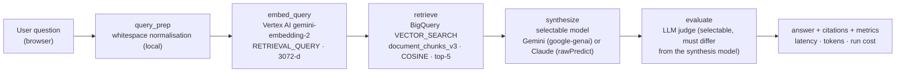
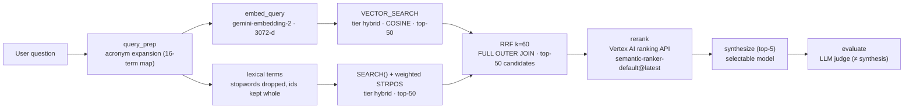
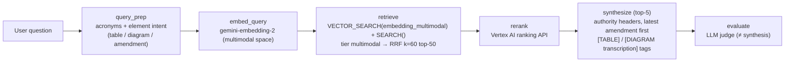
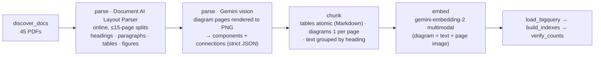
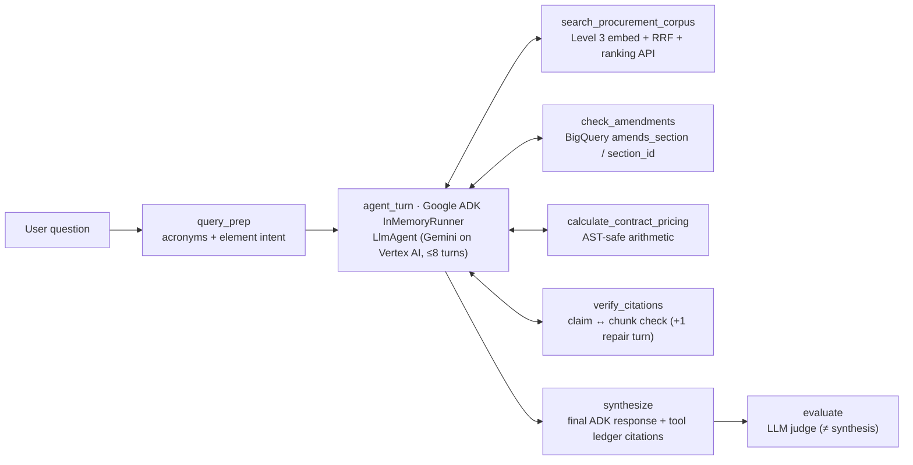
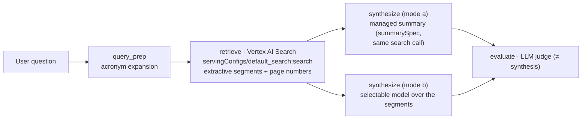
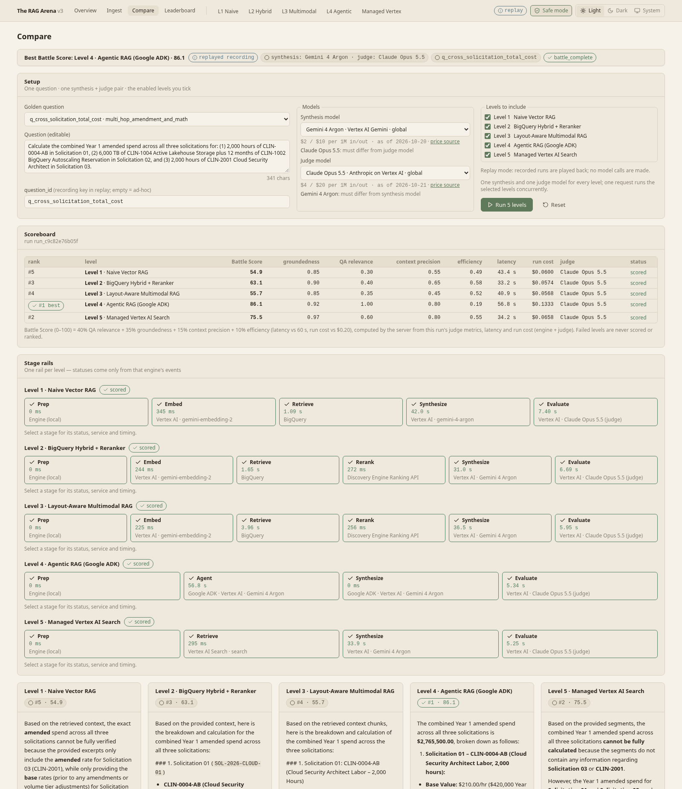
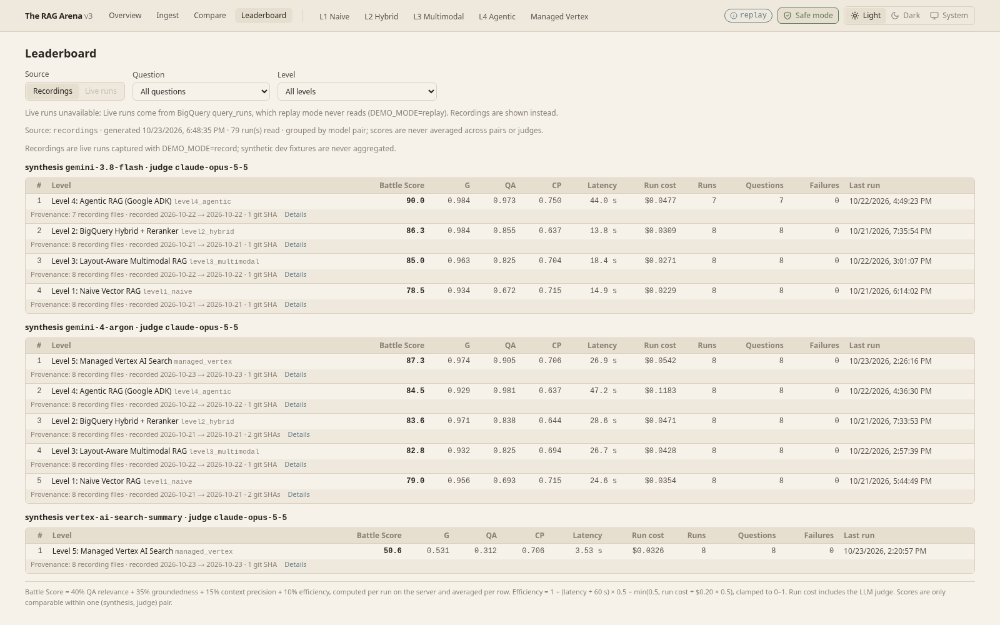

# The RAG Arena — Progressive Enterprise RAG on Google Cloud

**Five RAG architectures, one procurement corpus, every stage measured live — pick the right architecture with evidence, not demos.**

      

**Release:** v1.0.0 (2026-10-23, see [CHANGELOG.md](CHANGELOG.md)) · **Status:** all five levels live · Compare, Leaderboard and Cloud Run deployment done · Phase 6 open item: owner UI changes (later).

## The problem

Enterprise procurement documents — RFPs and SOWs, CLIN rate cards, SLA matrices, architecture diagrams, and
amendments that supersede earlier terms — break naive RAG:

- **Exact identifiers blur**: `CLIN-0004-AB` and `SEC-4.2.1` embed close to their neighbours, so the wrong row is retrieved.
- **Tables scramble** when fixed-size chunking cuts rows from their headers.
- **Diagrams are invisible** to a text-only parser.
- **Amendments are ignored**: the base clause outranks the amendment that replaced it.
- **Multi-hop math is hallucinated** when totals span documents.

Teams choosing a RAG architecture on Google Cloud rarely see measured quality, latency and cost trade-offs on the
same data — and many demos fake the pipeline with timers and hardcoded scores.

## How The RAG Arena solves it

- **Five progressively richer architectures** (naive vector → hybrid + rerank → multimodal → agentic ADK → managed
  Vertex AI Search) on **one corpus** (45 PDFs) and **one golden set** (8 questions, 4 failure modes).
- **Every stage measured and streamed live** over SSE: the real SQL or API request, what came back, backend-measured
  duration, tokens and cost, drawn on a live architecture diagram.
- **An LLM judge that differs from the synthesis model** (enforced server-side) scores groundedness, QA relevance and
  context precision; **Compare** and **Leaderboard** put levels side by side.
- **Zero-credential replay** of recorded real runs, and **one-command Cloud Run deployment** to your own project.

Design guarantees (full principles table: [docs/ARCHITECTURE.md](docs/ARCHITECTURE.md#0-design-principles-v3)):

- **Measured, not simulated** — stage events are emitted inside the engines; the API layer has no timers.
- **Fail loud** — a failed stage emits `stage_failed` + `engine_error`; no silent fallback service or model.
- **No hardcoded scores** — metrics come only from the live judge or from recordings of real runs.
- **Honest labels** — each stage names the service that actually ran (`reranker_used`, `adk_runner_used`, `layout_source`).
- **Replay never improvises** — questions without a recording return `engine_error`, never a made-up answer.

## The architecture ladder

| Level | Engine id | Retrieval & synthesis | What it proves |
| :-- | :-- | :-- | :-- |
| 1 | `level1_naive` | BigQuery `VECTOR_SEARCH` (COSINE, top-5) over 360-char windows, `gemini-embedding-2`, selectable synthesis model | The baseline — and its failure modes |
| 2 | `level2_hybrid` | Acronym expansion; `VECTOR_SEARCH` ⨝ `SEARCH()` over one-chunk-per-page lineage chunks → RRF (k=60) top-50 → Vertex AI ranking API → top-5 | Exact identifier recall; reranker precision |
| 3 | `level3_multimodal` | Document AI Layout Parser elements + Gemini vision transcription of diagrams → element-aware chunks with multimodal vectors; hybrid RRF + rerank; authority headers (latest amendment first) | Tables and diagrams answered correctly |
| 4 | `level4_agentic` | Google ADK `LlmAgent` + `InMemoryRunner` (Gemini, ≤ 8 turns) with search, amendment, pricing-calculator and citation-check tools | Multi-hop supersession, deterministic math, self-verification |
| 5 | `managed_vertex` | Vertex AI Search (Enterprise + LLM add-on) over the same 45 PDFs: extractive segments, answered by the managed summary or a selectable model | Build vs. buy baseline |

`ENABLED_LEVELS` defaults to all five (Level 5 needs `VAIS_*` keys live). Each level page draws its diagram live from
`GET /api/v1/levels` + SSE. Vector Search 2.0 / AlloyDB ScaNN engines are parked (`engines/parked/`, no resources).

**Cross-cutting Google Cloud products** (all levels and the deployment):

- **Cloud Run** — one container serving UI + API (IAP-protected live service, optional public replay-only copy)
- **Artifact Registry** + **Cloud Build** — image storage and remote builds (no local Docker needed)
- **Identity-Aware Proxy (IAP)** + **IAM** — owner-only access; least-privilege runtime service account, no key files
- **BigQuery** — `query_runs` (every live run, feeds the Leaderboard) and `ingest_runs` (ingestion provenance)
- **Cloud Storage** — corpus bucket (Level 5 import source; created by the bootstrap script)

## Level 1 architecture

**Query path** (`backend/app/engines/level1_naive.py`, `backend/app/evaluation/`):



**Ingestion path** (`backend/app/ingestion/{jobs,live_backends}.py`): `discover_docs → parse` (PyMuPDF) `→ chunk` (360/60) `→ embed` (`gemini-embedding-2`) `→ load_bigquery` (staging + transactional tier replace) `→ build_indexes → verify_counts`.

**Google Cloud products**

- **Vertex AI** — `gemini-embedding-2` embeddings (`RETRIEVAL_DOCUMENT` at ingestion, `RETRIEVAL_QUERY` per question)
- **Gemini on Vertex AI** (Gemini 4 Argon, Gemini 3.8 Flash) or **Anthropic Claude on Vertex AI** — synthesis
- **Claude Opus 5.5 on Vertex AI** — default LLM judge (any catalog model ≠ synthesis)
- **BigQuery** — chunk table, load jobs, `VECTOR_SEARCH` (COSINE) with an IVF vector index


## Level 2 architecture

**Query path** (`backend/app/engines/level2_hybrid.py`, `backend/app/ingestion/bq_indexer.py`,
`backend/app/core/ranking.py`):



Both legs and the fusion run as **one parameterized BigQuery statement**, scoring
`1/(60 + vector_rank) + 1/(60 + lexical_rank)` (SQL shape in [docs/ARCHITECTURE.md](docs/ARCHITECTURE.md)).
**Ingestion** (`hybrid` tier): one chunk per page prefixed with a Contextual Lineage header (solicitation · document ·
doc type · section; CUAD agreements are `COMMERCIAL_AGREEMENT`), then embed → staged load → vector + search index → verify.

**Google Cloud products** — Level 1, plus:

- **BigQuery** — `SEARCH()` with a search index, fused with `VECTOR_SEARCH` by RRF in one statement
- **Vertex AI ranking API** (Discovery Engine `rankingConfigs.rank`, `semantic-ranker-default@latest`) — reranks 50 → 5


## Level 3 architecture

**Query path** (`backend/app/engines/level3_multimodal.py`):



**Ingestion path** (`multimodal` tier; `backend/app/ingestion/{layout_documentai,vision_transcribe,multimodal,multimodal_job}.py`):



**Google Cloud products** — Level 2, plus:

- **Document AI Layout Parser** (v1.5 release candidate, online `:process`) — headings, paragraphs, tables, figures
- **Gemini on Vertex AI (vision)** — transcribes diagram pages into components + connections (`VISION_MODEL`)
- **Vertex AI `gemini-embedding-2` multimodal embeddings** — a diagram chunk is embedded as text + its page image
- **BigQuery** — `multimodal` tier with element type, layout source, bbox and amendment columns


Element boxes come from the PDF text layer (`bbox_source`) because Layout Parser v1.5 returns no table boxes; unusable
vision answers are listed in `vision_failed_pages`, never invented around. **Known limitation**: BigQuery allows one vector
index per table, so `VECTOR_SEARCH` on `embedding_multimodal` brute-forces; at scale the tier needs its own table.

## Level 4 architecture

**Query path** (`backend/app/engines/{level4_agentic,agent_runtime,agent_tools,agent_calculator,agent_verify}.py`; reuses the Level 3 `multimodal` tier):



**Google Cloud products** — Level 3 retrieval stack, plus:

- **Agent Development Kit (ADK)** — `LlmAgent` + `InMemoryRunner` driving **Gemini on Vertex AI** (Argon or Flash)
- **BigQuery** — hybrid RRF retrieval tool and the `check_amendments` supersession query
- **Vertex AI ranking API** + **`gemini-embedding-2`** — inside `search_procurement_corpus`
- **Claude Opus 5.5 on Vertex AI** — default judge (Claude is judge-only on this level)


Every model turn, tool call and tool result streams as an `agent_turn` SSE event while the runner executes; unsupported
claims after `verify_citations` trigger one bounded repair turn. Synthesis is Gemini-only (`google-adk`'s Claude adapter
needs the undeclared `anthropic` package), so Claude for Level 4 synthesis returns HTTP 400.

## Level 5 architecture (managed baseline)

**Query path** (`backend/app/engines/{managed_vertex,vais_search}.py`, `backend/app/core/vertex_search.py`):



**Ingestion** (`backend/app/ingestion/{gcs_sync,managed_job}.py`): `discover_docs → upload_gcs` (md5 diff, no deletes) `→ import_documents` (INCREMENTAL, bounded LRO poll) `→ verify_counts`; parse / chunk / embed / index are `stage_skipped` — "managed by Vertex AI Search". Provisioned by `scripts/provision_vertex_search.py`.

**Google Cloud products**

- **Vertex AI Search** (Enterprise edition + LLM add-on) — data store, search app, extractive segments, managed summary
- **Cloud Storage** — corpus bucket imported with `documents:import`
- **Gemini / Claude on Vertex AI** — mode (b) synthesis over the segments
- **Claude Opus 5.5 on Vertex AI** — default judge


The pseudo model `vertex-ai-search-summary` is Level-5-only (HTTP 400 elsewhere). Citations are page-level (`bbox_source: "page"`).

## Model catalog

Catalog in `backend/app/core/models_catalog.py`, prices in `backend/app/core/pricing.py` (published Vertex AI rates
with source URL and `price_as_of`), availability in `data/model_verification.json` (`scripts/verify_models.py`).

| Model | Id | Provider path | Input $/1M | Output $/1M | Price as of | Verified |
| :-- | :-- | :-- | --: | --: | :-- | :-- |
| Gemini 4 Argon | `gemini-4-argon` | Vertex AI, google-genai | 2.00 | 10.00 | 2026-10-20 | ✅ HTTP 200, 2026-10-21 |
| Gemini 3.8 Flash | `gemini-3.8-flash` | Vertex AI, google-genai | 0.75 | 3.75 | 2026-10-21 | ✅ HTTP 200, 2026-10-21 |
| Claude Opus 5.5 | `claude-opus-5-5` | Anthropic on Vertex AI, `:rawPredict` | 4.00 | 20.00 | 2026-10-21 | ✅ HTTP 200, 2026-10-21 |
| Claude Fable 5.1 | `claude-fable-5-1` | Anthropic on Vertex AI, `:rawPredict` | 10.00 | 50.00 | 2026-10-21 | ✅ HTTP 200, 2026-10-21 |

All on the `global` endpoint; Argon / Flash are introductory rates (Flash $1.50 / $7.50 from 2027-01-01), output
includes thinking tokens. Defaults: synthesis `gemini-4-argon`, judge `claude-opus-5-5`; **judge ≠ synthesis is enforced
server-side** (HTTP 400), no fallback model. Claude Fable needs Anthropic data sharing ([setup](docs/SETUP_GUIDE.md)).

Other billable services (`gemini-embedding-2`, ranking API, Vertex AI Search, Document AI) with prices and sources:
[docs/ARCHITECTURE.md](docs/ARCHITECTURE.md#4-model-selection-and-evaluation) (§4).

## Results (Levels 1–5)

Each level ran the 8 golden questions live (`DEMO_MODE=record`) with two (synthesis, judge) pairs: **Argon** =
`gemini-4-argon` + `claude-opus-5-5`, **Flash** = `gemini-3.8-flash` + `claude-opus-5-5`. Level 4 Flash has 7/8:
`q_sla_credit_calculation` timed out at 120 s across 6 live attempts, so it is unrecorded and returns
`ReplayUnavailableError` in replay. G / QA / CP = groundedness / QA relevance / context precision (0–1); latency =
engine run without the judge; run cost = engine + judge, mean per question (total in brackets).

| Level | Argon G / QA / CP | Argon latency | Argon run cost (total) | Flash G / QA / CP | Flash latency | Flash run cost (total) |
| :-- | :-: | --: | --: | :-: | --: | --: |
| 1 · naive | 0.956 / 0.693 / 0.715 | 24.6 s | $0.0354 ($0.283) | 0.934 / 0.672 / 0.715 | 14.9 s | $0.0229 ($0.183) |
| 2 · hybrid + rerank | 0.971 / 0.838 / 0.644 | 28.6 s | $0.0471 ($0.377) | 0.984 / 0.855 / 0.637 | 13.8 s | $0.0309 ($0.247) |
| 3 · multimodal | 0.932 / 0.825 / 0.694 | 26.7 s | $0.0428 ($0.342) | 0.963 / 0.825 / 0.704 | 18.4 s | $0.0271 ($0.217) |
| 4 · agentic (ADK) | 0.929 / 0.981 / 0.637 | 47.2 s | $0.1183 ($0.946) | 0.984 / 0.973 / 0.750 *(7/8)* | 44.0 s | $0.0477 ($0.334) |
| 5 · Vertex AI Search, Argon over segments | 0.974 / 0.905 / 0.706 | 26.9 s | $0.0542 ($0.434) | — | — | — |
| 5 · Vertex AI Search managed summary | 0.531 / 0.312 / 0.706 | 3.5 s | $0.0326 ($0.261) | — | — | — |

Level 2 lifts QA relevance on amendment and table questions; Level 3 recovers context precision on tables and
diagrams. Level 4 closes the multi-hop and arithmetic gaps (`q_cross_solicitation_total_cost` QA 0.35 → 1.00 with
exact `$2,765,500.00` via `calculate_contract_pricing`) at ~1.7× latency and ~2.8× Argon cost. Level 5's retrieval
is strong (QA 0.905 with Argon over its segments), but its managed summary often says the sources lack facts the top
segment contains (QA 0.312). Per-question scores, SQL, tool traces, prompts and judge rationales are in
[`data/recordings/`](data/recordings/).

## Quickstart

Requirements: Python 3.11+ (3.12 in the Docker image), Node.js 20+. Live mode also needs the Google Cloud CLI.

### (a) Zero-credential replay

```bash
python3 -m venv .venv
.venv/bin/pip install -r backend/requirements.txt

# terminal 1 — API on :8000, plays data/recordings/** (no GCP calls, no credentials)
DEMO_MODE=replay .venv/bin/python -m uvicorn app.main:app --app-dir backend --port 8000

# terminal 2 — UI on :5173 (Vite proxies /api to :8000)
cd frontend && npm install && npm run dev
```

Open `http://localhost:5173`, pick a level, a golden question and a recorded pair, and press Run; events replay with
their recorded timing. `docker compose up --build` serves the same replay from the single image on `http://localhost:8080` (not yet exercised).

### (b) Live on your own GCP project

```bash
cp .env.example .env            # git-ignored: DEMO_MODE=live|record, GCP_PROJECT_ID, GCP_LOCATION, BQ_TABLE=document_chunks_v3
gcloud auth application-default login
set -a; source .env; set +a
BQ_TABLE=document_chunks ./scripts/bootstrap_gcp.sh            # APIs, bucket, dataset, Layout Parser processor
PYTHONPATH=backend .venv/bin/python scripts/verify_models.py   # writes data/model_verification.json
```

Put the printed `DOCAI_PROCESSOR_ID` in `.env`, start the backend and UI as in (a), open `/ingest` and run each
level's ingestion job (Run stays disabled while a tier has 0 rows). The bootstrap creates a v2-schema table, hence
the v2 name; v3 ingestion creates `document_chunks_v3` and refuses the frozen v2 table. IAM: `roles/aiplatform.user`,
`roles/bigquery.jobUser`, `roles/bigquery.dataEditor`. Full guide: [docs/SETUP_GUIDE.md](docs/SETUP_GUIDE.md).

## Compare & Leaderboard

- **`/compare`** runs one question on selected levels concurrently (one SSE stream): stacked live stage rails,
  side-by-side answers + citations, and a server-computed Battle Score scoreboard. Levels that can't run with the
  chosen models or have no recording in replay are disabled with the reason.
- **`/leaderboard`** aggregates live runs from BigQuery `query_runs` or the committed recordings, one table per
  (synthesis, judge) pair with provenance per row; scores are never averaged across pairs.
- **Battle Score** (0–100) = 40% QA relevance + 35% groundedness + 15% context precision + 10% efficiency (latency vs
  60 s, run cost vs $0.20).





## Deploy to Cloud Run (your own project)

```bash
cp deploy/cloudrun.env.example deploy/cloudrun.env   # git-ignored: project, region, access, replay copy
scripts/deploy_cloudrun.sh --dry-run                  # validates every key, prints the exact plan
scripts/deploy_cloudrun.sh --yes                      # idempotent apply; prints the service URLs
```

Choices: `REGION` (default `us-central1`); `ACCESS_MODE=iap` (only `IAP_MEMBERS`, e.g. `user:you@example.com`) or
`public`; `DEPLOY_REPLAY=true` adds a public replay-only copy (role-less service account, identity hidden);
`LIVE_INGEST=true|false`. Min instances 0 → $0 when idle; `scripts/teardown_cloudrun.sh --yes` removes only what the
script created. Details: [docs/SETUP_GUIDE.md](docs/SETUP_GUIDE.md#6-cloud-run).

## API & SSE protocol

| Method & path | Purpose |
| :-- | :-- |
| `GET /api/v1/health` · `GET /api/v1/levels` · `GET /api/v1/models` | Mode and identity from `.env`; level descriptors; verified catalog + `recorded_pairs` |
| `GET /api/v1/benchmarks` · `GET /api/v1/leaderboard` | Golden benchmark (8 questions); aggregates per (engine, synthesis, judge) with provenance |
| `POST /api/v1/battle/stream` | Run: `{query, question_id?, engines?, solicitation_filter?, synthesis_model?, judge_model?}` → SSE |
| `POST /api/v1/ingest/jobs` · `GET …/jobs/{id}` · `GET …/jobs/{id}/stream` · `GET /api/v1/ingest/status` | Ingestion jobs, live counts and index states |
| `GET /api/v1/documents/page` · `GET /api/v1/documents/highlights` · `POST /api/v1/ingest/upload` | PDF page PNG, excerpt rectangles, guarded upload |

Run streams are `data: {json}\n\n` frames bounded by `MAX_SSE_FRAMES` (600). Events, fields and per-level payloads:
[docs/ARCHITECTURE.md](docs/ARCHITECTURE.md#23-sse-protocol) (§2.3, §3).

## Quality & tests

All tests run offline (fakes for Vertex AI, BigQuery, Document AI, Vertex AI Search and ADK). Measured 2026-10-23:

| Suite | Checks | What it guards |
| :-- | --: | :-- |
| **Backend total** (`pytest`, 29 files) | **278 passed** | engines, ingestion, API/SSE, evaluation, recording, deployment |
| `test_routes_no_timers.py` | 2 | the API layer never paces or fabricates stage events |
| `test_no_silent_fallbacks.py` | 3 | AST scan of `engines/**` for swallowed errors and fallback paths |
| `test_recording_redaction.py` · `test_recording_roundtrip.py` | 3 · 6 | no identity in recordings; replay reproduces recorded events |
| `test_model_selection.py` · `test_judges.py` | 20 · 15 | judge ≠ synthesis, role and level gates; strict judge parsing |
| `test_publish_manifest.py` | 4 | public docs leak scan; no `eval` / raw HTML / identity in the UI |
| `test_cloudrun_deploy.py` | 23 | SPA/API routing, deploy plan, no forwarded credentials, lockfiles from public registries only |
| **Frontend total** (`npm test`, 13 suites) | **156 passed** | stream reducer, per-level views, model picker, safe mode, compare, sessions |

```bash
PYTHONPATH=backend .venv/bin/pytest backend/tests -q   # 278 passed
cd frontend && npm test                                 # 156 pass across 13 suites
cd frontend && npm run build                            # tsc + vite build
```

- **Results are recorded real runs**: 79 recordings in `data/recordings/` (16 per level for Levels 1–3 and 5, 15 for
  Level 4), each with a provenance header (`recorded_at`, model ids, `git_sha`).
- **Pre-push leak scan**: tracked files are grepped for identity (account names, emails, home paths, project ids)
  before every push; identity lives only in the git-ignored `.env`.

## Repository layout

```text
rag-arena/
├── backend/
│   ├── app/
│   │   ├── api/             REST routes, SSE forwarder, documents, query_runs, SPA serving
│   │   ├── core/            config, telemetry, model catalog, pricing, ranking, architectures
│   │   ├── engines/         Levels 1–5, ADK runtime + tools, replay; parked/
│   │   ├── evaluation/      LLM judges, evaluator, Battle Score, leaderboard
│   │   ├── ingestion/       job runner, PyMuPDF / Document AI / vision, BigQuery + GCS loaders
│   │   └── recording/       recorder, store, redaction
│   └── tests/               278 offline tests + fakes
├── frontend/
│   ├── src/
│   │   ├── app/             router, shell, sessions, safe mode
│   │   ├── features/        levels/ · compare/ · ingest/
│   │   ├── components/      UI primitives, document drawer and viewer
│   │   ├── lib/             API client, bounded SSE reader, safe-mode masking
│   │   ├── pages/           overview, leaderboard
│   │   └── theme/ styles/ types/   themes, design tokens, SSE + API types
│   └── tests/               13 node:test suites
├── data/
│   ├── sample_docs/         procurement corpus (45 PDFs)
│   ├── golden_benchmarks/   8 questions, 4 failure modes
│   └── recordings/          <engine>/<synthesis>__<judge>/<question_id>.json
├── deploy/                  Cloud Run env template (real file git-ignored)
├── scripts/                 bootstrap, provisioning, model check, corpus build, deploy/teardown
├── infra/                   Terraform (main.tf)
├── docs/                    ARCHITECTURE, SETUP_GUIDE, audits, screenshots
├── Dockerfile               single image: SPA build + Uvicorn API
├── docker-compose.yml       replay mode on :8080
├── .env.example             configuration template
└── LICENSE                  MIT
```

## Security & leak hygiene

- **Identity only from the git-ignored `.env`** (project, bucket, credential paths); code defaults are empty.
- **Recorder redaction**: identity values become `${…}` placeholders and `assert_redacted` refuses to write otherwise.
  **Safe mode** (`?safe=1` or the header toggle) masks them in the UI for screen sharing.
- **Cloud Run**: least-privilege service account, no key files; the image never contains `.env` or deploy config, and
  the deploy script leak-scans the upload before every build. Parameterized queries, validated identifiers, and an
  explicit bound and timeout on every loop, retry, poll and request.

## Roadmap

| Phase | Scope | Status |
| :-- | :-- | :-- |
| 1–5 | Levels 1–5: naive vector, hybrid + rerank, multimodal, ADK agent, managed Vertex AI Search | ✅ live |
| 6 | Compare page, Leaderboard from `query_runs`, configurable Cloud Run deployment (IAP live service, optional public replay) | ✅ done |
| 6 | Owner UI changes | 🔜 later |

## License

The code is released under the [MIT License](LICENSE). Data notices:

- **Generated procurement corpus**: 18 interconnected solicitation PDFs across 3 solicitations
  (`scripts/build_procurement_corpus.py`); fictional, for benchmarking only.
- **CUAD**: 27 commercial agreements from the [Contract Understanding Atticus Dataset (CUAD) v1](https://zenodo.org/records/4595826)
  by The Atticus Project, licensed [CC BY 4.0](https://creativecommons.org/licenses/by/4.0/)
  (fetched by `scripts/download_procurement_corpus.sh`, not relicensed under MIT).
- **Golden benchmark**: `data/golden_benchmarks/procurement_benchmark.json`.

## Acknowledgements

Built on Google Cloud (Vertex AI, BigQuery, Cloud Storage, Vertex AI Search, Document AI, Agent Development Kit,
Cloud Run), Anthropic Claude models on Vertex AI, PyMuPDF, Starlette, React, Vite and Tailwind CSS. Contract data from
The Atticus Project's CUAD.
