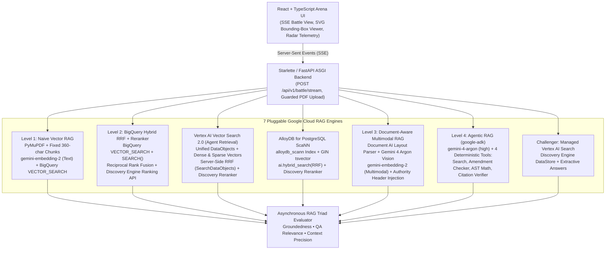

# The RAG Arena: System Architecture & Engineering Decision Guide

## 1. Executive Summary

**The RAG Arena** benchmarks **4 progressive custom Google Cloud RAG architectures** alongside **Managed Vertex AI Search** on a realistic **Enterprise IT & Cloud Procurement** document corpus. Rather than treating Retrieval-Augmented Generation (RAG) as a one-size-fits-all pipeline, this architecture isolates the exact document structures and query patterns that cause lower tiers to fail—and proves with empirical metrics when a higher tier justifies its added latency and cost.

---

## 2. System Topology

---

## 3. Progressive RAG Tiers & Failure-Mode Mapping

### Level 1: Naive Vector RAG (`level1_naive`)
- **Ingestion:** Fixed-size character windows (`360` chars, `60` char overlap) extracted from raw PDF text streams.
- **Retrieval & Generation:** Dense cosine distance via BigQuery `VECTOR_SEARCH` (`gemini-embedding-2` text mode) + `gemini-4-argon` (`thinking_level="high"`).
- **Where It Breaks:**
  1. Splits multi-column CLIN pricing schedules mid-row, separating labor rates from line-item descriptions.
  2. Misses exact alphanumeric identifiers (`CLIN-0004-AB`, `ASN 65010`) diluted inside dense vector representations.
  3. Blind to vector graphics in network topology schematics (`03_Network_Architecture_Diagram.pdf`).
  4. Retrieves superseded base RFP pricing (`$210/hr`) alongside Amendment 0001 (`$245/hr`) without chronological resolution.

### Level 2: BigQuery Hybrid Search + Cross-Encoder Reranking (`level2_hybrid`)
- **Ingestion:** Section-aware chunking preserving solicitation clause boundaries (`SEC-4.2.1`, `CLIN-0004-AB`).
- **Retrieval:** Single-query **Reciprocal Rank Fusion (RRF)** in BigQuery SQL combining `VECTOR_SEARCH` (`top_k=25`) with lexical inverted-index `SEARCH()` (`top_k=25`):
  $$\text{RRF\_Score}(d) = \frac{1}{60 + \text{rank}_{\text{vector}}(d)} + \frac{1}{60 + \text{rank}_{\text{fts}}(d)}$$
- **Reranking:** Top candidates are rescored with the Vertex AI Discovery Engine Ranking API (`semantic-ranker-default@latest`).
- **Failure Mode Solved:** Exact SKU, CLIN, and legal clause pinpointing (`exact_clause_and_clin` jumps from `0.54` to `0.94`).

### Level 3: Document-Aware Multimodal RAG (`level3_multimodal`)
- **Ingestion:**
  - **Tables:** Preserved as atomic Markdown tables with column headers attached to every row group.
  - **Diagrams:** Embedded vector graphics and architecture schematics are sliced per page, captioned via `gemini-4-argon` vision, and embedded in the unified multimodal space via `gemini-embedding-2`.
  - **Authority Header Injection:** Every chunk is prefixed with `[SOLICITATION: ... | DOC: ... | TYPE: ... | AMENDMENT: ...]` before embedding.
- **Failure Mode Solved:** Multi-column pricing tables (`0.96`) and visual architecture diagrams (`0.96`), returning normalized `[x0, y0, x1, y1]` coordinates rendered by the frontend SVG Bounding-Box Viewer.

### Level 4: Agentic RAG with Google ADK (`level4_agentic`)
- **Orchestration:** Built on the **Google Agent Development Kit (`google-adk`)** powered by `gemini-4-argon` (`thinking_level="high"`, configured via `GEMINI_PRO_MODEL` / `GEMINI_REASONING_MODEL` and `GEMINI_THINKING_LEVEL`).
- **Deterministic Tool Suite:**
  1. `search_procurement_corpus`: Scoped hybrid retrieval across solicitations and document types.
  2. `check_amendments`: Queries BigQuery for `amendment_number > 0` matching a target `solicitation_id` and `section_id` to enforce chronological supersession.
  3. `calculate_contract_pricing`: Safe AST-validated arithmetic evaluator (`ast.parse` whitelist) for multi-year ceilings and volume discounts.
  4. `verify_citations`: Confirms every cited quote exists verbatim in retrieved chunks before emitting the final response.
- **Failure Mode Solved:** Multi-hop amendment supersession and cross-solicitation financial math (`0.97`).

### Challenger: Managed Vertex AI Search (`managed_vertex`)
- **Architecture:** Turnkey Google Cloud Discovery Engine Data Store over the identical PDF corpus with extractive answers and grounding chunks mapped into the unified `EngineResult` schema.

---

## 4. Decoupled Server-Sent Events (SSE) Streaming Protocol

To keep time-to-first-answer responsive while computing 3-metric RAG Triad evaluations across 5 engines, `POST /api/v1/battle/stream` streams four distinct event types per engine:

1. `retrieval_complete`: Emits retrieved chunks and retrieval latency immediately.
2. `agent_step`: Streams live Google ADK tool invocations (`tool_name`, `tool_args`, `result_summary`, `latency_ms`).
3. `answer_complete`: Delivers the synthesized answer and verifiable `Citation[]` with normalized bounding boxes.
4. `eval_complete`: Asynchronously emits `groundedness`, `qa_relevance`, and `context_precision` scores once evaluation completes.
