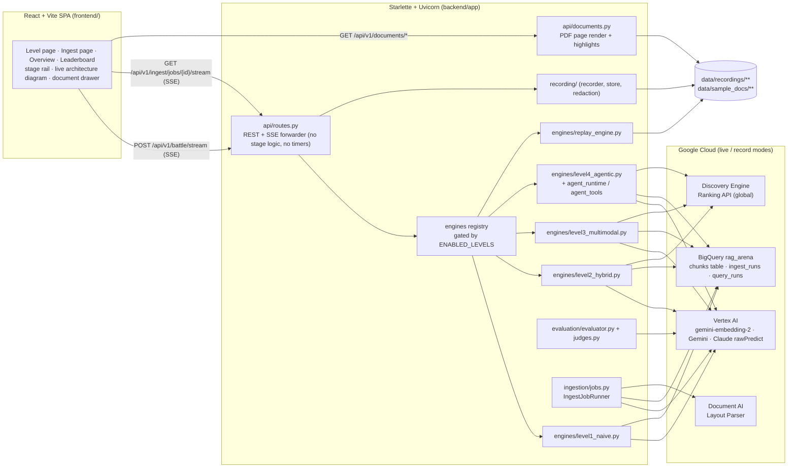

# The RAG Arena v3 — System Architecture

This document describes the architecture **as implemented** with Levels 1–5 live. Anything not yet built is
marked 🔒 *planned*. The product rule behind every decision: **nothing is shown that was not measured**
(principles P1–P6 in the [README](../README.md#why-v3-measured-not-simulated)).

---

## 1. System topology



| Mode (`DEMO_MODE`) | Engines | Judge | Writes |
| :-- | :-- | :-- | :-- |
| `replay` (default) | `ReplayRAGEngine` per enabled level, streaming recorded events with original relative timing × `REPLAY_SPEED` | recorded judge outcome of the selected pair | nothing; no credentials needed |
| `live` | real engines (Levels 1–4) | selected judge model, live | `query_runs` row per run; `ingest_runs` row per ingestion job |
| `record` | `live` + recorder | live | `live` writes + `data/recordings/<engine>/<synthesis>__<judge>/<question_id>.json` |

Settings are validated once at startup (`core/config.py`); invalid configuration fails the process, and
`live`/`record` refuse to start without `GCP_PROJECT_ID`.

---

## 2. Backend contracts

### 2.1 Engine contract (`engines/base.py`)

```python
class BaseRAGEngine(ABC):
    engine_id: str
    engine_label: str
    stages: tuple[str, ...]          # canonical stage ids in execution order

    async def run_query(self, query: str, *, question_id: str | None,
                        solicitation_filter: str | None, emitter: StageEmitter) -> EngineResult: ...
```

`EngineResult` (frozen dataclass) carries `answer`, `citations`, `retrieved_chunks`, `stage_log`, `usage`
(`TokenUsage` from the provider's usage block), `cost_usd` (usage × published prices in `core/pricing.py`) and
`flags` (`EngineFlags`: `reranker_used`, `adk_runner_used`, `layout_source`). There is **no `eval_metrics`
field** — engines cannot set scores.

### 2.2 Stage telemetry (`core/telemetry.py`)

Engines wrap each stage in `async with self.stage(emitter, "<stage>", label=…, service=…, request=…) as ctx:`.
Entering emits `stage_started` with the exact request; leaving emits `stage_completed` with the
`perf_counter`-measured `duration_ms` and `ctx.payload`; an exception emits `stage_failed` (exception class +
message) and re-raises. Blocking SDK calls run in `asyncio.to_thread`. Payloads are size-bounded.

`routes.py` only forwards emitter events to the SSE queue and adds `run_started`, `answer_complete`,
`eval_complete`, `engine_error`, `stream_warning`, `battle_complete`. `test_routes_no_timers.py` asserts it
contains no stage pacing.

### 2.3 SSE protocol

`POST /api/v1/battle/stream` → `data: {json}\n\n` frames, bounded by `MAX_SSE_FRAMES` (default 600). Events
and fields are listed in the [README](../README.md#api--sse-protocol). Ingestion jobs stream `job_started`,
`stage_*`, `doc_progress`, `embed_progress`, `job_complete` on `GET /api/v1/ingest/jobs/{job_id}/stream`.

---

## 3. Level 1 query path (`engines/level1_naive.py`)

| Stage | Service label | What runs | Payload (measured) |
| :-- | :-- | :-- | :-- |
| `query_prep` | Engine (local) | whitespace normalisation | `original_query`, `prepared_query`, `expansions: []` |
| `embed_query` | Vertex AI · gemini-embedding-2 | `models.embed_content`, `task_type=RETRIEVAL_QUERY` | `dimensions` (3072), `token_count` |
| `retrieve` | BigQuery | parameterized `VECTOR_SEARCH` over `tier_profile = 'naive'` rows, COSINE, `top_k => 5` | `sql`, `params` (vector preview), `rows_returned`, `scores[]`, `chunk_ids`, `job_id`, `bytes_processed`, `slot_millis`, `cache_hit` |
| `synthesize` | Vertex AI · *selected model* | `GeminiSynthesizer` (google-genai, `thinking_level` from `GEMINI_THINKING_LEVEL`) or `AnthropicVertexSynthesizer` (`:rawPredict`, `max_tokens = SYNTHESIS_MAX_TOKENS`, no temperature) | `model`, `provider`, `prompt_tokens`, `output_tokens`, `thinking_tokens`, `stop_reason`, `attempts`, `answer` |
| `evaluate` | Vertex AI · *selected judge* | `evaluation/evaluator.py` → `judges.py` | `groundedness`, `qa_relevance`, `context_precision`, `rationale`, `reference_answer_used`, judge tokens and cost |

The retrieval SQL (identifiers validated, the vector and optional `solicitation_id` passed as query
parameters):

```sql
SELECT base.chunk_id, base.solicitation_id, base.doc_name, …, base.content,
       (1.0 - distance) AS similarity_score
FROM VECTOR_SEARCH(
  (SELECT * FROM `<project>.<dataset>.<BQ_TABLE>` WHERE tier_profile = 'naive'),
  'embedding',
  (SELECT @query_embedding AS embedding),
  top_k => 5,
  distance_type => 'COSINE'
)
ORDER BY distance ASC
LIMIT 5;
```

---

## 3b. Level 2 query path (`engines/level2_hybrid.py`)

| Stage | Service label | What runs | Payload (measured) |
| :-- | :-- | :-- | :-- |
| `query_prep` | Engine (local) | deterministic 16-entry acronym map (CLIN, SLA, RTO, RPO, QASP, PEP, SOW, RFP, MSA, ZTA, VPC, VPN, BGP, ASN, KMS, GKE), whole-token, case-sensitive; prepared query = original + glossary suffix | `original_query`, `prepared_query`, `expansions[]` |
| `embed_query` | Vertex AI · gemini-embedding-2 | shared `common_stages.embed_query_stage` on the prepared query | `dimensions`, `token_count` |
| `retrieve` | BigQuery | one parameterized statement (`bq_indexer.build_hybrid_rrf_sql`) over `tier_profile = 'hybrid'` | `rows_returned`, `candidate_k`, `rrf_k`, `vector_k`, `lexical_k`, `with_both_ranks`, `candidates[]` with per-leg ranks, job stats, `index_usage` |
| `rerank` | Discovery Engine Ranking API | `core/ranking.RankingClient.rank` with all candidates (`topN` = records sent) | `results[]` (RRF rank/score → rerank rank/score), `rank_api_ms`, `attempts`, `records_truncated`, `billed_counts`, `cost_usd` |
| `synthesize` | Vertex AI · *selected model* | shared `common_stages.synthesize_stage` over the top `RERANK_TOP_N` (5) reranked chunks, context labelled `[doc \| Sec: … \| p.N]`, ≤ 6,000 chars each | as Level 1 |
| `evaluate` | Vertex AI · *selected judge* | as Level 1 | as Level 1 |

Full Level 2 payload fields (Level 3 adds the fields listed in §3c):

| Stage | `stage_completed.payload` fields |
| :-- | :-- |
| `query_prep` | `original_query`, `prepared_query`, `expansions[]` (`term`, `expansion`) |
| `retrieve` | `rows_returned`, `candidate_k`, `rrf_k`, `vector_k`, `lexical_k`, `with_both_ranks`, `candidates[]` (`chunk_id`, `doc_name`, `page_number`, `section_id`, `vector_rank`, `lexical_rank`, `vector_distance`, `rrf_score`), `job_id`, `bytes_processed`, `slot_millis`, `cache_hit`, `index_usage` (`search` / `vector_search`: `index_usage_mode`, `index_unused_reasons[]`) |
| `rerank` | `service_used`, `model`, `candidates_in`, `candidates_out`, `results[]` (`chunk_id`, `doc_name`, `page_number`, `rrf_rank`, `rrf_score`, `rerank_rank`, `rerank_score`), `rank_api_ms`, `attempts`, `records_truncated`, `billed_counts`, `cost_usd` |

The `rerank` request records `service`, `model`, `top_n`, `records_sent`, `query`, `method`
(`rankingConfigs.rank`), `ranking_config`, `record_content_max_chars` and `context_k`.

Hybrid statement (shape; user input enters only as `@query_embedding`, `@lexical_query`, `@lexical_terms` and
optional `@solicitation_id`; the tier literal is validated against `('hybrid', 'multimodal')`):

```sql
WITH vector_results AS (      -- VECTOR_SEARCH top_k => 50, COSINE; ROW_NUMBER() by distance = vector_rank
  ...
), lexical_scored AS (        -- SEARCH(content, sanitized @lexical_query) AS all_terms_match,
  ...                         -- SUM(STRPOS hits over @lexical_terms; terms with digits weigh 3) AS lexical_score
), lexical_results AS (       -- rank by all_terms_match DESC, lexical_score DESC; keep top 50
  ...
), fused AS (                 -- FULL OUTER JOIN; rrf_score = 1/(60 + vector_rank) + 1/(60 + lexical_rank)
  ...
)
SELECT ... FROM fused f JOIN <chunks table> c ON c.chunk_id = f.chunk_id
WHERE c.tier_profile = 'hybrid' ORDER BY f.rrf_score DESC, f.chunk_id LIMIT 50;
```

`build_lexical_terms` lower-cases the original query, keeps hyphen/dot-joined identifiers (`CLIN-0004-AB`,
`SEC-4.2.1`) whole, drops stopwords (`LEXICAL_STOPWORDS`) and terms shorter than 3 characters unless they contain a digit.
BigQuery's `searchStatistics` / `vectorSearchStatistics` are kept verbatim (`indexUsageMode`, reason
code/message/index name) with `baseTable` dropped because it echoes the project id. On the uncached recorded
retrieves, BigQuery reports the search index `UNUSED` ("The search index cannot be used when a vector search index is used.") while
the vector index is `PARTIALLY_USED`.

---

## 3c. Level 3 query path (`engines/level3_multimodal.py`)

Level 3 reuses the Level 2 stage shapes (hybrid RRF + Ranking API) over the `multimodal` tier and changes what the
stages carry:

| Stage | Level 3 behaviour (measured payload) |
| :-- | :-- |
| `query_prep` | Level 2 acronym expansion + `element_intent` from a deterministic keyword map (table / diagram / amendment), with `intent_matches` |
| `embed_query` | `MULTIMODAL_EMBEDDING_MODEL` (`gemini-embedding-2`), `RETRIEVAL_QUERY`, same space as the ingested `embedding_multimodal` vectors |
| `retrieve` | `build_hybrid_rrf_sql(..., embedding_column='embedding_multimodal', tier_profile='multimodal')`; candidates carry `element_type`, `layout_source`, `bbox_source`, amendment fields; payload adds `element_types`, `layout_sources`, `amendment_candidates` |
| `rerank` | Ranking API, Level 2 contract (no fallback ranker) |
| `synthesize` | top-5 ordered by authority — latest amendment first (`amendment_number`, then `effective_date`), then rerank order — each with a header such as `[AMENDMENT 0001 · effective … · SUPERSEDES SEC-4.2]` or `[BASE · <doc type> · effective …]` plus `[TABLE]` / `[DIAGRAM transcription]` / `[TEXT]` tags; payload `authority_headers`, `element_mix`, `context_order` |

Known limitation: BigQuery allows one vector index per table, and the `embedding` index exists, so the
`embedding_multimodal` index is not created and `VECTOR_SEARCH` on that column brute-forces (the retrieve payload
reports `UNINDEXED_SEARCH_FIELDS`: the vector index "does not cover the column to search"). At scale the
multimodal tier needs its own table.

---

## 3d. Level 4 query path (`engines/level4_agentic.py`, `agent_runtime.py`, `agent_tools.py`)

Level 4 reuses the Level 3 `multimodal` tier in BigQuery (`document_chunks_v3`, no separate ingestion job) and runs a
real Google ADK `LlmAgent` inside `InMemoryRunner` with a created session (`session_service.create_session`):

| Stage | Service label | What runs | Payload (measured) |
| :-- | :-- | :-- | :-- |
| `query_prep` | Engine (local) | Level 3 acronym expansion + `element_intent` | `original_query`, `prepared_query`, `expansions[]`, `element_intent`, `intent_matches` |
| `agent_turn` | Google ADK · Vertex AI · *selected Gemini model* | `InMemoryRunner.run_async` over `LlmAgent(model=Gemini(..., client_kwargs={vertexai:True, project, location}), tools=[...])`, bounded by `AGENT_MAX_TURNS` (8), `AGENT_MAX_TOOL_CALLS_PER_TURN` (8), `AGENT_TURN_TIMEOUT_SECONDS` (90); emits live `agent_turn` SSE events (`kind="model_turn"`, `"tool_call"`, `"tool_result"`) | `runner` (`google.adk.runners.InMemoryRunner`), `agent_name`, `session_id`, `model`, `turn_count`, `tool_call_count`, `tools_used[]`, `repair_turns_used`, `verify_citations_called`, `unsupported_claims_before`, `unsupported_claims_after`, `final_answer_check`, `prompt_tokens`, `output_tokens`, `thinking_tokens`, `embedding_tokens`, `rerank_billed_counts`, `rerank_cost_usd` |
| `synthesize` | Google ADK · Vertex AI · *selected Gemini model* | Final ADK model response assembled with the tool ledger's retrieved chunks ordered by authority (latest amendment first) | `source` (`"adk_final_response"`), `model`, `provider`, `prompt_tokens`, `output_tokens`, `thinking_tokens`, `embedding_tokens`, `citations_count`, `authority_headers[]`, `element_mix`, `context_order[]`, `answer` |
| `evaluate` | Vertex AI · *selected judge* | `evaluation/evaluator.py` over the union of chunks returned by `search_procurement_corpus` and `check_amendments` (`result.retrieved_chunks`) | as Levels 1–3 |

Tools registered on the `LlmAgent`:
- `search_procurement_corpus(query, solicitation_filter?, top_k=5)`: embeds with `gemini-embedding-2` (`RETRIEVAL_QUERY`), runs `build_hybrid_rrf_sql(..., embedding_column='embedding_multimodal', tier_profile='multimodal')` in BigQuery, and reranks via Discovery Engine Ranking API (`RankingClient.rank`). Records retrieved chunks, embedding tokens, and rerank billed counts/cost in `AgentLedger`.
- `check_amendments(section_id, solicitation_id?)`: runs parameterized `build_amendment_lookup_sql` against `document_chunks_v3` (`tier_profile = 'multimodal'`, matching `amends_section` or `section_id` prefix, ordered by `amendment_number DESC, effective_date DESC`). All static `_AMENDMENT_LEDGER` constants are deleted.
- `calculate_contract_pricing(expression, variables?)`: AST-validated arithmetic (`engines/agent_calculator.py`; only `Expression`, `BinOp`, `UnaryOp`, `Constant`, `Name` over `+ - * / // % **`, max 400 chars, max 64 AST nodes, max exponent 12; rejects calls/attributes/subscripts).
- `verify_citations(draft_answer, cited_chunk_ids?)`: deterministic numeric/currency/percentage, `CLIN-*`, `SEC-*`, and `AMENDMENT NNNN` claim extractor (`engines/agent_verify.py`) checked against the ledger's retrieved chunks (`supported_claims`, `unsupported_claims`). If the agent finishes without calling `verify_citations` or leaves `unsupported_claims` non-empty, `agent_runtime.py` runs one bounded repair turn (`repair=true`) on the same ADK session.

Model constraint: `google-adk`'s Claude adapter requires the undeclared `anthropic` package, so `level4_agentic`
requires a `vertex_gemini` synthesis model (`gemini-4-argon` or `gemini-3.8-flash`); selecting an `anthropic_vertex`
synthesis model on Level 4 returns HTTP 400 before streaming. Claude models remain selectable as the LLM judge.

---

## 3e. Level 5 query path (`engines/managed_vertex.py`, `engines/vais_search.py`, `core/vertex_search.py`)

Managed baseline over a Vertex AI Search data store `rag-arena-procurement` (unstructured, default digital parser, no
chunking config — layout-based chunking makes the API reject `extractiveContentSpec`) behind the Enterprise search
app `rag-arena-procurement-search` with the LLM add-on, both in `global` / `default_collection`
(`scripts/provision_vertex_search.py`, idempotent and limited to these ids; `infra/main.tf`). Settings:
`VAIS_LOCATION`, `VAIS_DATA_STORE_ID`, `VAIS_ENGINE_ID` (+ optional `VAIS_PAGE_SIZE`, `VAIS_MAX_SEGMENTS`,
`VAIS_SUMMARY_RESULT_COUNT`, `VAIS_TIMEOUT_SECONDS`, `VAIS_SUMMARY_MODEL_VERSION`).

| Stage | What runs | Payload (measured) |
| :-- | :-- | :-- |
| `query_prep` | Level 2 acronym expansion | `original_query`, `prepared_query`, `expansions[]` |
| `retrieve` | REST `engines/<id>/servingConfigs/default_search:search` with `extractiveContentSpec` (+ `summarySpec` in summary mode) | `api_request`, `total_size`, `results[]` (`rank`, `doc_name`, `extractive_segments[]` with `page_number`, `relevance_score`), `attribution_token`, `api_ms`, `summary_requested`, `solicitation_filter: "not supported (…)"` |
| `synthesize` (a) | synthesis model `vertex-ai-search-summary` (provider `vertex_ai_search`, Level 5 only, else HTTP 400): the summary generated inside the same search call | `answer`, `generated_in_stage: "retrieve"`, `summary_skipped_reasons[]`, `references[{title, document_id, uri}]`, `model_version_used: "not returned by the API"` |
| `synthesize` (b) | any catalog model over the extractive segments ("buy retrieval, build generation") | standard synthesize payload + `context_source`, `context_segments` |
| `evaluate` | judge (≠ synthesis) over the extractive segments | as Levels 1–4 |

Citations are page-level (`element_type: extractive_segment`, `layout_source: vertex_ai_search`, `bbox_source: page`).
A skipped summary or API error fails the stage — no local impersonation. Price: $4 / 1,000 queries + $4 / 1,000 for
the LLM add-on (summary mode $0.008 per run). Ingestion (`ingestion/{gcs_sync,managed_job}.py`): `discover_docs →
upload_gcs` (md5 diff, prefix-restricted, no deletes) `→ import_documents` (INCREMENTAL, bounded LRO poll, emits
`import_progress`) `→ verify_counts`; `parse … build_indexes` are `stage_skipped` ("managed by Vertex AI Search").
`/api/v1/ingest/status.managed_vertex` reports data store / engine state and document count.

---

## 4. Model selection and evaluation

- **Catalog** (`core/models_catalog.py`): `gemini-4-argon`, `gemini-3.8-flash` (provider `vertex_gemini`),
  `claude-opus-5-5`, `claude-fable-5-1` (provider `anthropic_vertex`). Location defaults to `global`
  (`MODEL_LOCATION_<ID>` overrides). A model is `available` only if it has a published price in
  `pricing.PRICE_TABLE` **and** an `ok` entry in `data/model_verification.json` (written by
  `scripts/verify_models.py`); otherwise the recorded error is surfaced verbatim as `unavailable_reason`.
- **Request gate**: `ModelCatalog.select(synthesis_model, judge_model)` rejects unknown, unavailable,
  role-disallowed and identical models → HTTP 400 before streaming. Engines are built per request with the
  selected `RunModels`; there is no fallback model.
- **Claude transport** (`core/anthropic_vertex.py`): Anthropic Messages body to
  `https://aiplatform.googleapis.com/v1/projects/<project>/locations/global/publishers/anthropic/models/<model>:rawPredict`
  with `anthropic_version: vertex-2023-10-16` and an ADC bearer token; ≤ 3 attempts, retries only on
  429 / 500 / 503 / timeouts; project numbers are redacted from surfaced errors.
- **Ranking API** (`core/ranking.py`, Level 2): REST `POST https://discoveryengine.googleapis.com/v1/projects/<project>/locations/global/rankingConfigs/default_ranking_config:rank`
  with an ADC bearer token and `x-goog-user-project`; body `{model, query, topN, records[{id, title, content}],
  ignoreRecordDetailsInResponse: true}`. Model `RERANKER_MODEL` (default `semantic-ranker-default@latest`);
  record content truncated to 3,600 characters and title to 200 (the API silently truncates beyond its per-record
  token limit); ≤ 1,000 records per request; ≤ 3 attempts, retries only on 429 / 500 / 503 / timeouts within
  `RANKING_TIMEOUT_SECONDS` (default 30); a response that does not score exactly the records sent raises. No
  fallback ranker. Price: $1.00 per 1,000 counts, one count = one query of ≤ 100 documents
  (`pricing.rank_billed_counts`, `price_as_of` 2026-10-21).
- **Document AI Layout Parser** (Level 3 ingestion only): $10 per 1,000 pages (`DOCAI_USD_PER_PAGE` in
  `ingestion/multimodal_job.py`, source `https://cloud.google.com/document-ai/pricing`, read 2026-10-22); online
  `:process` requests are limited to 15 pages, so PDFs are split into ≤ 15-page ranges (≤ 30 pages per document,
  concurrency 4). Vision transcription cost is computed from the `VISION_MODEL` token usage at `pricing.py` rates.
- **Price notes** (`pricing.py`): Gemini 4 Argon is an introductory global rate through 2026-11-30; Gemini 3.8
  Flash is introductory through 2026-12-31 ($1.50 / $7.50 from 2027-01-01); output rates include thinking tokens;
  Claude Opus 5.5 is the global rate for ≤ 200K input tokens; Claude Fable 5.1 regional endpoints are $11 / $55.
- **Judge** (`evaluation/judges.py`): strict parse of one JSON object
  `{groundedness, qa_relevance, context_precision, rationale}` with values in [0, 1]. QA relevance is graded
  against the golden `ground_truth_answer` when the run has a known `question_id`. Claude judges are called
  without `temperature`; a Gemini judge uses `temperature=0`, `thinking_level=LOW`. A judge failure fails the
  `evaluate` stage — there is no heuristic scorer.
- **Cost**: engine cost = synthesis tokens (output rate includes thinking tokens) + query-embedding tokens
  (+ the rank call at Level 2);
  judge cost from the judge's measured input/output tokens; run cost = engine + judge (`api/query_runs.py`).
- **Battle Score** (`evaluation/scoring.py`, used by the leaderboard): 40% QA relevance + 35% groundedness +
  15% context precision + 10% efficiency (latency vs. 60 s, cost vs. $0.20 per run), scaled to 0–100. Leaderboard rows
  are grouped per (engine, synthesis model, judge model) and never averaged across judges.

---

## 5. Ingestion (`ingestion/jobs.py`, `ingestion/live_backends.py`)

`POST /api/v1/ingest/jobs {"level": "level1_naive" | "level2_hybrid" | "level3_multimodal"}` starts an `IngestJobRunner` job (≤ 20 jobs held, bounded
by `INGEST_JOB_TIMEOUT_SECONDS`). Stages:

| Stage | Implementation |
| :-- | :-- |
| `discover_docs` | PDFs under `data/sample_docs/procurement_corpus/` (local corpus; 3 solicitations, 45 PDFs) |
| `parse` | Levels 1–2: PyMuPDF text + bounding boxes per page; genuinely blank PDFs are classified, not silently skipped. Level 3: Document AI Layout Parser online `:process` (≤ 15-page splits, concurrency 4; headings, paragraphs/lists, tables → Markdown, `imageBlock` → figure) then Gemini vision (`VISION_MODEL`) on diagram pages — pages with a Layout Parser figure or a box-and-connector drawing — returning strict JSON components/connections; unusable answers are listed in `vision_failed_pages`. No PyMuPDF text fallback; payload reports `processor_version` and its channel (release candidate vs stable) |
| `chunk` | `naive` profile (Level 1): 360-character windows with 60-character overlap. `hybrid` profile (Level 2): one chunk per page, content prefixed with `[Contextual Lineage: Solicitation=… \| Document=… \| DocType=… \| Section=…]`; CUAD agreements carry `doc_type = COMMERCIAL_AGREEMENT`. `multimodal` profile (Level 3): tables atomic, one diagram chunk per transcribed page (`layout_source='gemini_vision'`), text grouped under headings (≤ 1,800 chars, never across pages); bbox from Document AI when returned, else located on the PDF text layer, else the page (`bbox_source`) — v1.5 returns no boxes |
| `embed` | `VertexEmbedder`: one `embed_content` call per text (`RETRIEVAL_DOCUMENT`), ≤ 32 texts per batch, ≤ 8 worker threads, ≤ 3 attempts on 429/5xx; dimension drift fails the job. Level 3 writes `embedding_multimodal`; a diagram chunk is embedded as text + its rendered page image in one call |
| `load_bigquery` | load jobs only (no streaming inserts), 1,000 rows per load into a per-job staging table (2 h TTL), then one transaction: `DELETE` the tier's rows, `INSERT` from staging; staging dropped |
| `build_indexes` | `CREATE VECTOR INDEX IF NOT EXISTS` (IVF, COSINE; BigQuery rejects IVF below 5,000 rows — reported as state) and `CREATE SEARCH INDEX IF NOT EXISTS`, then poll `INFORMATION_SCHEMA.VECTOR_INDEXES` / `SEARCH_INDEXES` for ≤ 60 s |
| `verify_counts` | `COUNT(*)` by `tier_profile` read back from BigQuery; `ingest_runs` row written with `git_sha` and stage log |

Live ingestion refuses `BQ_TABLE=document_chunks` (the frozen v2 table); use a v3 table such as
`document_chunks_v3`, which the job creates with the schema below. Index states are reported verbatim (e.g.
`ACTIVE (coverage 0%)` while `VECTOR_SEARCH` still brute-forces, or `TEMPORARILY DISABLED` for search indexes on
tables below 10 GB) — never faked.

---

## 6. Storage schema (BigQuery dataset `rag_arena`)

Created by `ingestion/bq_indexer.py:build_tables_ddl` (`CREATE TABLE IF NOT EXISTS`, never drops):

```sql
CREATE TABLE IF NOT EXISTS `<project>.rag_arena.<BQ_TABLE>` (
  chunk_id STRING NOT NULL, tier_profile STRING NOT NULL, ingest_run_id STRING NOT NULL,
  solicitation_id STRING NOT NULL, doc_name STRING NOT NULL, doc_type STRING NOT NULL,
  element_type STRING NOT NULL, section_id STRING, amendment_number INT64 DEFAULT 0,
  effective_date DATE, amends_section STRING, page_number INT64 NOT NULL,
  bbox STRUCT<page INT64, x0 FLOAT64, y0 FLOAT64, x1 FLOAT64, y1 FLOAT64>,
  content STRING NOT NULL, layout_source STRING,
  embedding ARRAY<FLOAT64>, embedding_multimodal ARRAY<FLOAT64>
) CLUSTER BY tier_profile, solicitation_id;

-- ingest_runs: run_id, level, tier_profile, started_at, finished_at, status, docs, pages, chunks,
--              embedded, loaded, embedding_model, layout_source, git_sha, stage_log JSON
-- query_runs:  run_id, engine, question_id, query, started_at, latency_ms, cost_usd, groundedness,
--              qa_relevance, context_precision, stage_log JSON, answer, citations JSON, demo_mode,
--              git_sha, synthesis_model, judge_model
```

---

## 7. Recording and replay (`recording/`)

- `DEMO_MODE=record` writes one JSON per (engine, model pair, question): `header` (`format_version`,
  `recorded_at`, `demo_mode`, `model_ids`, `git_sha`, `app_version`, `engine`, `question_id`, `query`,
  `run_id`, `project_id` placeholder), `events` (each with `t_rel_ms`), `result` and `evaluation`.
- **Redaction** (`recording/redaction.py`): project id, bucket, `CLOUDSDK_CONFIG`,
  `GOOGLE_APPLICATION_CREDENTIALS` and the home directory become `${…}` placeholders, `projects/<digits>` becomes
  `projects/${GCP_PROJECT_NUMBER}`, and `assert_redacted` refuses to write if any value survives.
- **Replay** streams the recorded events with their original relative timing; recorded `duration_ms` values
  are forwarded unchanged. Questions without a recording for the selected pair return `engine_error`.
  Synthetic fixtures under `data/recordings/_dev/` are refused unless `ALLOW_DEV_FIXTURES=1`.

---

## 8. Live architecture diagram (`core/architectures.py` → `GET /api/v1/levels`)

Each level has an `ArchitectureDescriptor`: nodes (`label`, `service`, `kind`, grid `col/row`, `stage_ids`,
optional `region` and `code_ref`), edges, and `ingest_nodes`/`ingest_edges`. Descriptors are design metadata —
regions are `{GCP_LOCATION}` / `{VERTEX_GENAI_LOCATION}` placeholders resolved from settings — and never carry
timings or scores. The frontend (`features/levels/ArchitectureDiagram.tsx`) derives node state
(`idle | active | done | failed | skipped`) from the same SSE event log as the stage rail; the details pane
follows the active node unless pinned. A test asserts every canonical stage of every level maps to at least
one node.

---

## 9. Frontend (`frontend/src/`)

- `app/` — router (`/`, `/ingest`, `/levels/:levelId`, `/compare`, `/leaderboard`), full-width shell, safe-mode
  provider and toggle.
- `features/levels/` — `useBattleStream` (append-only event log → per-engine timeline), `StageRail`,
  `StageDetail` (dedicated Level 2 views: acronym-expansion diff, hybrid candidates with vector/lexical ranks,
  rerank before/after movement), `ArchitectureDiagram`, `ModelPicker` + `modelSelection` (judge ≠ synthesis; replay limited to
  recorded pairs), `AnswerPanels` (answer, citations, judge metrics, tokens, run cost).
- `features/ingest/` — ingestion job stream and status (counts, index states, `ingest_runs` provenance).
- `components/` — UI primitives, `DocumentDrawer` / `PageCanvas` / `DocumentViewer` for citations.
- `theme/`, `styles/tokens.css` — light / dark / system theme with CSS-variable design tokens.
- `lib/sse.ts` — bounded SSE reader; `lib/safeMode.ts` — masking of project id, bucket and project number.
- `/compare` is a placeholder until two levels pass their Definition of Done; `/leaderboard` renders
  `GET /api/v1/leaderboard`.

---

## 10. Planned (not implemented)

| Item | Phase |
| :-- | :-- |
| Compare page; leaderboard from `query_runs`; updated `docker-compose.yml` | 6 🔒 |
| Cloud Run: single multi-stage container serving API + SPA, least-privilege runtime service account with no key files, env-only config, IAP-protected live service, optional public replay service, Cloud Run Job for long ingestion | 6 🔒 |
