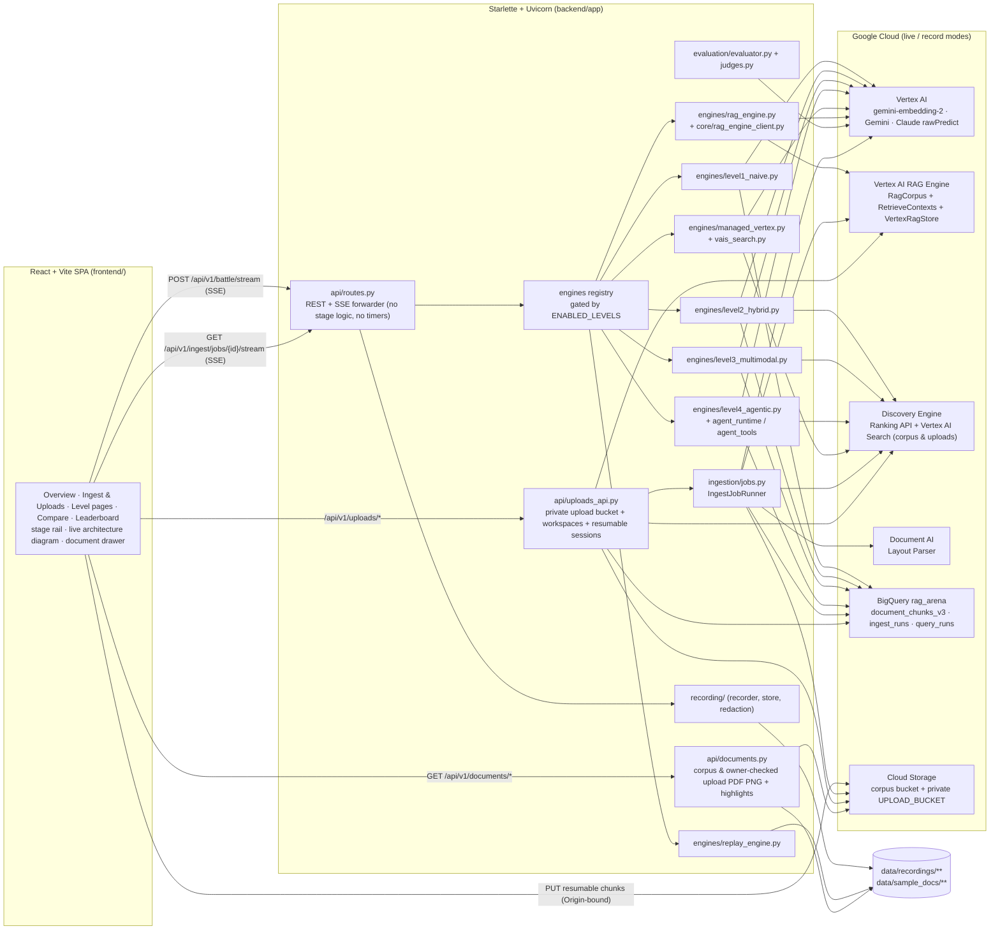

# The RAG Arena — System Architecture

This document describes the architecture **as implemented** in `v1.2.0` with Levels 1–6 and private user PDF uploads
live. The product rule behind every decision: **nothing is shown that was not measured** (principles P1–P6 in
[§0](#0-design-principles-v3)).

---

## 0. Design principles (v3)

v2 shipped seven engines, but an audit ([`audits/2026-10-20-v2-authenticity-audit.md`](audits/2026-10-20-v2-authenticity-audit.md))
found timer-driven stage events, silent fallbacks to local files, a Python-scripted "agent" trace and hardcoded
evaluation scores. v3 rebuilds the product around six rules:

| # | Principle | How it is enforced in the code |
| :-- | :-- | :-- |
| P1 | **Measured, not simulated** — every stage event is emitted inside the engine when the stage starts/ends, with a backend-measured `duration_ms`. | `core/telemetry.py` (`StageEmitter`); `routes.py` only forwards events — `test_routes_no_timers.py` guards it. |
| P2 | **Fail loud** — no silent fallback or impersonation; a failed stage emits `stage_failed`, then `engine_error`. | `test_no_silent_fallbacks.py` (AST scan of `engines/**`). |
| P3 | **No hardcoded scores** — live metrics come only from the LLM judge; replay metrics come from recordings of real live runs. | `EngineResult` has no `eval_metrics`; recordings carry a provenance header. |
| P4 | **One level at a time** — `ENABLED_LEVELS` gates the registry, navigation and Compare. | `core/config.py`; locked levels render a "Locked" card. |
| P5 | **Honest labels** — a stage is labelled with the service that actually ran. | `stage_started.service`, `EngineFlags` (`reranker_used`, `adk_runner_used`, `layout_source`). |
| P6 | **Zero-credential replay** — `DEMO_MODE=replay` streams recorded events with their original timing. | `engines/replay_engine.py`; ad-hoc questions in replay return `engine_error`, never an improvised answer. |

---

## 1. System topology



| Mode (`DEMO_MODE`) | Engines | Judge | Uploads | Writes |
| :-- | :-- | :-- | :-- | :-- |
| `replay` (default) | `ReplayRAGEngine` per enabled level, streaming recorded events with original relative timing × `REPLAY_SPEED` | recorded judge outcome of the selected pair | disabled (all `/api/v1/uploads/*` return `404`) | nothing; no credentials needed |
| `live` | real engines (Levels 1–6) | selected judge model, live | enabled (`UPLOAD_BUCKET` verified private) | `query_runs` row per run (`scope='golden'\|'uploads'`); `ingest_runs` row per ingestion job |
| `record` | `live` + recorder | live | enabled (`upl_*` runs emit `stream_warning` instead of overwriting golden recordings) | `live` writes + `data/recordings/<engine>/<synthesis>__<judge>/<question_id>.json` (golden runs only) |

Settings are validated once at startup (`core/config.py`); invalid configuration fails the process, and
`live`/`record` refuse to start without `GCP_PROJECT_ID`. All lazy Google Cloud SDK client factories share
`core/gcp_clients._CLIENT_LOCK` (`RLock`) and execute inside `asyncio.to_thread` / `run_in_threadpool` so `1 vCPU`
Cloud Run cold starts never block the Uvicorn event loop on `/api/v1/health` or `/api/v1/levels`.

---

## 2. Backend contracts

### 2.1 Engine contract (`engines/base.py`)

```python
class BaseRAGEngine(ABC):
    engine_id: str
    engine_label: str
    stages: tuple[str, ...]          # canonical stage ids in execution order

    async def run_query(self, query: str, *, question_id: str | None,
                        solicitation_filter: str | None, emitter: StageEmitter) -> EngineResult: ...
```

`EngineResult` (frozen dataclass) carries `answer`, `citations`, `retrieved_chunks`, `stage_log`, `usage`
(`TokenUsage` from the provider's usage block), `cost_usd` (usage × published prices in `core/pricing.py`) and
`flags` (`EngineFlags`: `reranker_used`, `adk_runner_used`, `layout_source`). There is **no `eval_metrics`
field** — engines cannot set scores.

### 2.2 Stage telemetry (`core/telemetry.py`)

Engines wrap each stage in `async with self.stage(emitter, "<stage>", label=…, service=…, request=…) as ctx:`.
Entering emits `stage_started` with the exact request; leaving emits `stage_completed` with the
`perf_counter`-measured `duration_ms` and `ctx.payload`; an exception emits `stage_failed` (exception class +
message) and re-raises. Blocking SDK calls run in `asyncio.to_thread`. Payloads are size-bounded.

`routes.py` only forwards emitter events to the SSE queue and adds `run_started`, `answer_complete`,
`eval_complete`, `engine_error`, `stream_warning`, `battle_complete`. `test_routes_no_timers.py` asserts it
contains no stage pacing.

### 2.3 SSE protocol

`POST /api/v1/battle/stream` → `data: {json}\n\n` frames, bounded by `MAX_SSE_FRAMES` (default 600). Ingestion jobs
stream `job_started`, `stage_*`, `doc_progress`, `embed_progress`, `import_progress`, `job_complete` on
`GET /api/v1/ingest/jobs/{job_id}/stream`.

| Event | Key fields |
| :-- | :-- |
| `run_started` | `run_id`, `engines[]`, `demo_mode`, `question_id` |
| `stage_started` / `stage_completed` | `engine`, `stage`, `label`, `service`, `request` / `duration_ms`, `payload` |
| `agent_turn` | `turn_index`, `kind` (`model_turn`\|`tool_call`\|`tool_result`), `tool_name`, `tool_args`, `duration_ms`, `tokens`, `repair` |
| `stage_failed` / `stage_skipped` | `error_type`, `error` / `reason` |
| `answer_complete` · `eval_complete` | `answer`, `citations[]`, `latency_ms`, `cost_usd`, `flags` · `metrics`, `judge_model`, `reference_answer_used`, `battle_score`, judge tokens & cost |
| `engine_error` · `stream_warning` · `battle_complete` | `error_type`, `failed_stage` · `message` · `engines_completed[]`, `engines_failed[]` |

---

## 3. Level 1 query path (`engines/level1_naive.py`)

| Stage | Service label | What runs | Payload (measured) |
| :-- | :-- | :-- | :-- |
| `query_prep` | Engine (local) | whitespace normalisation | `original_query`, `prepared_query`, `expansions: []` |
| `embed_query` | Vertex AI · gemini-embedding-2 | `models.embed_content`, `task_type=RETRIEVAL_QUERY` | `dimensions` (3072), `token_count` |
| `retrieve` | BigQuery | parameterized `VECTOR_SEARCH` over `tier_profile = 'naive'` rows, COSINE, `top_k => 5` | `sql`, `params` (vector preview), `rows_returned`, `scores[]`, `chunk_ids`, `job_id`, `bytes_processed`, `slot_millis`, `cache_hit` |
| `synthesize` | Vertex AI · *selected model* | `GeminiSynthesizer` (google-genai, `thinking_level` from `GEMINI_THINKING_LEVEL`) or `AnthropicVertexSynthesizer` (`:rawPredict`, `max_tokens = SYNTHESIS_MAX_TOKENS`, no temperature) | `model`, `provider`, `prompt_tokens`, `output_tokens`, `thinking_tokens`, `stop_reason`, `attempts`, `answer` |
| `evaluate` | Vertex AI · *selected judge* | `evaluation/evaluator.py` → `judges.py` | `groundedness`, `qa_relevance`, `context_precision`, `rationale`, `reference_answer_used`, judge tokens and cost |

Retrieval SQL isolation: when `solicitation_filter` is omitted (unscoped benchmark corpus run), the base subquery
enforces `NOT STARTS_WITH(solicitation_id, 'upl_')` so retained private upload workspaces never leak into corpus
results; when `solicitation_filter` is set (`solicitation_01` or an owner-verified `upl_<12hex>` workspace), it binds
`solicitation_id = @solicitation_id`:

```sql
SELECT base.chunk_id, base.solicitation_id, base.doc_name, …, base.content,
       (1.0 - distance) AS similarity_score
FROM VECTOR_SEARCH(
  (SELECT * FROM `<project>.<dataset>.<BQ_TABLE>`
   WHERE tier_profile = 'naive' AND NOT STARTS_WITH(solicitation_id, 'upl_')),
  'embedding',
  (SELECT @query_embedding AS embedding),
  top_k => 5,
  distance_type => 'COSINE'
)
ORDER BY distance ASC
LIMIT 5;
```

---

## 3b. Level 2 query path (`engines/level2_hybrid.py`)

| Stage | Service label | What runs | Payload (measured) |
| :-- | :-- | :-- | :-- |
| `query_prep` | Engine (local) | deterministic 16-entry acronym map (CLIN, SLA, RTO, RPO, QASP, PEP, SOW, RFP, MSA, ZTA, VPC, VPN, BGP, ASN, KMS, GKE), whole-token, case-sensitive; prepared query = original + glossary suffix | `original_query`, `prepared_query`, `expansions[]` |
| `embed_query` | Vertex AI · gemini-embedding-2 | shared `common_stages.embed_query_stage` on the prepared query | `dimensions`, `token_count` |
| `retrieve` | BigQuery | one parameterized statement (`bq_indexer.build_hybrid_rrf_sql`) over `tier_profile = 'hybrid'` (unscoped runs enforce `NOT STARTS_WITH(solicitation_id, 'upl_')`; scoped runs bind `solicitation_id = @solicitation_id`) | `rows_returned`, `candidate_k`, `rrf_k`, `vector_k`, `lexical_k`, `with_both_ranks`, `candidates[]` with per-leg ranks, job stats, `index_usage` |
| `rerank` | Discovery Engine Ranking API | `core/ranking.RankingClient.rank` with all candidates (`topN` = records sent) | `results[]` (RRF rank/score → rerank rank/score), `rank_api_ms`, `attempts`, `records_truncated`, `billed_counts`, `cost_usd` |
| `synthesize` | Vertex AI · *selected model* | shared `common_stages.synthesize_stage` over the top `RERANK_TOP_N` (5) reranked chunks, context labelled `[doc \| Sec: … \| p.N]`, ≤ 6,000 chars each | as Level 1 |
| `evaluate` | Vertex AI · *selected judge* | as Level 1 | as Level 1 |

Hybrid statement shape (user input enters only as `@query_embedding`, `@lexical_query`, `@lexical_terms` and optional
`@solicitation_id`; the tier literal is validated against `('hybrid', 'multimodal')`):

```sql
WITH vector_results AS (      -- VECTOR_SEARCH top_k => 50, COSINE; ROW_NUMBER() by distance = vector_rank
  ...
), lexical_scored AS (        -- SEARCH(content, sanitized @lexical_query) AS all_terms_match,
  ...                         -- SUM(STRPOS hits over @lexical_terms; terms with digits weigh 3) AS lexical_score
), lexical_results AS (       -- rank by all_terms_match DESC, lexical_score DESC; keep top 50
  ...
), fused AS (                 -- FULL OUTER JOIN; rrf_score = 1/(60 + vector_rank) + 1/(60 + lexical_rank)
  ...
)
SELECT ... FROM fused f JOIN <chunks table> c ON c.chunk_id = f.chunk_id
WHERE c.tier_profile = 'hybrid' AND NOT STARTS_WITH(c.solicitation_id, 'upl_')
ORDER BY f.rrf_score DESC, f.chunk_id LIMIT 50;
```

`build_lexical_terms` lower-cases the original query, keeps hyphen/dot-joined identifiers (`CLIN-0004-AB`,
`SEC-4.2.1`) whole, and drops stopwords (`LEXICAL_STOPWORDS`). BigQuery's `searchStatistics` /
`vectorSearchStatistics` are kept verbatim (`indexUsageMode`, reason code/message/index name) with `baseTable` dropped
because it echoes the project id.

---

## 3c. Level 3 query path (`engines/level3_multimodal.py`)

Level 3 reuses the Level 2 stage shapes (hybrid RRF + Ranking API) over the `multimodal` tier and changes what the
stages carry:

| Stage | Level 3 behaviour (measured payload) |
| :-- | :-- |
| `query_prep` | Level 2 acronym expansion + `element_intent` from a deterministic keyword map (table / diagram / amendment), with `intent_matches` |
| `embed_query` | `MULTIMODAL_EMBEDDING_MODEL` (`gemini-embedding-2`), `RETRIEVAL_QUERY`, same space as the ingested `embedding_multimodal` vectors |
| `retrieve` | `build_hybrid_rrf_sql(..., embedding_column='embedding_multimodal', tier_profile='multimodal')`; candidates carry `element_type`, `layout_source`, `bbox_source`, amendment fields; payload adds `element_types`, `layout_sources`, `amendment_candidates` |
| `rerank` | Ranking API, Level 2 contract (no fallback ranker) |
| `synthesize` | top-5 ordered by authority — latest amendment first (`amendment_number`, then `effective_date`), then rerank order — each with `[AMENDMENT …]` or `[BASE …]` headers plus `[TABLE]` / `[DIAGRAM transcription]` / `[TEXT]` tags; payload `authority_headers`, `element_mix`, `context_order` |

Known limitation: BigQuery allows one vector index per table, so `embedding_multimodal` has no second IVF index and
`VECTOR_SEARCH` on that column runs exact brute-force (reported verbatim as `UNINDEXED_SEARCH_FIELDS`).

---

## 3d. Level 4 query path (`engines/level4_agentic.py`, `agent_runtime.py`, `agent_tools.py`)

Level 4 reuses the Level 3 `multimodal` tier in BigQuery (`document_chunks_v3`, no separate ingestion job) and runs a
real Google ADK `LlmAgent` inside `InMemoryRunner` with a created session (`session_service.create_session`):

| Stage | Service label | What runs | Payload (measured) |
| :-- | :-- | :-- | :-- |
| `query_prep` | Engine (local) | Level 3 acronym expansion + `element_intent` | `original_query`, `prepared_query`, `expansions[]`, `element_intent`, `intent_matches` |
| `agent_turn` | Google ADK · Vertex AI · *selected Gemini model* | `InMemoryRunner.run_async` over `LlmAgent(model=Gemini(...), tools=[...])`, bounded by `AGENT_MAX_TURNS` (8), `AGENT_MAX_TOOL_CALLS_PER_TURN` (8), `AGENT_TURN_TIMEOUT_SECONDS` (90); emits live `agent_turn` SSE events (`model_turn`, `tool_call`, `tool_result`) | `runner`, `agent_name`, `session_id`, `model`, `turn_count`, `tool_call_count`, `tools_used[]`, `repair_turns_used`, `verify_citations_called`, `unsupported_claims_before`, `unsupported_claims_after`, `final_answer_check`, token & rerank ledger |
| `synthesize` | Google ADK · Vertex AI · *selected Gemini model* | Final ADK model response assembled with the tool ledger's retrieved chunks ordered by authority (latest amendment first) | `source` (`"adk_final_response"`), `model`, `provider`, token counts, `citations_count`, `authority_headers[]`, `element_mix`, `context_order[]`, `answer` |
| `evaluate` | Vertex AI · *selected judge* | `evaluation/evaluator.py` over the union of chunks returned by `search_procurement_corpus` and `check_amendments` (`result.retrieved_chunks`) | as Levels 1–3 |

Tools registered on the `LlmAgent`:
- `search_procurement_corpus(query, solicitation_filter?, top_k=5)`: embeds with `gemini-embedding-2`, runs
  `build_hybrid_rrf_sql(..., embedding_column='embedding_multimodal', tier_profile='multimodal')`, and reranks via
  `RankingClient.rank`.
- `check_amendments(section_id, solicitation_id?)`: runs parameterized `build_amendment_lookup_sql` against
  `document_chunks_v3` (`tier_profile = 'multimodal'`, matching `amends_section` or `section_id` prefix; unscoped runs
  exclude `upl_*`).
- `calculate_contract_pricing(expression, variables?)`: AST-validated arithmetic (`engines/agent_calculator.py`; max
  400 chars, max 64 AST nodes, max exponent 12; rejects calls/attributes/subscripts).
- `verify_citations(draft_answer, cited_chunk_ids?)`: deterministic numeric/currency/percentage, `CLIN-*`, `SEC-*`, and
  `AMENDMENT NNNN` claim extractor (`engines/agent_verify.py`) checked against the ledger's retrieved chunks; triggers
  at most one bounded repair turn (`repair=true`) if omitted or if `unsupported_claims` remain.

Upload scope pinning (`ToolDeps.upload_scope`): when a run targets a private upload workspace (`solicitation_filter = upl_<12hex>`),
`upload_scope` is closure-pinned inside `search_procurement_corpus` and `check_amendments`. Omitted filter arguments
are forced to `upload_scope`, and any conflicting `solicitation_filter` / `solicitation_id` (e.g. a prompt-injected PDF
instructing the model to read `solicitation_01` or another user's `upl_*`) raises `ToolArgumentError` immediately.
Level 4 requires a `vertex_gemini` synthesis model (`gemini-4-argon`, `gemini-4-carbon`, or `gemini-3.8-flash`); Claude
models remain selectable as the LLM judge.

---

## 3e. Level 5 query path (`engines/managed_vertex.py`, `engines/vais_search.py`, `core/vertex_search.py`)

Managed baseline over two strictly isolated Vertex AI Search stacks in `global` / `default_collection`
(`scripts/provision_vertex_search.py`, `infra/main.tf`):
1. **Benchmark corpus**: data store `VAIS_DATA_STORE_ID` (`rag-arena-procurement`) + Enterprise/LLM-add-on search app
   `VAIS_ENGINE_ID` (`rag-arena-procurement-search`).
2. **Private user uploads (`v1.1`)**: data store `VAIS_UPLOADS_DATA_STORE_ID` (`rag-arena-uploads`, forbidden from
   reusing the corpus id, configured with filterable `default_schema` indexing `workspace_id` and `doc_name`) + search
   app `VAIS_UPLOADS_ENGINE_ID` (`rag-arena-uploads-search`).

| Stage | What runs | Payload (measured) |
| :-- | :-- | :-- |
| `query_prep` | Level 2 acronym expansion | `original_query`, `prepared_query`, `expansions[]` |
| `retrieve` | REST `engines/<id>/servingConfigs/default_search:search` with `extractiveContentSpec` (+ `summarySpec` in summary mode); `solicitation_filter=upl_<12hex>` targets `VAIS_UPLOADS_ENGINE_ID` with `filter: workspace_id: ANY("upl_<12hex>")` | `api_request`, `total_size`, `results[]` (`rank`, `doc_name`, `extractive_segments[]` with `page_number`, `relevance_score`), `attribution_token`, `api_ms`, `summary_requested`, `solicitation_filter` |
| `synthesize` (a) | synthesis model `vertex-ai-search-summary` (provider `vertex_ai_search`, Level 5 only, else HTTP 400): summary generated inside the same search call | `answer`, `generated_in_stage: "retrieve"`, `summary_skipped_reasons[]`, `references[{title, document_id, uri}]`, `model_version_used` |
| `synthesize` (b) | any catalog model over the extractive segments ("buy retrieval, build generation") | standard synthesize payload + `context_source`, `context_segments` |
| `evaluate` | judge (≠ synthesis) over the extractive segments | as Levels 1–4 |

On upload queries, `vais_search.py` reads `structData.{doc_name, workspace_id}`, stamps `doc_type = UPLOADED_DOCUMENT`,
redacts `${UPLOAD_BUCKET}`, and fails loud if any returned hit falls outside the requested `upl_<12hex>` workspace.

---

## 3f. Level 6 query path (`engines/rag_engine.py`, `core/rag_engine_client.py`)

Managed Vertex AI RAG Engine (`aiplatform` REST v1 in a regional location such as `us-central1`, never `global`).
`scripts/provision_rag_engine.py` inspects the regional `ragEngineConfig` first: if the project already runs an active
`RagManagedDb` mode (e.g. `spanner.basic`), it reuses it untouched at \$0 incremental Spanner compute and never mutates
or unprovisions regional config; on an uninitialized project, it patches `RagManagedDbConfig(serverless=Serverless())`
via `v1beta1`.

1. **Benchmark corpus**: `RAG_ENGINE_CORPUS_ID` (`rag-arena-procurement`, `text-embedding-005`, `chunk_size=512`,
   `chunk_overlap=100`). Solicitation filters (`solicitation_01`..`03`) resolve matching `ragFileIds` inside that corpus.
2. **Private user uploads (`v1.2`)**: each `upl_<12hex>` workspace creates an isolated `RagCorpus` named
   `rag-arena-upl_<12hex>` (`ingestion/rag_engine_job.py`), queried directly during upload runs and deleted synchronously
   on `DELETE /api/v1/uploads/{id}` without touching neighbor corpora.

| Stage | What runs | Payload (measured) |
| :-- | :-- | :-- |
| `query_prep` | Level 2 acronym expansion | `original_query`, `prepared_query`, `expansions[]` |
| `retrieve` | REST `POST locations/<loc>:retrieveContexts` (`topK = RAG_ENGINE_TOP_K`, \$0/query API fee) | `api_request`, `corpus`, `location`, `embedding_model`, `rows_returned`, `api_ms`, `attempts`, `retrieval_api_fee_usd` (`0.0`), `contexts[]` (`rank`, `chunk_id`, `doc_name`, `page_number`, `last_page`, `page_source`, cosine distance `score`, `text`) |
| `synthesize` (a) | any catalog LLM (Gemini or Claude) over the retrieved `RagChunk` context | standard synthesize payload + `context_source`, `context_chunks`, `corpus` |
| `synthesize` (b) | pseudo-model `vertex-rag-engine-grounded` (provider `vertex_rag_engine`, Level 6 only, else HTTP 400): `models.generate_content` (`GEMINI_FAST_MODEL`) grounded natively via `Tool(retrieval=Retrieval(vertex_rag_store=...))` | `model`, `underlying_gemini_model`, `corpus`, `prompt_tokens`, `output_tokens`, `thinking_tokens`, `grounding_chunks_count`, `answer` |
| `evaluate` | judge (≠ synthesis) over the retrieved `RagChunk` contexts | as Levels 1–5 |

---

## 3g. What each stage shows (UI)

Every value is read from the stage event payloads the engine emits (recordings store them verbatim).

| Stage | Level 1 | Level 2 adds | Level 3 adds | Level 4 |
| :-- | :-- | :-- | :-- | :-- |
| `query_prep` | original & prepared query | 16-acronym expansion + diff | `element_intent` + matched keywords | same as Level 3 |
| `embed_query` | `gemini-embedding-2` 3072-d, tokens | — | multimodal space | inside `search_procurement_corpus` |
| `retrieve` | parameterized `VECTOR_SEARCH` SQL, scores, `job_id`, bytes, cache hit | hybrid RRF top-50 (`vector_rank`, `lexical_rank`, index usage) | element / layout / bbox badges | inside the search + amendment tools |
| `rerank` | — | ranking API before/after ranks & cost | element badges per row | inside `search_procurement_corpus` |
| `agent_turn` | — | — | — | live ADK model turns, tool calls/results, calculator, `verify_citations` counts |
| `synthesize` | prompt + top-5 chunks, model, tokens | `[doc · section · page]` labels | authority headers, `element_mix` | final ADK response, agent + tool tokens & cost |
| `evaluate` | judge (≠ synthesis), G / QA / CP, `reference_answer_used`, rationale, tokens & cost | — | — | — |

Citations open a drawer with the real corpus or owner-checked uploaded PDF page rendered to PNG (PyMuPDF) and the
excerpt highlighted on it — raw uploaded PDF bytes are never served back to the browser.

---

## 4. Model selection and evaluation

- **Catalog** (`core/models_catalog.py`): `gemini-4-argon`, `gemini-4-carbon`, `gemini-3.8-flash` (provider
  `vertex_gemini`), `claude-opus-5-5`, `claude-fable-5-1` (provider `anthropic_vertex`), Level-5-only
  `vertex-ai-search-summary` (provider `vertex_ai_search`), and Level-6-only `vertex-rag-engine-grounded` (provider
  `vertex_rag_engine`). Location defaults to `global` (`MODEL_LOCATION_<ID>` overrides). An LLM model is `available`
  only if it has a published price in `pricing.PRICE_TABLE` **and** an `ok` entry in `data/model_verification.json`
  (`scripts/verify_models.py`); otherwise the recorded error is surfaced in the picker's `"Pricing & availability"`
  disclosure (`unavailable_reason`).
- **Request gate**: `ModelCatalog.select(synthesis_model, judge_model)` rejects unknown, unavailable, role-disallowed
  and identical models → HTTP 400 before streaming. No fallback model.
- **Claude transport** (`core/anthropic_vertex.py`): Anthropic Messages body to
  `https://aiplatform.googleapis.com/v1/projects/<project>/locations/global/publishers/anthropic/models/<model>:rawPredict`
  with `anthropic_version: vertex-2023-10-16` and an ADC bearer token; ≤ 3 attempts on 429 / 500 / 503 / timeouts;
  project numbers are redacted from surfaced errors.
- **Ranking API** (`core/ranking.py`, Levels 2–4): REST `rankingConfigs/default_ranking_config:rank` (`RERANKER_MODEL`,
  default `semantic-ranker-default@latest`, `RANKING_TIMEOUT_SECONDS` 30, ≤ 3 attempts, no fallback ranker).
- **Billable services & prices** (`pricing.py`):
  - `gemini-4-argon` ($2.00 / $10.00 per 1M tokens, 2026-10-20), `gemini-4-carbon` ($2.00 / $10.00 intro, 2026-10-28),
    `gemini-3.8-flash` ($0.75 / $3.75 intro through 2026-12-31, 2026-10-21; output includes thinking tokens),
    `claude-opus-5-5` ($4.00 / $20.00, 2026-10-21), `claude-fable-5-1` ($10.00 / $50.00, 2026-10-21).
  - `gemini-embedding-2`: $0.20 / 1M input tokens (2026-10-20).
  - Vertex AI ranking API: $1.00 / 1,000 counts, 1 count = 1 query of ≤ 100 docs (2026-10-21).
  - Vertex AI Search (Enterprise + LLM add-on): $4 / 1,000 queries + $4 / 1,000 generative answers (2026-10-23).
  - Vertex AI RAG Engine (`RagCorpus` + `:retrieveContexts`): \$0 / 1,000 retrieval queries (`text-embedding-005`
    \$0.000025 / 1k chars at import; `RagManagedDb` Serverless \$0/mo idle or reused active regional Spanner at \$0
    incremental compute; synthesis billed at the selected LLM's token rates).
  - Document AI Layout Parser (Level 3 ingestion): $10 / 1,000 pages (`multimodal_job.py`, 2026-10-22).
- **Judge** (`evaluation/judges.py`, `evaluation/evaluator.py`): strict parse of one JSON object
  `{groundedness, qa_relevance, context_precision, rationale}` with values in `[0, 1]`. Golden benchmark runs grade QA
  relevance against `ground_truth_answer` (`reference_answer_used: true`); upload runs (`solicitation_filter = upl_*`)
  and custom ad-hoc questions grade QA relevance directly against the user's question and retrieved context using the
  reference-free rubric (`reference_answer_used: false`).
- **Battle Score & winner highlighting** (`evaluation/scoring.py`, `frontend/src/lib/winnerHighlight.ts`):
  40% QA relevance + 35% groundedness + 15% context precision + 10% efficiency (latency vs. 60 s, run cost vs. $0.20),
  scaled to 0–100. `GET /api/v1/leaderboard?scope=golden|uploads` keeps benchmark and upload runs strictly separated;
  `bestRows(rows, metric)` highlights winning (and tied) non-failed rows per table by `battle_score`, `qa_relevance`,
  `groundedness`, `context_precision` (max-wins), `latency_ms`, or `cost_usd` (min-wins).

---

## 5. Ingestion (`ingestion/jobs.py`, `ingestion/live_backends.py`)

`POST /api/v1/ingest/jobs {"level": "level1_naive" | "level2_hybrid" | "level3_multimodal" | "managed_vertex" | "rag_engine"}`
starts a benchmark corpus `IngestJobRunner` job (≤ 20 jobs held, bounded by `INGEST_JOB_TIMEOUT_SECONDS`). Stages:

| Stage | Implementation |
| :-- | :-- |
| `discover_docs` | Corpus PDFs under `data/sample_docs/procurement_corpus/` (45 PDFs) or ready files from a private `UploadSource` (`upl_<12hex>`) |
| `parse` | Levels 1–2: PyMuPDF text + bounding boxes per page. Level 3: Document AI Layout Parser online `:process` (≤ 15-page splits, concurrency 4; headings, paragraphs, tables → Markdown, `imageBlock` → figure) + Gemini vision (`VISION_MODEL`) on diagram pages (`vision_failed_pages` recorded, no PyMuPDF fallback). Uploaded PDFs carry honest `doc_type = UPLOADED_DOCUMENT`, `amendment_number = 0`, `effective_date = NULL` unless printed on the page banner |
| `chunk` | `naive` (360-char windows, 60 overlap), `hybrid` (one page chunk prefixed with Contextual Lineage header), `multimodal` (atomic Markdown tables, 1 diagram chunk per vision page, heading-grouped text ≤ 1,800 chars, PDF text-layer `bbox_source`) |
| `embed` | `VertexEmbedder`: `RETRIEVAL_DOCUMENT`, ≤ 32 texts/batch, ≤ 8 worker threads, ≤ 3 attempts on 429/5xx; Level 3 embeds diagram chunks as text + rendered page image into `embedding_multimodal` |
| `load_bigquery` | Load jobs into a 2 h TTL staging table, then one transaction: benchmark corpus replaces `tier_profile = @tier AND NOT STARTS_WITH(solicitation_id, 'upl_')` (never touching user uploads); upload jobs replace `tier_profile = @tier AND solicitation_id = @scope` |
| `build_indexes` | Corpus jobs (`scope=None`): `CREATE VECTOR INDEX IF NOT EXISTS` (IVF, COSINE) and `CREATE SEARCH INDEX IF NOT EXISTS`, polling `INFORMATION_SCHEMA` for ≤ 60 s. Upload jobs (`scope=upl_*`, `v1.1.1`): `snapshot_upload_indexes` inspects existing table indexes once (`poll_skipped_reason: "upload_scope_uses_table_indexes"`, `<3 s`) instead of re-polling |
| `verify_counts` | Scoped or corpus (`NOT STARTS_WITH(solicitation_id, 'upl_')`) `COUNT(*)` read back from BigQuery (or `ragFiles.list` / `documents.list` for managed levels); `ingest_runs` row written with `git_sha` and stage log |

### 5b. Private user PDF uploads (`v1.1`–`v1.2` — `api/uploads_api.py`, `ingestion/{upload_bucket,uploads,managed_upload_job,rag_engine_job}.py`)

- **Private upload bucket (`upload_bucket.py`)**: `UPLOAD_BUCKET_MODE=auto` (default) checks or creates `UPLOAD_BUCKET`
  (`<project>-rag-arena-uploads`, forbidden from equalling `GCS_CORPUS_BUCKET`) with enforced public access prevention,
  uniform bucket-level access, optional CMEK (`UPLOAD_BUCKET_KMS_KEY`), and no lifecycle auto-deletion. Startup and
  `/api/v1/uploads/bucket` verify PAP, UBLA, and the absence of `allUsers` / `allAuthenticatedUsers` IAM or ACL
  grants, returning typed outcomes (`ok`, `created`, `permission_denied`, `org_policy`, `name_conflict`, `not_found`,
  `unsafe_bucket`, `unreachable`, `error`) with copy-paste remedies.
- **Owner-isolated workspaces & direct-to-GCS resumable uploads (`uploads.py`, `uploads_api.py`)**:
  - Workspace metadata lives in `gs://$UPLOAD_BUCKET/uploads/upl_<12hex>/workspace.json` guarded by GCS generation
    preconditions (`ifGenerationMatch`), with `owner` set to SHA-256 of `X-Goog-Authenticated-User-Email` (`404` for
    any non-owner; `DEMO_MODE=replay` registers zero upload routes → `404`).
  - `POST /api/v1/uploads/{id}/files` validates `Origin` (blocking cross-origin callers and `localhost` origins when
    `K_SERVICE` is set on Cloud Run), sanitizes filenames (collapsing `..`), and creates a server-initiated GCS
    resumable upload session URI (`ifGenerationMatch=0`, `Origin`-bound so the browser `PUT`s chunks straight to GCS
    with `308` resume and no Cloud Run 32 MiB body cap).
  - `POST .../files/{fid}/finalize` streams the uploaded object in `8 MiB` ranges through a single `httpx.Client.stream`
    (`O(1)` `RssAnon` heap even on multi-hundred-MB PDFs), checks PDF structure/encryption and rejects `/JS`,
    `/JavaScript`, `/Launch`, and `/EmbeddedFiles` (deleting rejected blobs immediately).
- **Level 3 cost confirmation & Level 5 zero-download import**:
  - `GET /api/v1/uploads/{id}/estimate?level=level3_multimodal` computes exact Document AI page cost plus worst-case
    `VISION_MODEL` diagram cost; `POST .../ingest` refuses Level 3 (`409 needs_confirmation`) unless
    `confirm_cost_usd >= max_usd`.
  - `managed_upload_job.py` writes `uploads/<ws>/_vais_import.jsonl` (`dataSchema="document"`, deterministic id
    `upl_<12hex>_f_<12hex>`, `structData.{workspace_id, doc_name}`) directly into GCS without downloading PDFs locally,
    runs an `INCREMENTAL` import into `VAIS_UPLOADS_DATA_STORE_ID`, and verifies each doc via point `documents.get`
    (never enumerating other workspaces).
  - `rag_engine_job.py` provisions an isolated per-workspace `RagCorpus` (`rag-arena-upl_<12hex>`, stripping the numeric
    `rag_corpus_id` from `_public_manifest`), imports GCS URIs in batches of `<=25` with zero local PDF downloads, and
    verifies every expected URI is `ACTIVE`.
- **Synchronous retry-safe deletion (`DELETE /api/v1/uploads/{id}`)**: deletes BigQuery rows (`delete_scope`) first,
  then Vertex AI Search upload documents (`delete_if_exists`), then the workspace's isolated Vertex AI RAG Engine
  `RagCorpus` (`delete_rag_corpus`), and finally GCS objects (`uploads/<ws>/*`), preserving the manifest if an earlier
  backend fails so the owner can retry cleanly.

---

## 6. Storage schema (BigQuery dataset `rag_arena`)

Created and migrated idempotently by `ingestion/bq_indexer.py:build_tables_ddl` (`CREATE TABLE IF NOT EXISTS` +
`ALTER TABLE ... ADD COLUMN IF NOT EXISTS`, never drops):

```sql
CREATE TABLE IF NOT EXISTS `<project>.rag_arena.<BQ_TABLE>` (
  chunk_id STRING NOT NULL, tier_profile STRING NOT NULL, ingest_run_id STRING NOT NULL,
  solicitation_id STRING NOT NULL, doc_name STRING NOT NULL, doc_type STRING NOT NULL,
  element_type STRING NOT NULL, section_id STRING, amendment_number INT64 DEFAULT 0,
  effective_date DATE, amends_section STRING, page_number INT64 NOT NULL,
  bbox STRUCT<page INT64, x0 FLOAT64, y0 FLOAT64, x1 FLOAT64, y1 FLOAT64>,
  content STRING NOT NULL, layout_source STRING,
  embedding ARRAY<FLOAT64>, embedding_multimodal ARRAY<FLOAT64>
) CLUSTER BY tier_profile, solicitation_id;

-- ingest_runs: run_id, level, tier_profile, started_at, finished_at, status, docs, pages, chunks,
--              embedded, loaded, embedding_model, layout_source, git_sha, stage_log JSON
-- query_runs:  run_id, engine, question_id, query, started_at, latency_ms, cost_usd, groundedness,
--              qa_relevance, context_precision, stage_log JSON, answer, citations JSON, demo_mode,
--              git_sha, synthesis_model, judge_model, solicitation_id, scope ('golden' | 'uploads')
```

---

## 7. Recording and replay (`recording/`)

- `DEMO_MODE=record` writes one JSON per golden (engine, model pair, question): `header` (`format_version`,
  `recorded_at`, `demo_mode`, `model_ids`, `git_sha`, `app_version`, `engine`, `question_id`, `query`,
  `run_id`, `project_id` placeholder), `events` (each with `t_rel_ms`), `result` and `evaluation`. Runs scoped to
  `upl_*` emit a `stream_warning` and never write to `data/recordings/`.
- **Redaction** (`recording/redaction.py`): `GCP_PROJECT_ID`, `GCS_CORPUS_BUCKET`, `UPLOAD_BUCKET` (configured or
  default `<project>-rag-arena-uploads`), `RAG_ENGINE_CORPUS_ID`, `CLOUDSDK_CONFIG`, `GOOGLE_APPLICATION_CREDENTIALS`,
  and the home directory become `${…}` placeholders; `projects/<digits>` becomes `projects/${GCP_PROJECT_NUMBER}`;
  `assert_redacted` refuses to write if any raw token survives.
- **Replay** streams recorded events with their original relative timing; unrecorded pairs/questions return
  `engine_error`, and synthetic fixtures under `data/recordings/_dev/` require `ALLOW_DEV_FIXTURES=1`.

---

## 8. Live architecture diagram (`core/architectures.py` → `GET /api/v1/levels`)

Each level has an `ArchitectureDescriptor`: nodes (`label`, `service`, `kind`, grid `col/row`, `stage_ids`,
optional `region` and `code_ref`), edges, and `ingest_nodes`/`ingest_edges`. Descriptors are design metadata —
regions are `{GCP_LOCATION}` / `{VERTEX_GENAI_LOCATION}` placeholders resolved from settings — and never carry
timings or scores. The frontend (`features/levels/ArchitectureDiagram.tsx`) derives node state
(`idle | active | done | failed | skipped`) from the same SSE event log as the stage rail; the details pane
follows the active node unless pinned.

---

## 9. Frontend (`frontend/src/`)

- `app/` — router (`/`, `/ingest`, `/levels/:levelId`, `/compare`, `/leaderboard`), `AppDataProvider` (bounded 30 s
  bootstrap retry + single-flight `/ingest/status` via `lib/bootstrap.ts`), `IngestSessionProvider` (app-wide live
  ingestion SSE streams surviving navigation and reloads via owner-scoped `active_jobs`), per-page run `sessions`, and
  safe-mode provider.
- `features/levels/` — `useBattleStream`, `StageRail`, `StageDetail`, `ArchitectureDiagram`, `LevelIngestBanner`,
  `ModelPicker` + `modelSelection` (`buildPickerDetails` deduplicated `"Pricing & availability"` disclosure; judge ≠
  synthesis; replay limited to recorded pairs), `AnswerPanels` (answer, citations, `no reference answer` badge, judge
  metrics, tokens, run cost).
- `features/uploads/` & `features/ingest/` — private upload bucket status/create, workspace lifecycle, direct-to-GCS
  `256 KiB` resumable upload with `308` resume, Level 3 inline cost confirmation, `ScopeSelector`, and separated
  benchmark corpus vs upload workspace panels.
- `features/compare/` & `pages/LeaderboardPage.tsx` — concurrent multi-level runs (corpus or upload scope),
  `Scope: Golden set | Uploads` toggle, and persisted `bestRows` winner highlighting (`lib/winnerHighlight.ts`).
- `components/` — UI primitives, `DocumentDrawer` / `PageCanvas` / `DocumentViewer` for corpus and uploaded citations.
- `lib/sse.ts` — bounded SSE reader; `lib/safeMode.ts` — masking of `${UPLOAD_BUCKET}`, `${GCS_CORPUS_BUCKET}`,
  `${GCP_PROJECT_ID}`, and `projects/${GCP_PROJECT_NUMBER}`.

---

## 10. Status

Levels 1–6 (including Managed Vertex AI RAG Engine), private user PDF uploads (`v1.1`–`v1.2`), Compare, Leaderboard
(`query_runs` Golden set + Uploads scopes with winner highlighting), `docker-compose.yml`, and the configurable Cloud
Run deployment (single multi-stage container, least-privilege service account, IAP-protected live service, optional
public replay service) are live (`v1.2.0`). Vector Search 2.0 / AlloyDB ScaNN engines stay parked (`engines/parked/`,
zero GCP resources).
