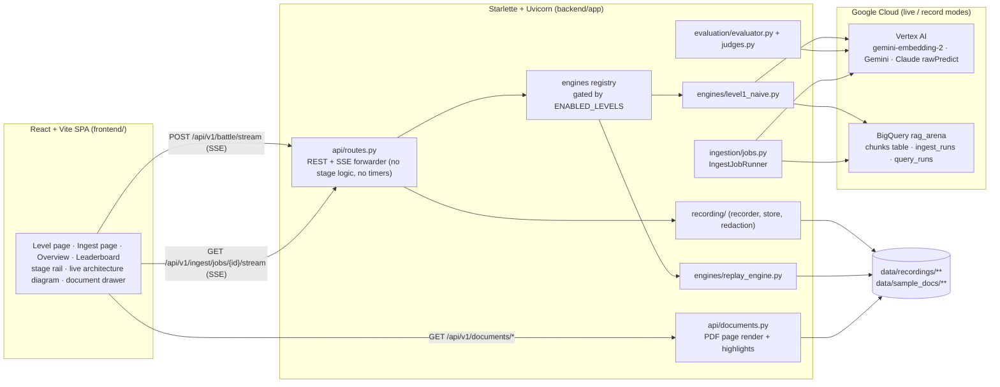

# The RAG Arena v3 — System Architecture

This document describes the architecture **as implemented** on the Level 1 branch. Anything not yet built is
marked 🔒 *planned*. The product rule behind every decision: **nothing is shown that was not measured**
(principles P1–P6 in the [README](../README.md#why-v3-measured-not-simulated)).

---

## 1. System topology



| Mode (`DEMO_MODE`) | Engines | Judge | Writes |
| :-- | :-- | :-- | :-- |
| `replay` (default) | `ReplayRAGEngine` per enabled level, streaming recorded events with original relative timing × `REPLAY_SPEED` | recorded judge outcome of the selected pair | nothing; no credentials needed |
| `live` | real engines (Level 1) | selected judge model, live | `query_runs` row per run; `ingest_runs` row per ingestion job |
| `record` | `live` + recorder | live | `live` writes + `data/recordings/<engine>/<synthesis>__<judge>/<question_id>.json` |

Settings are validated once at startup (`core/config.py`); invalid configuration fails the process, and
`live`/`record` refuse to start without `GCP_PROJECT_ID`.

---

## 2. Backend contracts

### 2.1 Engine contract (`engines/base.py`)

```python
class BaseRAGEngine(ABC):
    engine_id: str
    engine_label: str
    stages: tuple[str, ...]          # canonical stage ids in execution order

    async def run_query(self, query: str, *, question_id: str | None,
                        solicitation_filter: str | None, emitter: StageEmitter) -> EngineResult: ...
```

`EngineResult` (frozen dataclass) carries `answer`, `citations`, `retrieved_chunks`, `stage_log`, `usage`
(`TokenUsage` from the provider's usage block), `cost_usd` (usage × published prices in `core/pricing.py`) and
`flags` (`EngineFlags`: `reranker_used`, `adk_runner_used`, `layout_source`). There is **no `eval_metrics`
field** — engines cannot set scores.

### 2.2 Stage telemetry (`core/telemetry.py`)

Engines wrap each stage in `async with self.stage(emitter, "<stage>", label=…, service=…, request=…) as ctx:`.
Entering emits `stage_started` with the exact request; leaving emits `stage_completed` with the
`perf_counter`-measured `duration_ms` and `ctx.payload`; an exception emits `stage_failed` (exception class +
message) and re-raises. Blocking SDK calls run in `asyncio.to_thread`. Payloads are size-bounded.

`routes.py` only forwards emitter events to the SSE queue and adds `run_started`, `answer_complete`,
`eval_complete`, `engine_error`, `stream_warning`, `battle_complete`. `test_routes_no_timers.py` asserts it
contains no stage pacing.

### 2.3 SSE protocol

`POST /api/v1/battle/stream` → `data: {json}\n\n` frames, bounded by `MAX_SSE_FRAMES` (default 600). Events
and fields are listed in the [README](../README.md#api--sse-protocol). Ingestion jobs stream `job_started`,
`stage_*`, `doc_progress`, `embed_progress`, `job_complete` on `GET /api/v1/ingest/jobs/{job_id}/stream`.

---

## 3. Level 1 query path (`engines/level1_naive.py`)

| Stage | Service label | What runs | Payload (measured) |
| :-- | :-- | :-- | :-- |
| `query_prep` | Engine (local) | whitespace normalisation | `original_query`, `prepared_query`, `expansions: []` |
| `embed_query` | Vertex AI · gemini-embedding-2 | `models.embed_content`, `task_type=RETRIEVAL_QUERY` | `dimensions` (3072), `token_count` |
| `retrieve` | BigQuery | parameterized `VECTOR_SEARCH` over `tier_profile = 'naive'` rows, COSINE, `top_k => 5` | `sql`, `params` (vector preview), `rows_returned`, `scores[]`, `chunk_ids`, `job_id`, `bytes_processed`, `slot_millis`, `cache_hit` |
| `synthesize` | Vertex AI · *selected model* | `GeminiSynthesizer` (google-genai, `thinking_level` from `GEMINI_THINKING_LEVEL`) or `AnthropicVertexSynthesizer` (`:rawPredict`, `max_tokens = SYNTHESIS_MAX_TOKENS`, no temperature) | `model`, `provider`, `prompt_tokens`, `output_tokens`, `thinking_tokens`, `stop_reason`, `attempts`, `answer` |
| `evaluate` | Vertex AI · *selected judge* | `evaluation/evaluator.py` → `judges.py` | `groundedness`, `qa_relevance`, `context_precision`, `rationale`, `reference_answer_used`, judge tokens and cost |

The retrieval SQL (identifiers validated, the vector and optional `solicitation_id` passed as query
parameters):

```sql
SELECT base.chunk_id, base.solicitation_id, base.doc_name, …, base.content,
       (1.0 - distance) AS similarity_score
FROM VECTOR_SEARCH(
  (SELECT * FROM `<project>.<dataset>.<BQ_TABLE>` WHERE tier_profile = 'naive'),
  'embedding',
  (SELECT @query_embedding AS embedding),
  top_k => 5,
  distance_type => 'COSINE'
)
ORDER BY distance ASC
LIMIT 5;
```

---

## 4. Model selection and evaluation

- **Catalog** (`core/models_catalog.py`): `gemini-4-argon`, `gemini-3.8-flash` (provider `vertex_gemini`),
  `claude-opus-5-5`, `claude-fable-5-1` (provider `anthropic_vertex`). Location defaults to `global`
  (`MODEL_LOCATION_<ID>` overrides). A model is `available` only if it has a published price in
  `pricing.PRICE_TABLE` **and** an `ok` entry in `data/model_verification.json` (written by
  `scripts/verify_models.py`); otherwise the recorded error is surfaced verbatim as `unavailable_reason`.
- **Request gate**: `ModelCatalog.select(synthesis_model, judge_model)` rejects unknown, unavailable,
  role-disallowed and identical models → HTTP 400 before streaming. Engines are built per request with the
  selected `RunModels`; there is no fallback model.
- **Claude transport** (`core/anthropic_vertex.py`): Anthropic Messages body to
  `https://aiplatform.googleapis.com/v1/projects/<project>/locations/global/publishers/anthropic/models/<model>:rawPredict`
  with `anthropic_version: vertex-2023-10-16` and an ADC bearer token; ≤ 3 attempts, retries only on
  429 / 500 / 503 / timeouts; project numbers are redacted from surfaced errors.
- **Judge** (`evaluation/judges.py`): strict parse of one JSON object
  `{groundedness, qa_relevance, context_precision, rationale}` with values in [0, 1]. QA relevance is graded
  against the golden `ground_truth_answer` when the run has a known `question_id`. Claude judges are called
  without `temperature`; a Gemini judge uses `temperature=0`, `thinking_level=LOW`. A judge failure fails the
  `evaluate` stage — there is no heuristic scorer.
- **Cost**: engine cost = synthesis tokens (output rate includes thinking tokens) + query-embedding tokens;
  judge cost from the judge's measured input/output tokens; run cost = engine + judge (`api/query_runs.py`).
- **Battle Score** (`evaluation/scoring.py`, used by the leaderboard): 40% QA relevance + 35% groundedness +
  15% context precision + 10% efficiency (latency vs. 5 s, cost vs. $0.01), scaled to 0–100. Leaderboard rows
  are grouped per (engine, synthesis model, judge model) and never averaged across judges.

---

## 5. Ingestion (`ingestion/jobs.py`, `ingestion/live_backends.py`)

`POST /api/v1/ingest/jobs {"level": "level1_naive"}` starts an `IngestJobRunner` job (≤ 20 jobs held, bounded
by `INGEST_JOB_TIMEOUT_SECONDS`). Stages:

| Stage | Implementation |
| :-- | :-- |
| `discover_docs` | PDFs under `data/sample_docs/procurement_corpus/` (local corpus; 3 solicitations, 45 PDFs) |
| `parse` | PyMuPDF text + bounding boxes per page; genuinely blank PDFs are classified, not silently skipped |
| `chunk` | `naive` profile: 360-character windows with 60-character overlap |
| `embed` | `VertexEmbedder`: one `embed_content` call per text (`RETRIEVAL_DOCUMENT`), ≤ 32 texts per batch, ≤ 8 worker threads, ≤ 3 attempts on 429/5xx; dimension drift fails the job |
| `load_bigquery` | load jobs only (no streaming inserts), 1,000 rows per load into a per-job staging table (2 h TTL), then one transaction: `DELETE` the tier's rows, `INSERT` from staging; staging dropped |
| `build_indexes` | `CREATE VECTOR INDEX IF NOT EXISTS` (IVF, COSINE; BigQuery rejects IVF below 5,000 rows — reported as state) and `CREATE SEARCH INDEX IF NOT EXISTS`, then poll `INFORMATION_SCHEMA.VECTOR_INDEXES` / `SEARCH_INDEXES` for ≤ 60 s |
| `verify_counts` | `COUNT(*)` by `tier_profile` read back from BigQuery; `ingest_runs` row written with `git_sha` and stage log |

Live ingestion refuses `BQ_TABLE=document_chunks` (the frozen v2 table); use a v3 table such as
`document_chunks_v3`, which the job creates with the schema below. Index states are reported verbatim (e.g.
`ACTIVE (coverage 0%)` while `VECTOR_SEARCH` still brute-forces, or `TEMPORARILY DISABLED` for search indexes on
tables below 10 GB) — never faked.

---

## 6. Storage schema (BigQuery dataset `rag_arena`)

Created by `ingestion/bq_indexer.py:build_tables_ddl` (`CREATE TABLE IF NOT EXISTS`, never drops):

```sql
CREATE TABLE IF NOT EXISTS `<project>.rag_arena.<BQ_TABLE>` (
  chunk_id STRING NOT NULL, tier_profile STRING NOT NULL, ingest_run_id STRING NOT NULL,
  solicitation_id STRING NOT NULL, doc_name STRING NOT NULL, doc_type STRING NOT NULL,
  element_type STRING NOT NULL, section_id STRING, amendment_number INT64 DEFAULT 0,
  effective_date DATE, amends_section STRING, page_number INT64 NOT NULL,
  bbox STRUCT<page INT64, x0 FLOAT64, y0 FLOAT64, x1 FLOAT64, y1 FLOAT64>,
  content STRING NOT NULL, layout_source STRING,
  embedding ARRAY<FLOAT64>, embedding_multimodal ARRAY<FLOAT64>
) CLUSTER BY tier_profile, solicitation_id;

-- ingest_runs: run_id, level, tier_profile, started_at, finished_at, status, docs, pages, chunks,
--              embedded, loaded, embedding_model, layout_source, git_sha, stage_log JSON
-- query_runs:  run_id, engine, question_id, query, started_at, latency_ms, cost_usd, groundedness,
--              qa_relevance, context_precision, stage_log JSON, answer, citations JSON, demo_mode,
--              git_sha, synthesis_model, judge_model
```

---

## 7. Recording and replay (`recording/`)

- `DEMO_MODE=record` writes one JSON per (engine, model pair, question): `header` (`format_version`,
  `recorded_at`, `demo_mode`, `model_ids`, `git_sha`, `app_version`, `engine`, `question_id`, `query`,
  `run_id`, `project_id` placeholder), `events` (each with `t_rel_ms`), `result` and `evaluation`.
- **Redaction** (`recording/redaction.py`): project id, bucket, `CLOUDSDK_CONFIG`,
  `GOOGLE_APPLICATION_CREDENTIALS` and the home directory become `${…}` placeholders, `projects/<digits>` becomes
  `projects/${GCP_PROJECT_NUMBER}`, and `assert_redacted` refuses to write if any value survives.
- **Replay** streams the recorded events with their original relative timing; recorded `duration_ms` values
  are forwarded unchanged. Questions without a recording for the selected pair return `engine_error`.
  Synthetic fixtures under `data/recordings/_dev/` are refused unless `ALLOW_DEV_FIXTURES=1`.

---

## 8. Live architecture diagram (`core/architectures.py` → `GET /api/v1/levels`)

Each level has an `ArchitectureDescriptor`: nodes (`label`, `service`, `kind`, grid `col/row`, `stage_ids`,
optional `region` and `code_ref`), edges, and `ingest_nodes`/`ingest_edges`. Descriptors are design metadata —
regions are `{GCP_LOCATION}` / `{VERTEX_GENAI_LOCATION}` placeholders resolved from settings — and never carry
timings or scores. The frontend (`features/levels/ArchitectureDiagram.tsx`) derives node state
(`idle | active | done | failed | skipped`) from the same SSE event log as the stage rail; the details pane
follows the active node unless pinned. A test asserts every canonical stage of every level maps to at least
one node.

---

## 9. Frontend (`frontend/src/`)

- `app/` — router (`/`, `/ingest`, `/levels/:levelId`, `/compare`, `/leaderboard`), full-width shell, safe-mode
  provider and toggle.
- `features/levels/` — `useBattleStream` (append-only event log → per-engine timeline), `StageRail`,
  `StageDetail`, `ArchitectureDiagram`, `ModelPicker` + `modelSelection` (judge ≠ synthesis; replay limited to
  recorded pairs), `AnswerPanels` (answer, citations, judge metrics, tokens, run cost).
- `features/ingest/` — ingestion job stream and status (counts, index states, `ingest_runs` provenance).
- `components/` — UI primitives, `DocumentDrawer` / `PageCanvas` / `DocumentViewer` for citations.
- `theme/`, `styles/tokens.css` — light / dark / system theme with CSS-variable design tokens.
- `lib/sse.ts` — bounded SSE reader; `lib/safeMode.ts` — masking of project id, bucket and project number.
- `/compare` is a placeholder until two levels pass their Definition of Done; `/leaderboard` renders
  `GET /api/v1/leaderboard`.

---

## 10. Planned (not implemented)

| Item | Phase |
| :-- | :-- |
| Level 2: `SEARCH()` + RRF + Discovery Engine Ranking API, rerank before/after scores | 2 🔒 |
| Level 3: Document AI Layout Parser, Gemini vision transcription of diagram pages, multimodal embeddings | 3 🔒 |
| Level 4: real Google ADK runner, tools over real data, `agent_turn` events | 4 🔒 |
| Level 5: Vertex AI Search data store baseline | 5 🔒 |
| Compare page; leaderboard from `query_runs`; updated `docker-compose.yml` | 6 🔒 |
| Cloud Run: single multi-stage container serving API + SPA, least-privilege runtime service account with no key files, env-only config, IAP-protected live service, optional public replay service, Cloud Run Job for long ingestion | 6 🔒 |
